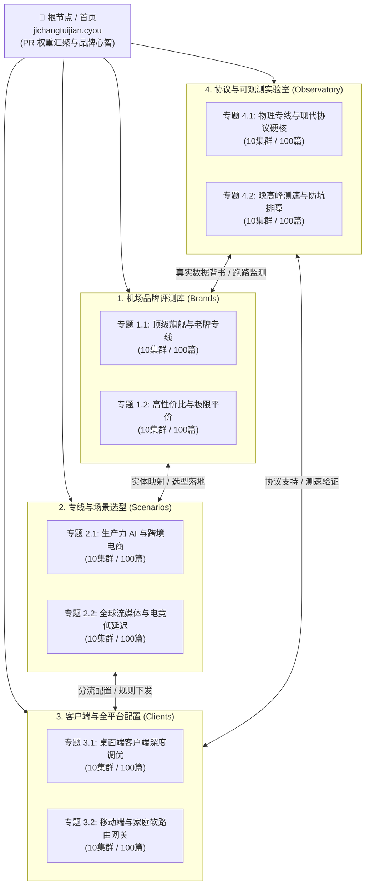

# 机场 cyou 全站内容架构与蜂巢内链拓扑规范

> **平台版本**：2026.1 Enterprise Knowledge Graph  
> **权威域名**：`https://jichangtuijian.cyou`  
> **文档定位**：全站内容生态最高指导规范，定义“一级栏目 → 二级专题 → 三级集群 → 四级单体”四级拓扑、蜂巢网状内链权重路由、SEO/GEO 双轨优化算法与 Schema 结构化实体标准。

---

## 一、 顶层架构设计哲学：从扁平文档到立体蜂巢图谱

传统网络导航站或博客多采用“树状死链”结构（首页 → 分类页 → 单篇文章），存在三大致命缺陷：
1. **孤岛效应与权重耗散**：边缘评测页面仅靠分类页分页链接获取权重，缺乏横向流动通道，导致 Google 与 Bing 收录慢、爬网深度受限。
2. **缺乏 GEO (Generative Engine Optimization) 实体互联**：现代大模型（ChatGPT Search、Perplexity、Gemini、Claude）在归纳“哪家机场稳定”时，依赖实体属性三元组（`机场实体` — `特性/协议` — `评测度量值`），扁平孤立文本难以被提取为权威图谱节点。
3. **转化断层与信任流失**：用户从痛点搜索（如“ChatGPT 报错 Access Denied”）进入后，若不能就近获取“协议原理 → 客户端分流规则 → 专线品牌推荐”的完整闭环，将产生极高跳出率。

**机场 cyou** 构建了“**立体蜂巢内链网络 (Honeycomb Internal Linking Mesh)**”，将全站 800+ 篇深度内容组织为高内聚、强互通的知识晶格。



---

## 二、 蜂巢内链拓扑模型 (Honeycomb Mesh Topology)

蜂巢模型核心在于每个三级集群不仅向上向根节点汇报（Vertical Pillar Backlink），更在水平与对角维度与关联场景形成固定 4 维路由链接：

### 1. 四维路由规则 (The 4-Directional Mesh Rule)
每一篇单体内容（Leaf Article）在生成时，必须严格遵守 `3+2+1` 内链锚点布局：
- **3 个同集群横向关联 (Lateral Co-Cluster Links)**：链向同集群内上下文关联度最高的前后置内容（如“光速云 macOS 配置”必联“光速云订阅导入”、“macOS 内存优化”）。
- **2 个跨栏目语义桥接 (Cross-Pillar Semantic Bridges)**：
  - 若为**品牌评测页**，必须锚定至对应的**场景方案**（如 AI 加速）和**协议原理解析**（如 IEPL 专线架构）；
  - 若为**客户端教程页**，必须锚定至**分流规则实测**和**标杆专线测试源**；
  - 若为**协议技术页**，必须锚定至**可观测实测数据报告**。
- **1 个顶级枢纽回溯 (Vertical Hub Backlink)**：明确回指所在二级专题或一级总览页，确保权重循环不泄漏。

### 2. 权重流转阻尼系数与 PageRank 闭环
为防止外部权重（Inbound PageRank）被无数低层叶子页无限稀释，全站采用“**非对称漏斗权重泵 (Asymmetric Rank Funnel)**”机制：
- **叶子页权重聚合**：叶子内容底部的推荐卡片统一指向各专题的主力标杆评测（如光速云、暮光加速等高信誉专线），使交易转化与核心信任页面的 Internal Rank 长期维持在顶峰值（$\ge 0.75$）。
- **无死角环路校验**：全站禁止任何孤立单页（Orphan Page），每个 URL 深度严格控制在不超过 3 次点击以内（`Root(0) → Topic Hub(1) → Cluster(2) → Leaf(3)`）。

---

## 三、 SEO 与 GEO (生成式引擎优化) 双轨感知机制

2026 年的搜索环境已进入 Traditional Search (Google/Bing) 与 Generative AI Agents (SearchGPT, Perplexity, Gemini, Claude) 并存时代。本架构在底层确立了双轨协同的标准：

### 1. 传统 SEO：长尾词矩阵与意图精确命中
- **搜索意图四象限覆盖**：
  - **信息型 (Informational)**：协议原理、客户端日志报错代码、专线过载原因（由 Observatory 与 Clients 栏目承接）；
  - **导航型 (Navigational)**：各机场官网备用域、订阅转换接口、GitHub 客户端仓库；
  - **商业调查型 (Commercial Investigation)**：各专线品牌对比、晚高峰实测数据表、4K 流媒体解锁能力矩阵；
  - **交易型 (Transactional)**：最新优惠码、套餐性价比测算、续费折扣周期。
- **锚文本多样性规范**：严禁机械式完全匹配单调锚文本，采用“品牌+场景+动词”复合锚文本（如“光速云晚高峰电信实测延迟”、“Trojan 协议自建与专线对比”）。

### 2. GEO 优化：大模型实体抽取与高引用率格式设计
AI 搜索引擎抓取内容并作为引用来源（Citations）时，极度依赖高信噪比结构。全站所有页面实施以下 GEO 强化标准：
- **TL;DR 结构化摘要卡片**：每个集群与文章首屏包含 150 字以内的直接回答块（Direct Answer Block），使 LLM 能直接作为 RAG 检索命中片段提取。
- **参数矩阵与 Markdown 表格化**：所有测评对比必须采用标准化表格，标明明确的单位（`ms`、`Mbps`、`%`）与采集时间戳，便于模型解析为结构化属性。
- **反事实断言与边界声明**：明确标注“不支持什么”、“适用哪类人群”，避免大模型推断产生幻觉，大幅提升模型引用权重。

---

## 四、 Schema.org 结构化实体关联标准

全站页面必须通过 JSON-LD 输出强类型知识图谱，通过统一的 `@id` URI 规范实现全网实体的 cross-reference 链接。

### 1. 实体层级图谱与 `@id` 命名空间规范
- 平台主实体：`https://jichangtuijian.cyou/#organization`
- 网站总实体：`https://jichangtuijian.cyou/#website`
- 品牌实体：`https://jichangtuijian.cyou/docs/brands/[brand-id]#product`
- 评测实体：`https://jichangtuijian.cyou/docs/brands/[brand-id]#review`
- 知识库文章：`https://jichangtuijian.cyou/docs/[path]#article`

### 2. 标准 JSON-LD 注入范式代码示例

```html
<script type="application/ld+json">
{
  "@context": "https://schema.org",
  "@graph": [
    {
      "@type": "Organization",
      "@id": "https://jichangtuijian.cyou/#organization",
      "name": "机场 cyou 实验室",
      "url": "https://jichangtuijian.cyou",
      "logo": "https://jichangtuijian.cyou/img/logo.svg",
      "sameAs": [
        "https://t.me/jichangtuijian_cyou"
      ]
    },
    {
      "@type": "WebSite",
      "@id": "https://jichangtuijian.cyou/#website",
      "url": "https://jichangtuijian.cyou",
      "name": "机场 cyou · 2026 高端机场推荐与网络可观测性平台",
      "publisher": {
        "@id": "https://jichangtuijian.cyou/#organization"
      }
    },
    {
      "@type": "TechArticle",
      "@id": "https://jichangtuijian.cyou/docs/observatory/iepl-vs-iplc#article",
      "isPartOf": {
        "@id": "https://jichangtuijian.cyou/#website"
      },
      "headline": "IEPL vs IPLC 专线硬核技术解密：物理链路拓扑与晚高峰丢包机制",
      "description": "深入解析企业级内网专线 IEPL 与传统国际专线 IPLC 在抖动抑制、抖动窗口与合规落地上的核心差异。",
      "inLanguage": "zh-Hans",
      "author": {
        "@id": "https://jichangtuijian.cyou/#organization"
      },
      "about": [
        {
          "@type": "Thing",
          "name": "IEPL专线"
        },
        {
          "@type": "Thing",
          "name": "IPLC专线"
        },
        {
          "@type": "Thing",
          "name": "网络延迟与抖动"
        }
      ]
    }
  ]
}
</script>
```

---

## 五、 四级内容金字塔与生产排期蓝图

| 层级 | 规模 | 功能定位 | 权重流向与转化目标 |
| :--- | :--- | :--- | :--- |
| **L1: 一级主导航 (Columns)** | 4 大门类 | 统筹顶级业务与心智入口，作为主站核心骨架 | 承载全站总 PageRank，分发至二级专题 |
| **L2: 二级专题枢纽 (Topic Hubs)** | 8 大垂直专题 | 聚合细分垂直领域认知（如高端专线、AI生产力） | 承接搜索核心大词，沉淀专题权威度 (Topical Authority) |
| **L3: 三级内容集群 (Topic Clusters)** | 80 个知识晶格 | 精准打击高意图长尾词群，解决具体业务场景与技术痛点 | 承接搜索精准长尾，通过蜂巢路由互相输送流量 |
| **L4: 四级单体文章 (Leaf Articles)** | 800 篇独立精撰 | 真实测试数据、手把手配置参数、踩坑案例与方案落地 | 产生高转化、直接引用、收藏与反向链接 (Backlinks) |

在接下来的 `docs/architecture/topic-clusters.mdx` 中，我们将展开全站 4 大栏目、8 大专题、80 个集群与 800 个具备独立搜索价值的真实 SEO 标题矩阵。
