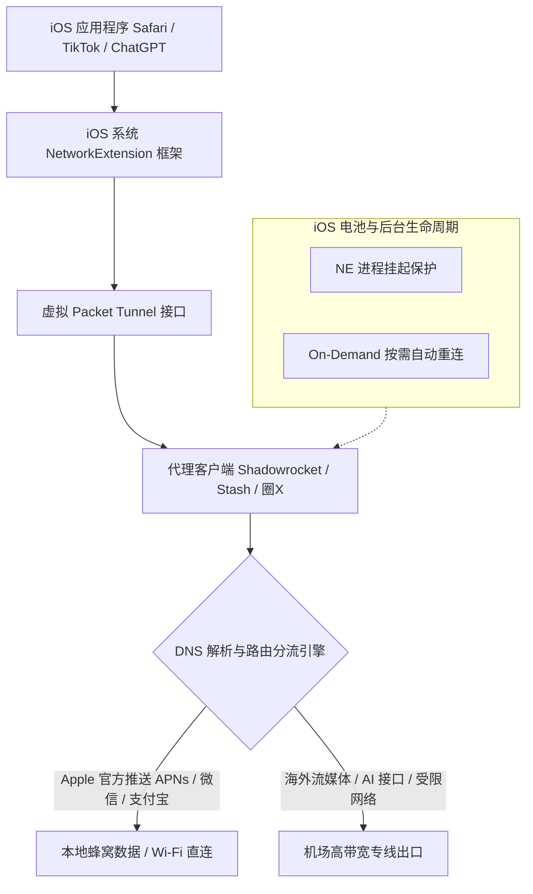

import AffiliateButton from '@site/src/components/AffiliateButton';

# iOS 苹果手机客户端终极配置手册：Shadowrocket 小火箭、Stash 与圈 X 规则重写指南

由于 Apple 的严格审核政策，中国大陆地区的 App Store 无法上架网络代理类应用。因此，在 iPhone 与 iPad 设备上实现科学上网，不仅需要掌握客户端的配置逻辑，还需要了解 **非国区 Apple ID** 的安全使用规范，以及 iOS 独特的 **NetworkExtension (NE)** 沙箱机制与 **On-Demand（按需连接）** 电源管理策略。

本篇万字级实战百科将为 iOS 用户彻底理清：**如何安全合规下载应用**、**主流四大神器（Shadowrocket / Stash / Quantumult X / Surge）横向选型**、**保姆级订阅导入**、**AI 与流媒体分流实战**、**故障排查字典** 与 **10 大核心痛点 FAQ**。

---

## 一、iOS 平台代理机制深度解析

iOS 以严苛的沙箱隔离和电量管理著称，代理工具在系统内部的运行链路与桌面端有着本质区别：



### 1. NetworkExtension 与 Packet Tunnel Provider
- iOS 不允许任何普通 App 随意安装网卡驱动或注入系统 Hook。所有代理应用都必须调用苹果官方的 `NetworkExtension.framework`，通过其提供的 `NEPacketTunnelProvider` 在系统网络层建立一个受信任的本地虚拟 VPN 通道。
- **单通道排他性**：iOS 系统全局同一时刻仅允许激活一个 Packet Tunnel 配置文件。当你开启 Stash 时，Shadowrocket 会被系统强制挂断；无法像桌面端一样多工具并存。

### 2. iOS 电池保护与后台进程保活机制
- 普通 App 进入后台数十秒内便会被 iOS 冻结挂起，但通过 `NEPacketTunnelProvider` 运行的网络核心拥有高优先级的后台守护特权。
- **电量消耗真相**：在 iOS 设置的「电池」中，常常显示代理工具耗电占比极高（例如 30%-40%）。**这通常是统计错觉**。因为全机所有 App 发出的网络流量都会流经此虚拟通道，iOS 电池统计系统会将这些 App 产生的网络无线电发射功耗通通计算在代理工具名下。

### 3. Apple 推送通知服务（APNs）的特殊处理
iOS 系统所有的后台消息提醒（如微信、邮件、Telegram）都是通过 Apple 的 APNs 长连接通道推送的（域名多为 `*.push.apple.com`）。若代理规则将 APNs 误分流至不可靠的海外节点，会导致锁屏状态下消息延迟、甚至漏接语音电话。因此，APNs 流量必须在规则首层予以 **DIRECT 直连** 放行。

---

## 二、2026 iOS 主流客户端选型横评大表

以下是 2026 年度 App Store 平台主流网络工具的综合横评：

| 客户端名称 | 常用简称 | 美区售价 (参考) | 协议兼容覆盖 | 规则分流体系 | MitM / 脚本重写 | 推荐指数与适用定位 |
| :--- | :--- | :--- | :--- | :--- | :--- | :--- |
| **Shadowrocket** | **小火箭** | **$2.99** | SS, VMess, Trojan, VLESS, Hysteria2, TUIC v5 | 规则列表 / 简单重写 | 支持基础 MitM / 脚本 | ⭐⭐⭐⭐⭐ **综合首选**（性价比之王、更新最勤、全网机场皆适配） |
| **Stash** | **Clash for iOS** | **$3.99** | 全面同步 Clash / Mihomo 协议 | 完整原生兼容 Clash YAML 规则 | 支持扩展脚本与 Dashboard | ⭐⭐⭐⭐⭐ **追求优雅 UI 与规则兼容者**（Mac/PC 规则通用） |
| **Quantumult X** | **圈 X** | **$7.99** | 主流全协议 | 强大嵌套分流规则 | ⭐⭐⭐⭐⭐ 天花板级 HTTP 重写与 JS 脚本 | ⭐⭐⭐⭐ **高级玩家 / 去广告与极客脚本重度用户** |
| **Surge 5 for iOS** | **Surge** | **免费下载 + 订阅制** ($49.99 起) | 官方标准协议 | 工业级网络调试规则 | 专业抓包、实时捕获 | ⭐⭐⭐⭐ **专业开发者与无预算压力极客** |
| **Loon** | **Loon** | **$5.99** | 主流全协议 | 插件体系极其丰富 | 强大的 Plugin 生态 | ⭐⭐⭐⭐ **喜欢模块化开箱即用插件的用户** |

---

## 三、海外 Apple ID 获取与首选客户端安全下载

> ⚠️ **高危安全红线（必读）**：
> 1. **严禁在系统「设置」中直接登录陌生的共享 Apple ID**！这会导致你的 iPhone 被远程恶意开启「查找我的 iPhone」并将手机锁死勒索！
> 2. **正确做法**：仅在手机自带的 **「App Store」** 内部点击右上角头像退出当前账号，并登录海外 Apple ID。

### 1. 获取海外 Apple ID（美区 / 日区 / 港区）
- **推荐方案 A（最稳妥安全）**：自建美区 ID。打开苹果官网（appleid.apple.com），国家/地区选择“美国”，使用全新的邮箱注册，付款方式选择“None（无）”，账单地址使用免税州（如俄勒冈 Oregon、特拉华 Delaware）生成器生成的真实地址。
- **推荐方案 B（快速兑换）**：通过正规电商渠道购买正规美区 App Store 礼品卡（Gift Card），在美区 App Store 点击「Redeem Gift Card or Code」充值兑换相应美元余额，随后购买应用。

### 2. Shadowrocket（小火箭）保姆级安装与配置

小火箭是全球普及率最高的 iOS 客户端，其稳定性和协议迭代速度常年领跑行业。

#### 步骤 1：导入订阅
以标杆专线机场 **[光速云](/docs/brands/guangsu)** 为例：

<AffiliateButton brandId="guangsu" brandName="光速云" coupon="AMM" size="large" />

1. 登录光速云后台，在手机 Safari 浏览器中点击「一键导入 Shadowrocket」；
2. 此时系统会自动调起小火箭并弹窗确认，点击保存即可完成全量节点配置；
3. **手动导入备用方案**：若未自动调起，可在后台复制订阅链接，打开小火箭，点击右上角 `+` 号，类型选择 `Subscribe`（订阅），在 URL 栏粘贴链接，点击右上角「完成」。

#### 步骤 2：自动测速与策略切换
1. 点击底部菜单栏的「设置」->「订阅」-> 开启「打开时更新」，确保每次启动软件自动拉取最新节点；
2. 回到「首页」，向下滑动刷新节点列表；
3. 点击任意节点展开，点击「连通性测试 (Ping)」，建议选择测试方法为 `CONNECT` 或 `HTTP`（以实际 TCP 握手为准，避免 ICMP 误判）；
4. 选择延迟在 30-80ms 的香港、日本或新加坡专线节点。

#### 步骤 3：全局路由模式设置
在小火箭首页下方找到「全局路由」：
- **配置 (Config)**：**强烈推荐日常开启**。按规则自动分流，国内网站直连，海外受阻网站走代理。
- **代理 (Proxy)**：所有流量一律走代理（易造成国内 App 定位漂移与流量浪费）。
- **直连 (Direct)**：所有流量不走代理。

#### 步骤 4：首次启动与权限授予
点击顶部「未连接」右侧的开关，iOS 系统会弹出系统弹窗提示：“Shadowrocket 想要添加 VPN 配置”，点击 **「允许 (Allow)」**，随后输入 iPhone 锁屏密码或通过 Face ID 验证。状态栏出现 `VPN` 小图标，即代表全机代理成功建立。

---

## 四、iOS 进阶核心调优指南

### 1. On-Demand（按需连接）自动化无感运行
许多用户经常遇到出门断网或回到家 Wi-Fi 无法访问内网的问题。小火箭内置的 **On-Demand** 功能可根据网络环境自动决策：
1. 进入小火箭「设置」->「按需连接 (On Demand)」；
2. 开启「按需连接」总开关；
3. 在「总是连接」中勾选「蜂窝网络 (Cellular)」与「Wi-Fi」；
4. 若家中配置了透明网关软路由，可在「不连接的 Wi-Fi 列表」中添加家庭 Wi-Fi 的 SSID。当手机连上家里 Wi-Fi 时，小火箭会自动静默断开代理，省电且避免双重代理冲突；一旦离开家切到 5G 信号，小火箭在 0.5 秒内自动唤醒重连。

### 2. DNS 防污染与防泄漏（DoH / DoT）设置
iOS 在移动网络环境下极易受到省市级运营商的 DNS 劫持（例如弹窗广告、域名解析超时）。
1. 打开小火箭「配置」选项卡，点击当前使用的 `.conf` 规则文件右侧的 `(i)` 图标；
2. 找到「DNS」设置段，在「DNS 服务器」中填入国内高防 DNS：
   ```text
   223.5.5.5, 119.29.29.29
   ```
3. 在「DoH 服务器」中填入：
   ```text
   https://dns.alidns.com/dns-query
   ```
4. 确保勾选「DNS 覆盖」与「解析系统 DNS」，彻底封死运营商 DNS 投毒漏洞。

---

## 五、针对高负载与 AI/流媒体分流配置实操

针对 iOS 上最常使用的 ChatGPT 原生 App、TikTok、Netflix 4K 等服务，标准的自定义分流规则编写逻辑如下：

```text
# Shadowrocket / 圈X 规则示范片段
[Rule]
# 1. 优先直连：苹果 APNs 推送与国内常见办公
DOMAIN-SUFFIX,push.apple.com,DIRECT
DOMAIN-SUFFIX,icloud.com,DIRECT
DOMAIN-SUFFIX,feishu.cn,DIRECT
DOMAIN-SUFFIX,dingtalk.com,DIRECT

# 2. 国际 AI 工具矩阵（指定低延迟或美国出口）
DOMAIN-KEYWORD,openai,PROXY
DOMAIN-SUFFIX,identrust.com,PROXY
DOMAIN-SUFFIX,auth0.com,PROXY
DOMAIN-SUFFIX,claude.ai,PROXY
DOMAIN-SUFFIX,anthropic.com,PROXY
DOMAIN-SUFFIX,perplexity.ai,PROXY

# 3. 国际流媒体与社交媒体
DOMAIN-KEYWORD,netflix,PROXY
DOMAIN-KEYWORD,spotify,PROXY
DOMAIN-SUFFIX,cdn.optimizely.com,PROXY
DOMAIN-SUFFIX,youtube.com,PROXY
DOMAIN-SUFFIX,googlevideo.com,PROXY

# 4. 国内主流 IP 与域名兜底直连
GEOIP,CN,DIRECT
FINAL,PROXY
```

> **小贴士**：使用官方 ChatGPT iOS 客户端时，OpenAI 对节点 IP 的纯净度（Fraud Score 欺诈评分）检测极其严苛。如果遇到提示“Something went wrong”，请在客户端中将节点切换为 **光速云** 的原生美国或日本住宅级专线节点。

---

## 六、iOS 故障排查字典与常见报错解决指南

### 1. 报错：开启代理后，顶部状态栏 VPN 图标疯狂闪烁且瞬间断开
- **原因分析**：配置文件内部存在语法错误，或者本地监听端口被占用；亦或是所选节点的服务器 IP/端口已经完全不可达导致系统握手超时主动切断。
- **排查解决**：
  1. 重启 iPhone 手机，清理残留的系统 NetworkExtension 守护句柄；
  2. 切换回默认的 `default.conf` 纯净配置文件；
  3. 更换一个确认绿色的健康节点再尝试开启。

### 2. 报错：开启小火箭后，微信文字正常，但无法接收图片、语音及朋友圈
- **原因分析**：微信 CDN 图片加速域名被误判分流到了不兼容的国外代理节点，触发微信安全风控连接熔断。
- **排查解决**：
  1. 确保全局路由模式为「配置 (Config)」而非「代理 (Proxy)」；
  2. 进入规则文件，在最顶部添加：
     ```text
     DOMAIN-SUFFIX,qpic.cn,DIRECT
     DOMAIN-SUFFIX,weixin.qq.com,DIRECT
     ```
  3. 关闭代理后重新打开微信拉取缓存，再重新激活小火箭。

### 3. 报错：提示“无法验证 App”，下载的应用图标变为暗灰色
- **原因分析**：使用的共享 Apple ID 被苹果官方风控封禁，或者从非 App Store 途径（如企业证书签名工具）安装的描述文件证书过期失效。
- **排查解决**：通过正规途径购买属于自己的独立美区 Apple ID 并下载官方正版，彻底摆脱企业签名证书被频繁吊销的困扰。

### 4. 报错：开代理后，手机开个人热点给电脑，电脑无法翻墙
- **原因分析**：iOS 系统的热点流量转发默认由蜂窝基带芯片直接由 Linux 核心桥接转发，不经过本机的 NetworkExtension 虚拟网卡通道。
- **排查解决**：
  - 在小火箭「设置」中找到并开启 **「代理共享」**；
  - 记下手机界面显示的内网 IP（如 `172.20.10.1`）与端口（如 `1082`）；
  - 在电脑网络设置中，手动将 HTTP/Socks5 代理填入该手机 IP 与端口即可实现热点代理共享。

---

## 七、iOS 平台 10 大真实痛点 FAQ

### Q1: 可以在中国大陆的 App Store 账号直接下载小火箭吗？
**A**: 不能。苹果根据中国大陆相关法律法规，已在大陆区下架了所有代理工具。必须且仅需注册一个外区（如美国、日本、中国香港）Apple ID，即可在 App Store 搜索下载。已下载的应用即使换回大陆 ID 登录也能终身正常使用与更新。

### Q2: 为什么小火箭只要 $2.99，而 Surge 要卖 $49.99？新手有必要买 Surge 吗？
**A**: 完全没有必要。Surge 定位是专业级网络开发与协议调试套件，针对的是需要深度排查网络数据包、修改 HTTP 报文的工程师群体。对于绝大多数看视频、刷推特、查资料、玩游戏的用户，小火箭或 Stash 的性能与功能已绰绰有余。

### Q3: 为什么我的 iPhone 开启小火箭后电量掉得飞快？
**A**: 常见原因包括：1. 开启了激进的「URL-Test 自动优选节点」，导致后台每隔几秒对全列表几十个节点发起网络握手，基带芯片持续工作无法休眠；2. 开启了过多无效的 MitM 证书解密与庞大的广告拦截脚本。建议在策略组中关闭过于频繁的高频测速。

### Q4: Stash 和 Shadowrocket 相比，哪一个更值得买？
**A**: 如果你在 Windows/Mac/软路由上深度使用 Clash 或 OpenClash，**Stash** 会更适合你，因为它的底层配置文件完全遵循 Clash 语法，策略组和分流规则可以在多设备间一套配置到处复用；如果追求极速连通、兼容极多小众前沿协议，**Shadowrocket** 则是老牌全能王。

### Q5: 为什么在 iOS 上用 ChatGPT App 总提示“Something went wrong”？
**A**: iOS 版 ChatGPT 集成了非常严格的设备指纹与 IP 风控。请检查：1. 开启了小火箭的 UDP 转发支持；2. 代理节点不能被 OpenAI 列入数据中心（DataCenter）黑名单，请选用 **光速云** 的专属低风控原生解锁专线节点。

### Q6: 开启代理会泄露我的银行卡和支付密码吗？
**A**: 绝不会。现代手机银行（如招商银行、工行、支付宝）与重要凭证传输均采用双向 TLS/SSL 强加密，传输内容在应用层即已高度密文封装。只要你不在手机中随意导入并信任来历不明的第三方 CA 根证书，代理节点服务器只能看到目标 IP 和握手域名，绝不可能解密你的明文账密。

### Q7: 小火箭可以屏蔽爱奇艺、腾讯视频的开头片头广告吗？
**A**: 目前国内爱优腾等平台已全面采用视频流与广告流混合下发的 HTTPS 机制，单纯依靠 DNS 或域名规则拦截极易导致视频正片直接黑屏报错。目前主流代理工具主要用于解除海外平台（如 YouTube、Spotify）广告，不建议强行对国内流媒体做深度注入。

### Q8: 切换 Apple ID 后，我之前在国区下载的微信等软件还能正常更新吗？
**A**: 可以。iOS 系统支持多账号混装机制。微信等国内应用在更新时，系统会自动识别其原本的购买账号，只要不发生大版本授权变更，均可直接在更新页面点击更新。

### Q9: 为什么有时候锁屏几小时后，收不到 Telegram 消息推送？
**A**: 进入 iOS「设置」->「Shadowrocket」，确保开启了「后台 App 刷新」权限。同时在小火箭内检查是否误启用了过短的空闲超时断连设置。

### Q10: 订阅链接在小火箭内更新报错“Core Error”或返回 0 节点？
**A**: 常见排查：1. 订阅链接过期或流量已耗尽，请登录机场后台核验；2. 机场后台的短网址在本地被运营商解析拦截，可尝试复制长订阅链接导入；3. 手机时钟不准确，前往系统设置开启“自动设置时间”。

---

## 八、蜂巢内链与标杆机场推荐

移动网络（5G/4G）受基站切换与基带频段影响，抗抖动能力远弱于家庭宽带。在 iOS 平台上，选择拥有多线 BGP 入口与专线备份的机场至关重要。

综合我们在 iPhone 15/16 系列及最新 iOS 18 环境下的长期网络抖动与延迟评测：

- **首选移动端标杆推荐：[光速云](/docs/brands/guangsu)**
  - 部署全国内多地 **BGP 智能入口 + IPLC 内网专线**，基站漫游平滑无感切流；
  - 原生支持小火箭与 Stash 一键无缝导入，无需复杂手动配置；
  - 极致省电优化，晚高峰 4K 流媒体秒开、TikTok 顺畅滑动。
  - **专属限时优惠码**：`AMM`

<AffiliateButton brandId="guangsu" brandName="光速云" coupon="AMM" size="large" />

### 相关进阶技术专题导航
- 安卓用户实战指南：[Android 平台防后台杀进程与省电优化](/docs/clients/android)
- 桌面主力电脑配置：[Windows 11/10 平台客户端深度配置](/docs/clients/windows)
- Mac 苹果电脑协同指南：[macOS 平台客户端权威指南](/docs/clients/macos)
