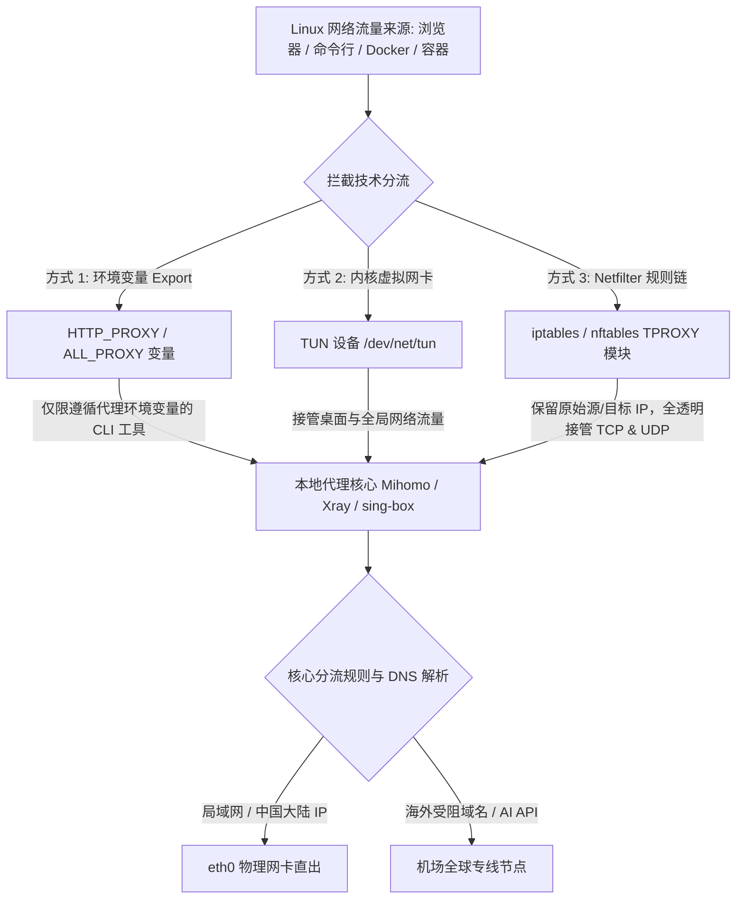

import AffiliateButton from '@site/src/components/AffiliateButton';

# Linux 客户端安装配置全景指南：桌面图形端与服务器无头 v2rayA 透明网关实战

Linux 生态涵盖了面向开发者的桌面工作站（Ubuntu、Fedora、Arch Linux）以及面向云计算与本地自建机房的无桌面（Headless）服务器与 NAS（Debian、Rocky Linux、Proxmox VE）。与常规桌面系统不同，Linux 拥有极为强大的网络协议栈（Netfilter、iptables、nftables、Policy Routing），但也因复杂的包过滤机制与 DNS 守护进程（如 `systemd-resolved`），让许多用户在配置代理时踩坑不断：**“桌面端 AppImage 打不开”、“服务器 Docker 拉取镜像超时”、“开启透明代理导致 SSH 远程连接断开”、“53 端口被 systemd 占用导致 TUN 报错”**。

本篇万字级指南将全面覆盖 Linux 平台的两大主流使用场景（**GUI 桌面图形端** 与 **无桌面服务器端**），深度解析 Linux 内核网络劫持机制，提供保姆级部署实战、Docker 生产级加速、故障字典及 10 大权威 FAQ。

---

## 一、Linux 平台代理机制深度解析

Linux 在网络层具备极高的掌控粒度，主流的代理劫持方式呈现阶梯式递进：



### 1. 用户态环境变量代理（`http_proxy` & `all_proxy`）
- **机制原理**：在当前 Shell 会话中执行 `export http_proxy=http://127.0.0.1:7890`。仅针对主动读取此环境变量的 CLI 工具（如 `curl`, `wget`, `python-requests`, `git`）生效。
- **致命弱点**：
  1. 采用 `sudo apt update` 或 `sudo yum install` 时，由于 `sudo` 默认重置环境变量，代理会瞬间失效（必须加参数 `sudo -E`）；
  2. 守护进程（systemd services）、底层后台脚本、Docker 守护进程完全不走环境变量；
  3. 无法处理任何原始 UDP 流量。

### 2. TUN 虚拟网卡与策略路由（Policy Routing）
- **机制原理**：在内核创建 `/dev/net/tun` 虚拟网络接口，配置策略路由表（`ip rule` 与 `ip route`），将流量标记后引入代理核心。
- **优势**：接管能力强，桌面端 GUI 客户端普遍采用此方案。

### 3. Netfilter TPROXY（透明代理工业级标准）
- **机制原理**：Linux 内核 Netfilter 框架下的 `TPROXY`（Transparent Proxy）目标模块。相比老旧的 `REDIRECT` 模式只能劫持 TCP 并篡改数据包目标 IP，`TPROXY` 模式可以**同时接管 TCP 和 UDP**，并且能够**完美保留数据包的原始目的地址与源地址**。
- **适用场景**：这是本地服务器、软路由、无头网关实现“透明加速”的最高性能技术方案，也是 **v2rayA** 和 **sing-box** 的底层核心基石。

---

## 二、2026 Linux 主流客户端横评选型大表

根据你的运行环境（桌面 GUI 还是 无桌面服务器），选择最为匹配的方案：

| 客户端名称 | 适用运行场景 | 核心与底层机制 | 安装包支持形式 | Web UI / GUI | 推荐指数与核心优势 |
| :--- | :--- | :--- | :--- | :--- | :--- |
| **Clash Verge Rev** | **桌面图形工作站** (Ubuntu/Arch/Fedora) | **Mihomo (Clash Meta)** + TUN 虚拟网卡 | AppImage, DEB, RPM, Arch AUR | 原生桌面 GUI (Tauri/Rust) | ⭐⭐⭐⭐⭐ **桌面端首选**（界面美观、一键开启系统代理与 TUN） |
| **v2rayA** | **无头服务器 / NAS / 软路由** | **Xray-core** + **iptables / TPROXY** | APT, YUM, Arch AUR, Docker 容器 | 原生 Web 控制面板 (端口 2017) | ⭐⭐⭐⭐⭐ **服务器端首选**（开箱即用透明代理、多协议无感接管） |
| **FlClash (Linux)** | **桌面图形环境** | Mihomo 核心 | AppImage, Flatpak | 现代极简 GUI (Flutter) | ⭐⭐⭐⭐ **轻量桌面极客**（跨端一致） |
| **sing-box CLI** | **服务器原生服务** | 纯 Go 原生内核 | 单二进制文件 + systemd | 纯命令行 / 远程 REST API | ⭐⭐⭐⭐ **高级运维 / 资源极致压缩** |
| **Mihomo CLI** | **服务器原生服务** | Meta 原生核心 | 单二进制文件 + Web Dashboard | 外部 Web UI 托管 | ⭐⭐⭐⭐ **轻量服务器自动化运维** |

---

## 三、桌面端实战：Clash Verge Rev 安装与避坑

针对使用 GNOME、KDE 或 XFCE 桌面环境的 Linux 用户：

### 1. 各发行版安装流程
- **Debian / Ubuntu / Linux Mint**：
  ```bash
  # 下载最新的 deb 安装包
  wget https://github.com/clash-verge-rev/clash-verge-rev/releases/download/v1.7.7/clash-verge_1.7.7_amd64.deb
  sudo dpkg -i clash-verge_1.7.7_amd64.deb
  sudo apt-get install -f # 自动修复缺失的依赖
  ```
- **Arch Linux / Manjaro**：
  ```bash
  # 通过 AUR 助手一键编译安装
  yay -S clash-verge-rev-bin
  ```
- **Fedora / RHEL / openSUSE**：
  ```bash
  sudo rpm -i clash-verge-1.7.7-1.x86_64.rpm
  ```
- **通用 AppImage 运行避坑**：
  在较新的 Ubuntu 22.04 / 24.04 上，运行 AppImage 可能会报错缺少 FUSE。
  ```bash
  # 赋予可执行权限
  chmod +x Clash.Verge_*.AppImage
  # 若报错 dlopen(): error loading libfuse.so.2，安装兼容运行库：
  sudo apt install libfuse2
  ./Clash.Verge_*.AppImage
  ```

### 2. 赋予内核特权与开启 TUN 模式
在 Linux 下开启 TUN 模式需要创建虚拟网卡权限。打开终端执行：
```bash
# 给予 clash 内核设置网络命名空间与 RAW 套接字特权
sudo setcap cap_net_admin,cap_net_bind_service=+ep /usr/bin/mihomo
```
在软件设置中点击开启「TUN 模式」，即可实现 Linux 桌面系统的全局流量接管。

---

## 四、服务器与 NAS 首选：v2rayA 无头透明网关实战

在没有显示器与图形界面的生产服务器、家庭 NAS（群晖/PVE/UNRAID）上，**v2rayA** 是业界公认最稳定的透明代理利器。

### 1. 安装与启动 v2rayA 服务
以 Ubuntu / Debian 系统为例：

```bash
# 1. 导入公钥与添加官方 APT 软件源
curl -Ls https://mirrors.v2raya.org/go.sh | sudo bash

# 2. 启动 v2rayA 并设置开机自启
sudo systemctl enable --now v2raya.service

# 3. 检查服务运行状态
sudo systemctl status v2raya.service
```

### 2. Web 界面配置与导入机场订阅（以标杆机场光速云为例）

高规格内网专线可彻底消除服务器编译超时与 Docker 镜像卡死：

<AffiliateButton brandId="guangsu" brandName="光速云" coupon="AMM" size="large" />

1. 打开同一局域网电脑的浏览器，访问 `http://<你的Linux服务器IP>:2017`；
2. 首次进入会提示创建管理员账号与密码；
3. 点击左上角「创建」，选择「导入」，粘贴来自 **光速云** 的 V2Ray / Clash 格式订阅 URL；
4. 导入成功后，列表将呈现全部高速专线节点，点击右上角「Ping」测试握手延迟，勾选延迟优良的节点并点击「连接」；
5. 点击右上角「设置」：
   - **透明代理 / 系统代理**：选择 **「启动透明代理 (Redirect/TPROXY)」**；
   - **实现方式**：选择 **`tproxy`**（极致性能且支持 UDP）；
   - **防止 DNS 污染**：选择 **`doh`**；
   - 点击右上角「保存并应用」。
此时，整台 Linux 服务器的所有外发流量（包括后台任务、Git、Docker）全部透明走代理，无需在终端配置任何环境变量！

---

## 五、Linux 开发者生产力：Docker 容器与镜像拉取专属加速

即使服务器已经配置了代理，在许多 DevOps 自动化构建场景中，Docker Daemon 依然会因沙箱隔离无法直接借道。以下是官方推荐的标准加速配置：

### 1. 配置 Docker 守护进程代理（加速 Docker Pull）
创建或编辑 `/etc/systemd/system/docker.service.d/http-proxy.conf`：

```ini
[Service]
Environment="HTTP_PROXY=http://127.0.0.1:20171"
Environment="HTTPS_PROXY=http://127.0.0.1:20171"
Environment="NO_PROXY=localhost,127.0.0.1,docker-registry.somecorporation.com"
```
*(注：`20171` 为 v2rayA 或本地客户端开放的 HTTP 本地监听端口)*

重载并重启 Docker 服务：
```bash
sudo systemctl daemon-reload
sudo systemctl restart docker
# 验证代理是否挂载成功
docker info | grep -i proxy
```

### 2. 配置容器内构建环境代理（加速 Docker Build）
编辑 `~/.docker/config.json`：
```json
{
 "proxies": {
   "default": {
     "httpProxy": "http://172.17.0.1:7890",
     "httpsProxy": "http://172.17.0.1:7890",
     "noProxy": "localhost,127.0.0.1"
   }
 }
}
```
此时执行 `docker build` 时，容器内下载依赖包将直接流向宿主机的代理端口。

---

## 六、针对高负载与 AI/流媒体分流配置代码

针对 Linux 平台开发与多媒体环境，以下是轻量高效的规则集示例：

```yaml
# Linux 专用分流规则
rules:
  # 关键 Linux 软件源与官方镜像加速
  - DOMAIN-SUFFIX,github.com,节点选择
  - DOMAIN-SUFFIX,githubusercontent.com,节点选择
  - DOMAIN-SUFFIX,docker.com,节点选择
  - DOMAIN-SUFFIX,docker.io,节点选择
  - DOMAIN-SUFFIX,crates.io,节点选择
  - DOMAIN-SUFFIX,pypi.org,节点选择

  # AI 接口支持 (Cursor, OpenAI, HuggingFace)
  - DOMAIN-SUFFIX,openai.com,🤖 人工智能
  - DOMAIN-SUFFIX,huggingface.co,🤖 人工智能
  - DOMAIN-SUFFIX,anthropic.com,🤖 人工智能

  # 国内主流源保持直连
  - DOMAIN-SUFFIX,aliyun.com,DIRECT
  - DOMAIN-SUFFIX,tsinghua.edu.cn,DIRECT
  - DOMAIN-SUFFIX,ustc.edu.cn,DIRECT

  - GEOIP,CN,DIRECT
  - MATCH,节点选择
```

---

## 七、Linux 故障排查字典与常见报错解决指南

### 1. 报错：`Failed to bind port 53: address already in use`
- **原因分析**：Ubuntu 等现代发行版默认启用了 `systemd-resolved` 守护进程，该服务强占了本机的 `127.0.0.53:53` 端口，导致客户端内置 DNS 无法绑定 53 端口。
- **排查解决**：
  1. 编辑配置文件：
     ```bash
     sudo nano /etc/systemd/resolved.conf
     ```
  2. 将 `DNSStubListener` 修改为 `no`：
     ```text
     DNSStubListener=no
     ```
  3. 创建软链接更新系统 resolv.conf，并重启服务：
     ```bash
     sudo ln -sf /run/systemd/resolve/resolv.conf /etc/resolv.conf
     sudo systemctl restart systemd-resolved
     ```

### 2. 报错：开启透明代理后，外部通过 SSH 无法连接到此 Linux 服务器
- **原因分析**：透明代理规则（iptables PREROUTING）无差别劫持了入站的 22 端口流量，回包时被错误重定向，导致 TCP 握手无法完成。
- **排查解决**：
  在 iptables 规则链首部添加 SSH 端口白名单放行（以实际 SSH 端口 22 为例）：
  ```bash
  sudo iptables -t mangle -I PREROUTING -p tcp --dport 22 -j ACCEPT
  sudo iptables -t mangle -I OUTPUT -p tcp --sport 22 -j ACCEPT
  ```
  *(若使用 v2rayA，直接在 Web 设置中勾选「防止阻断 SSH 端口」即可)*

### 3. 报错：`sudo: curl: command not found` 或 `sudo apt` 依然连不上国外源
- **原因分析**：普通的 `export http_proxy` 只写入当前用户的环境。执行 `sudo` 时，系统为了安全会重置环境变量（`env_reset`）。
- **排查解决**：
  - 临时解决：执行命令时携带参数 `sudo -E apt update`；
  - 永久解决：编辑 `/etc/sudoers`（使用 `sudo visudo`），添加一行：
    ```text
    Defaults env_keep += "http_proxy https_proxy all_proxy no_proxy"
    ```

### 4. 报错：执行 `ping google.com` 提示未知主机，但 `curl` 能成功
- **原因分析**：本地 `/etc/resolv.conf` 的 Nameserver 指向了不可达的虚假地址，而 curl 读取了环境变量代理，代理远端解析成功。
- **排查解决**：检查 `/etc/resolv.conf`，确保包含可用的备用 DNS 服务器，如 `nameserver 223.5.5.5`。

---

## 八、Linux 平台 10 大真实痛点 FAQ

### Q1: Linux 服务器使用终端代理，需要装图形界面 (Desktop) 吗？
**A**: 完全不需要。在服务器环境下，强烈推荐部署 **v2rayA** 或纯命令行版 **sing-box / Mihomo** 作为 systemd 后台守护进程。仅需占用 20MB 左右内存，通过浏览器远程 Web 管理或单文件配置即可全天候无感加速。

### Q2: 为什么在终端敲 `ping` 测试不通国外 IP，而客户端却显示连接成功？
**A**: 大多数通用代理协议（SOCKS5 / HTTP 环境变量）工作在应用层或传输层（TCP/UDP），而 `ping` 采用的是网络层 ICMP 协议。因此通过命令行设置的代理变量不会对 `ping` 生效。若要验证连通性，请使用真实 HTTP 请求测试：`curl -I https://www.google.com`。

### Q3: 使用 systemd 托管客户端时，服务器重启后无法自启怎么办？
**A**: 执行 `sudo systemctl enable <服务名>` 开启开机自启。同时检查该服务的 `.service` 单元文件，确保在 `[Unit]` 段落包含 `After=network.target network-online.target`，保证系统完全获取到 IP 后才拉起代理核心。

### Q4: 在云服务器 VPS 上使用 TPROXY 会被云厂商封禁吗？
**A**: 不会。TPROXY 是 Linux 官方内核的标准 Netfilter 模块，属于完全合法的内核数据路由机制，仅在机器本地生效，绝不违反云厂商的使用守则。

### Q5: 为什么在 Linux 上跑大流量下载时，CPU 的 `ksoftirqd` 进程占用极高？
**A**: 软中断（ksoftirqd）飙高通常是由于旧版 TAP 虚拟网卡的高频用户态内存拷贝引起的。建议将内核驱动升级为支持 GSO/GRO（通用分段卸载）的 **Wintun / Tun 现代栈**，或切换为内核级 `TPROXY` 模式，即可大幅减少软中断上下文切换。

### Q6: Arch Linux 下通过 AUR 安装的客户端更新缓慢如何处理？
**A**: 可以配置 AUR 镜像源，或者直接从项目的 GitHub Releases 页面下载编译好的可执行二进制文件放置在 `/usr/local/bin/` 目录下，并自行编写精简的 systemd 单元文件直接维护。

### Q7: 在多网卡服务器（双网口）上配置代理，如何防止内网流量走偏？
**A**: 必须在路由规则最顶部配置内网私有网段的硬放行：将 `10.0.0.0/8`、`172.16.0.0/12` 和 `192.168.0.0/16` 全部显式绑定到物理网卡直连，确保业务集群内网通信与存储挂载（NFS/iSCSI）不受干扰。

### Q8: WSL2 (Windows Subsystem for Linux) 里的 Linux 如何无缝走宿主机代理？
**A**: Windows 11 的最新版 WSL2 支持「镜像网络模式 (Mirrored Mode)」。在 Windows 用户主目录下的 `.wslconfig` 中写入：
```ini
[wsl2]
networkingMode=mirrored
```
保存后在 PowerShell 执行 `wsl --shutdown` 重启 WSL。WSL2 即可与 Windows 宿主机完全共享网络栈与 TUN 虚拟网卡，无需任何二次网络配置！

### Q9: 为什么 Git clone GitHub 仓库速度只有几 KB/s？
**A**: Git 默认不主动读取系统环境变量，必须显式为 Git 配置代理：
```bash
git config --global http.proxy http://127.0.0.1:7890
git config --global https.proxy http://127.0.0.1:7890
```
配置完成后瞬间可跑满几百兆带宽。

### Q10: 订阅链接在 Linux 下通过 curl 或 wget 下载总是被拒？
**A**: 部分机场后台为了防止爬虫爬取，要求请求头中必须携带客户端的 User-Agent。下载时追加模拟请求头即可：
```bash
curl -A "ClashMeta" -L -o config.yaml "https://your-subscription-url"
```

---

## 九、蜂巢内链与标杆机场推荐

Linux 编译环境与服务器容器拉取往往具有大并发、大文件持续下载的特性，这对机场节点的线路带宽冗余与抗丢包能力提出了极致考验。

经过针对各大 Linux 发行版与云原生环境的高强度压测：

- **首选基础设施标杆推荐：[光速云](/docs/brands/guangsu)**
  - 核心骨干部署企业级 **IPLC 内网专线**，千兆带宽冗余，Git 与 Docker 秒速拉取；
  - 完美适配 v2rayA、Clash Verge Rev 及 sing-box CLI 原生订阅；
  - 全协议支持，低丢包率保证高并发长连接任务永不断线。
  - **专属限时优惠码**：`AMM`

<AffiliateButton brandId="guangsu" brandName="光速云" coupon="AMM" size="large" />

### 相关进阶技术专题导航
- 软路由全屋网关联动：[OpenWrt 软路由透明网关实战指南](/docs/clients/router)
- 桌面 Windows 调优：[Windows 11/10 平台客户端深度配置](/docs/clients/windows)
- 苹果 macOS 平台实战：[macOS 苹果电脑客户端权威指南](/docs/clients/macos)
