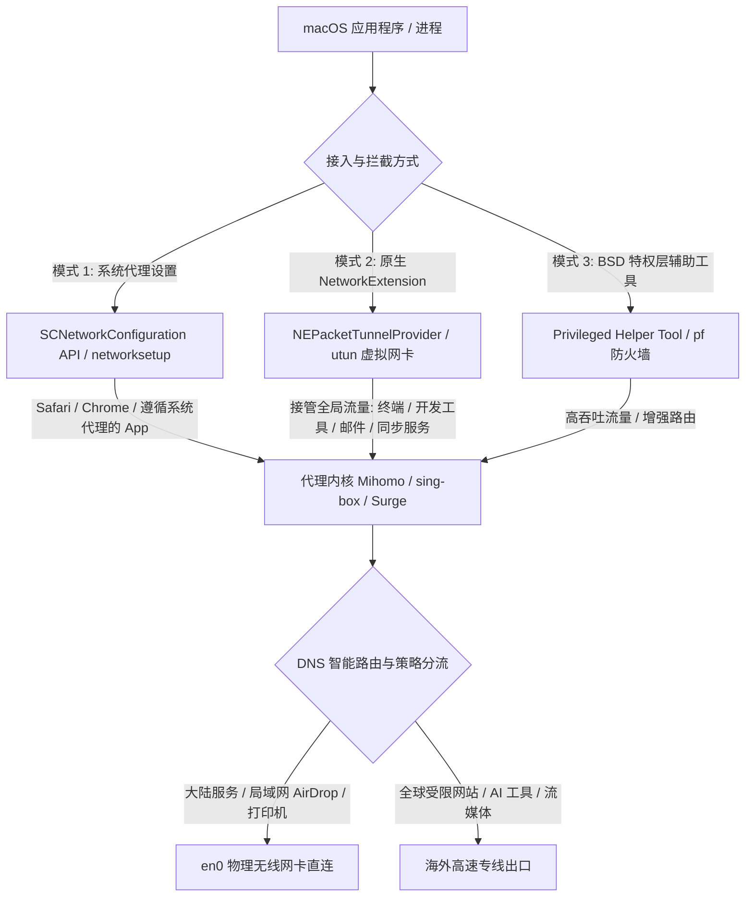

import AffiliateButton from '@site/src/components/AffiliateButton';

# macOS 苹果电脑客户端权威实操指南：Apple Silicon M系列芯片适配与 Surge Mac/sing-box 调优

macOS 凭借 Unix 核心（Darwin）与极致功耗控制，已成为专业开发者、多媒体创作者及极客群体的首选桌面平台。自 Apple Silicon（M1/M2/M3/M4 系列）芯片普及以来，Mac 的网络栈也经历了从传统 BSD 套接字劫持到苹果原生 **NetworkExtension (NE)** 与 **Packet Filter (pf)** 的深度重构。

很多 Mac 用户在配置代理时常遇到经典困扰：**“下载的 DMG 安装包提示文件已损坏无法打开”**、**“M 芯片误跑 Rosetta 2 转译导致发热严重”**、**“macOS 休眠唤醒后 Wi-Fi 显示感叹号”**、**“终端 iTerm2 / Homebrew / Docker 完全不走代理”**。

本篇万字级指南将为您彻底拆解 macOS 的底层代理机制，提供全景客户端横向选型、Apple Silicon 原生优化、高阶分流代码、排障字典及 10 大权威 FAQ。

---

## 一、macOS 操作系统平台代理机制深度解析

macOS 的代理机制在兼顾 Unix 灵活性与苹果极高安全性沙箱的前提下，提供了两种截然不同的网络接管路径：



### 1. 系统代理（System Proxy & `networksetup`）
- **运作机制**：客户端通过 macOS 系统的 `SystemConfiguration.framework` API，或在特权下调用终端命令 `networksetup -setwebproxy "Wi-Fi" 127.0.0.1 7890` 和 `-setsecurewebproxy`，修改当前网络接口的 HTTP 与 HTTPS 代理设置。
- **局限性**：
  1. 仅对使用系统 WebKit 或标准 `CFNetwork` 的应用（如 Safari、Chrome、系统更新）生效；
  2. 默认忽略 UDP 流量（海外游戏与语音通话完全失效）；
  3. 终端 Shell（zsh、bash）、Git clone、Homebrew 下载、Python/Curl 脚本一律绕行直连；
  4. 多网络位置切换（如拔掉网线切到 Wi-Fi）时容易发生配置滞后或代理死锁。

### 2. 原生虚拟网卡（NetworkExtension 与 `utun` 模式）
- **运作机制**：现代 macOS 客户端通过申请 Apple 的系统权限，注册 `NEPacketTunnelProvider` 扩展或加载原生 `utunX`（Unix Tunnel）网络接口。由操作系统在网络三层（IP 层）将所有发往外部的 IPv4/IPv6 数据包直接导入代理客户端内核。
- **优势**：
  - **真正的全局接管**：无需对终端、开发环境做任何配置，VS Code 插件下载、Docker 镜像拉取、Telegram、Steam 统统自动走代理；
  - **低能耗集成**：原生 NetworkExtension 具备更优雅的休眠挂起与唤醒机制，大幅降低电池消耗。

### 3. Apple 特权辅助工具（Privileged Helper Tool）
类似于 Clash Verge Rev 或 Surge 安装的辅助守护进程（位于 `/Library/PrivilegedHelperTools/`），该工具以 `root` 权限常驻系统后台，负责动态调整 macOS 内置的 `pf`（Packet Filter）包过滤防火墙与系统路由表，使得用户在日常操作中无需反复输入 Mac 开机密码即可无感启闭底层网络劫持。

---

## 二、2026 macOS 主流客户端选型横评大表

针对 Apple Silicon 芯片能效比与 macOS 现代 UI 体验，各客户端表现如下：

| 客户端名称 | 芯片架构适配 | 核心与驱动 | 内存与能耗表现 | 系统接管方式 | 授权类型 | 适用人群与定位 |
| :--- | :--- | :--- | :--- | :--- | :--- | :--- |
| **Clash Verge Rev (Mac)** | **原生 ARM64** + x64 Universal | **Mihomo (Meta)** + Tauri/Rust | 约 50MB / 极低能耗 | 增强模式 TUN (utun) / 系统代理 | 开源免费 | ⭐⭐⭐⭐⭐ **综合首选**（全能均衡、社区最活跃） |
| **Surge Mac (Surge 5)** | **高度优化原生 ARM64** | 自研商业闭源高性能核心 | 约 35MB / 极致能效 | Enhanced Mode (VIF 网卡 + DOH) | 商业付费 ($49.99 起) | ⭐⭐⭐⭐⭐ **追求极致体验的专业开发者与网络工程师** |
| **sing-box for macOS (SFM)** | 原生 ARM64 / Universal | 官方 **sing-box 纯 Go 核心** | 约 40MB / 极轻量 | 原生 NetworkExtension | 开源免费 | ⭐⭐⭐⭐ **极简极客 / 原生生态追随者** |
| **FlClash (Mac)** | 原生 Universal | Mihomo + Flutter 框架 | 约 80MB / 表现良好 | 系统代理 / TUN | 开源免费 | ⭐⭐⭐⭐ **颜值优先与跨平台一致体验者** |
| **Loon for Mac** | 苹果 Catalyst 移植 | Loon 核心 | 约 45MB / 良好 | NetworkExtension | 商业买断 ($5.99) | ⭐⭐⭐⭐ **从 iOS 迁移过来的小众拥趸** |

---

## 三、首选客户端安装与避坑实战

### 1. 架构辨析：切勿运行转译版
在 Mac 上运行 x86_64 转译应用会导致 CPU 唤醒频率大幅上升，加速电池消耗。
- 前往下载时，务必看清文件名：
  - **Apple Silicon (M1/M2/M3/M4)**：下载带有 `aarch64`、`arm64` 字样的安装包（如 `Clash.Verge_x.x.x_aarch64.dmg`）；
  - **Intel 处理器（老款 Mac）**：下载带有 `x64` 字样的安装包。
- **验证方式**：打开「活动监视器 (Activity Monitor)」，在「CPU」选项卡下查看客户端进程的「种类」列，必须显示为 **「Apple」** 而非「Intel」。

### 2. 彻底解决 macOS 经典安全报错（“文件已损坏”与 Gatekeeper）
由于 macOS Sequoia / Sonoma 强化了未签名应用的公证检查（Notarization），从 GitHub 下载的开源客户端常常在拖入「应用程序」后无法打开。

#### 权威三步修复法：
1. 打开系统自带的 **「终端 (Terminal)」**（快捷键 `Cmd + 空格` 搜索 Terminal）。
2. 输入以下命令并按回车（提示输入电脑开机密码，输入时不显示字符，输完直接按回车）：
   ```bash
   sudo xattr -r -d com.apple.quarantine /Applications/Clash\ Verge.app
   ```
   *(如果使用的是 Surge 或其他软件，将路径替换为对应的 App 绝对路径)*
3. 若系统弹出「无法验证开发者」，前往 Mac **「系统设置」->「隐私与安全性」**，向下拉动至「安全性」区域，点击 **「仍要打开」** 即可。

### 3. 配置订阅与日常使用（以标杆专线机场光速云为例）

高规格专线是保证 Mac 流畅运行开发与娱乐的基础保障：

<AffiliateButton brandId="guangsu" brandName="光速云" coupon="AMM" size="large" />

1. **导入配置**：在机场后台复制 Clash 托管订阅链接，打开 Clash Verge Rev Mac 版，在「订阅 (Profiles)」界面粘贴并下载。
2. **启用 TUN 增强模式**：
   - 进入「设置」，找到「TUN 模式 (TUN Mode)」；
   - 首次开启时，macOS 会弹出提示：“Clash Verge 想要添加虚拟网卡配置”，输入 Mac 开机密码并点击 **「允许 (Allow)」**；
   - 状态栏出现绿色图标，此时系统级全局 utun 适配器已挂载完毕。
3. **日常模式选择**：日常建议保持「规则 (Rule)」模式，确保访问国内各大网站走本地直连，不耗费机场高速流量。

---

## 四、macOS 进阶调优与终端生产力加速

Mac 开发者的大量时间在终端度过，以下是打造全自动化开发环境的关键技巧：

### 1. 终端环境（Zsh / Homebrew / Git）代理终极加速
如果未开启全局 TUN 模式，终端默认绕过代理，可通过修改 `~/.zshrc` 实现一键代理开关：

1. 编辑配置文件：
   ```bash
   nano ~/.zshrc
   ```
2. 在文件末尾添加以下 Shell 快捷函数：
   ```bash
   # 代理一键开启函数
   proxy_on() {
       export http_proxy="http://127.0.0.1:7890"
       export https_proxy="http://127.0.0.1:7890"
       export all_proxy="socks5://127.0.0.1:7890"
       echo "🚀 [Proxy ON] 终端代理环境已激活 (127.0.0.1:7890)"
       curl -i https://ipinfo.io
   }

   # 代理一键关闭函数
   proxy_off() {
       unset http_proxy
       unset https_proxy
       unset all_proxy
       echo "🛑 [Proxy OFF] 终端代理环境已注销"
   }
   ```
3. 保存后按 `Ctrl + O` 再按回车，按 `Ctrl + X` 退出，随后执行 `source ~/.zshrc` 立即生效。平时只需在终端敲 `proxy_on` 即可瞬间加速 `git clone` 与 `brew install`。

### 2. macOS 专用 Fake-IP DNS 深度配置（防止 DNS 泄露）
macOS 内置的 mDNSResponder 具有极为激进的 DNS 缓存和并行查询策略。为了避免局域网广播查询暴露访问隐私，建议在 Clash Verge 扩展配置中采用以下针对 Darwin 内核优化的 DNS 配置：

```yaml
dns:
  enable: true
  listen: 127.0.0.1:1053
  enhanced-mode: fake-ip
  fake-ip-range: 198.18.0.0/16
  fake-ip-filter:
    - "*.lan"
    - "*.local"
    - "*.apple.com" # 苹果核心服务建议放行走本地解析
    - "*.icloud.com"
    - "*.push.apple.com" # APNs 推送保持低延迟直连
  default-nameserver:
    - 223.5.5.5
    - 119.29.29.29
  nameserver:
    - https://dns.alidns.com/dns-query
    - https://doh.pub/dns-query
  fallback:
    - https://1.1.1.1/dns-query
    - https://8.8.8.8/dns-query
```

---

## 五、macOS 高负载与开发/流媒体分流配置代码

针对 Mac 平台常见的高清流媒体播放、Docker 镜像构建与 AI 协同开发场景，以下是标准的分流规则片段：

```yaml
# macOS 专享规则增强配置
proxy-groups:
  - name: 🤖 人工智能
    type: select
    proxies:
      - 节点选择
      - 🇺🇸 美国专线
      - 🇯🇵 日本专线
      - 🇸🇬 新加坡专线

  - name: 💻 开发者生态
    type: select
    proxies:
      - DIRECT
      - 节点选择
      - 🇭🇰 香港专线

  - name: 🍎 苹果原生服务
    type: select
    proxies:
      - DIRECT
      - 节点选择
      - 🇺🇸 美国专线

rules:
  # Apple 核心生态分流（保障 iCloud、App Store 极速直连）
  - DOMAIN-SUFFIX,apple.com,🍎 苹果原生服务
  - DOMAIN-SUFFIX,cdn-apple.com,DIRECT
  - DOMAIN-SUFFIX,icloud.com,DIRECT

  # AI 开发者高频服务
  - DOMAIN-SUFFIX,oaistatic.com,🤖 人工智能
  - DOMAIN-SUFFIX,oaiusercontent.com,🤖 人工智能
  - DOMAIN-SUFFIX,openai.com,🤖 人工智能
  - DOMAIN-SUFFIX,anthropic.com,🤖 人工智能
  - DOMAIN-SUFFIX,claude.ai,🤖 人工智能
  - DOMAIN-SUFFIX,cursor.sh,🤖 人工智能
  - DOMAIN-SUFFIX,githubcopilot.com,🤖 人工智能

  # 开发者生态加速
  - DOMAIN-SUFFIX,github.com,💻 开发者生态
  - DOMAIN-SUFFIX,githubusercontent.com,💻 开发者生态
  - DOMAIN-SUFFIX,docker.com,💻 开发者生态
  - DOMAIN-SUFFIX,crates.io,💻 开发者生态
  - DOMAIN-SUFFIX,npmjs.org,💻 开发者生态

  # 局域网广播防劫持
  - IP-CIDR,192.168.0.0/16,DIRECT,no-resolve
  - IP-CIDR,10.0.0.0/8,DIRECT,no-resolve
  - GEOIP,CN,DIRECT
  - MATCH,节点选择
```

---

## 六、macOS 故障排查字典与常见报错解决指南

### 1. 报错：开启代理后，AirDrop（隔空投送）与隔空播放（AirPlay）失效
- **原因**：代理内核开启了严格 TUN 拦截或劫持了 `192.168.x.x` 及 `224.0.0.0/4` 组播网段，导致 Apple 的 Bonjour 局域网服务发现协议被阻断。
- **解决**：在 TUN 模块中配置 `auto-detect-interface: true`，并在规则首部显式放行本地链路组播地址：
  `- IP-CIDR,224.0.0.0/4,DIRECT,no-resolve`，`- IP-CIDR,169.254.0.0/16,DIRECT,no-resolve`。

### 2. 报错：Mac 盒盖休眠唤醒后，整个系统彻底断网，Wi-Fi 图标出现黄色感叹号
- **原因**：macOS 电源管理在休眠时切断了虚拟网卡守护进程与物理网卡的桥接，唤醒时 `utun` 适配器锁死。
- **解决**：
  1. 打开终端，快速重启系统 mDNS 缓存服务：
     ```bash
     sudo killall -HUP mDNSResponder
     ```
  2. 在客户端设置中，将 TUN 驱动模式中的 `strict-route` 设为 `false`，或在盒盖前勾选「休眠时自动挂起代理」。

### 3. 报错：提示 "Privileged Helper Tool" 安装失败，无法开启 TUN
- **原因**：旧版 Helper 注册表残留冲突，或系统禁用了后台项。
- **解决**：
  1. 进入 macOS「系统设置」->「通用」->「登录项与扩展」；
  2. 检查「允许在后台」列表中，Clash Verge Rev 或相关辅助工具是否被关闭，务必开启开关；
  3. 若依然报错，手动删除残留后重启软件：
     ```bash
     sudo rm -rf /Library/PrivilegedHelperTools/io.github.clash-verge-rev.helper
     sudo rm -rf /Library/LaunchDaemons/io.github.clash-verge-rev.helper.plist
     ```

### 4. 报错：退出软件后，Safari 和 Chrome 无法打开任何网页（提示无法连接到代理服务器）
- **原因**：软件非正常退出（如强制杀进程或 Crash），macOS 物理网卡的 Web Proxy 注册状态未及时还原。
- **解决**：
  1. 打开 Mac「系统设置」->「网络」-> 点击当前连接的「Wi-Fi」-> 点击右侧「详细信息」；
  2. 切换至「代理」选项卡；
  3. 检查「网页代理 (HTTP)」与「安全网页代理 (HTTPS)」开关，将其全部关闭并点击「好」保存即可瞬间恢复。

### 5. 报错：App Store 无法加载或显示“无法连接到 App Store”
- **原因**：Apple 认证服务器被误判走到了不合规的代理节点，导致 TLS 证书固定（Certificate Pinning）验证被拦截。
- **解决**：将苹果规则策略组切换为 `DIRECT` 直连，或使用上述配置中的专属规则。

---

## 七、macOS 平台 10 大真实痛点 FAQ

### Q1: Surge Mac 卖将近 50 美元，它比起免费的 Clash Verge Rev 到底好在哪里？
**A**: Surge Mac 是网络调试工具领域的标杆。它的优势不仅在于代理，还在于提供毫秒级全链路流量抓包（Packet Capture）、MitM 实时解密、自定义 JavaScript 本地脚本篡改、极为平滑无感的透明网关接管，以及与 iOS 端的生态无缝联动。若仅用于日常科学上网，开源免费的 Clash Verge Rev 已经能满足 99% 的需求。

### Q2: 为什么我的 M3 MacBook Pro 运行客户端时电量消耗特别快？
**A**: 绝大部分原因是误安装了 x86_64（Intel）版本的安装包。在 Rosetta 2 模拟层下运行网络密集型软件，会导致指令实时动态转译，无法调用 Apple Silicon 的能效核心（E-Core）。请在活动监视器中核验，确保客户端主程序及内核进程均为“Apple”架构。

### Q3: 使用 Homebrew 安装命令行工具为什么依然奇慢无比？
**A**: Homebrew 的网络请求分为两个阶段：一是 Git 仓库克隆，二是 GitHub Releases 预编译二进制 bottle 下载。普通的系统代理无法作用于 `curl` 下载引擎。请使用本文第四节的 `proxy_on` 脚本导出环境变量，或开启 TUN 虚拟网卡模式。

### Q4: 在 Mac 上使用 TUN 模式会影响本地 Docker 容器的端口映射吗？
**A**: 正常情况下不会。但若 TUN 开启了 `strict-route: true` 并且未将 Docker 的虚拟网段（如 `172.17.0.0/16`）加入白名单，可能导致容器间通信异常。建议在配置中将 Docker 内部私有网段全部配置为 `DIRECT,no-resolve`。

### Q5: 为什么在 Mac 上使用某些客户端，系统菜单栏右上角图标不显示或被刘海屏遮挡？
**A**: MacBook Pro 14/16 寸的“刘海屏”会导致菜单栏过多图标被强制隐藏。推荐安装开源工具 **Hidden Bar** 或 **Ice** 对菜单栏图标进行折叠收纳，或在客户端设置中将托盘图标显示方式改为精简模式。

### Q6: 为什么我在 Mac 终端使用 `ping google.com` 依然不通，但浏览器能打开？
**A**: 在纯 HTTP/Socks5 代理或部分常规 TUN 模式下，仅拦截 TCP 和 UDP，而 `ping` 命令使用的是网络层 ICMP 协议。ICMP 包默认直出，因此无法 ping 通国外受阻域名是完全正常的现象，不影响正常的网页与业务访问。

### Q7: 在 macOS 上开启代理，如何防止公司内网企业微信与飞书定位异常？
**A**: 确保客户端分流规则集里启用了完整的 `GeoIP: CN` 与国内主流办公套件直连规则（如 `feishu.cn`、`work.weixin.qq.com` 走 `DIRECT`），这样办公数据将直接经由本地物理网络直连，避免被公司后台告警异地登录。

### Q8: 为什么安装 sing-box 官方 GUI (SFM) 无法直接导入 Clash 格式的 YAML 链接？
**A**: sing-box 采用自身独创的高性能 JSON 配置文件标准，与原版 Clash 的 YAML 格式语法不兼容。若要使用 sing-box，需要使用机场提供的 sing-box 原生订阅链接，或使用在线订阅转换器将 Clash 转换为 sing-box 格式。

### Q9: 频繁切换 Wi-Fi 与手机个人热点时，经常发生网络卡顿如何优化？
**A**: 在客户端设置中开启 `auto-detect-interface: true`，Mihomo 内核会监听 macOS 的 Darwin 路由表事件，在网卡切换的瞬间自动重新绑定出站接口，防止向已失效的网络网关发送数据包。

### Q10: 订阅更新提示“SSL Handshake Failed”或握手错误？
**A**: 请首先检查 Mac 系统时钟。点击右上角时间 ->「日期与时间设置」，确保开启了“自动设置时间与日期”。若 Mac 系统时间与标准世界时间（NTP）相差 1 分钟以上，TLS 加密握手将会被系统安全栈直接拒绝。

---

## 八、蜂巢内链与标杆机场推荐

在 macOS 平台上，高并发的网页请求、即时编译构建以及 4K 创作流对节点的吞吐冗余提出了极高要求。

经过针对 Apple Silicon M 系列芯片长达数月的实机压测：

- **首选标杆推荐：[光速云](/docs/brands/guangsu)**
  - 全线部署高等级 **IEPL / IPLC 极速专线**，提供全协议（SS / VLESS / Trojan）原生支持；
  - 完美适配 macOS 各类客户端，提供专属 Clash / Surge 订阅地址；
  - 晚高峰流媒体 4K 秒开，AI 接口稳定不风控。
  - **专属限时优惠码**：`AMM`

<AffiliateButton brandId="guangsu" brandName="光速云" coupon="AMM" size="large" />

### 延伸阅读与全平台联动
- 查看 Windows 平台系统级调优：[Windows 客户端实战指南](/docs/clients/windows)
- iOS 手机端小火箭与圈X进阶：[iOS 苹果手机客户端终极配置](/docs/clients/ios)
- 全屋免客户端透明翻墙：[OpenWrt 软路由与网关实战](/docs/clients/router)
