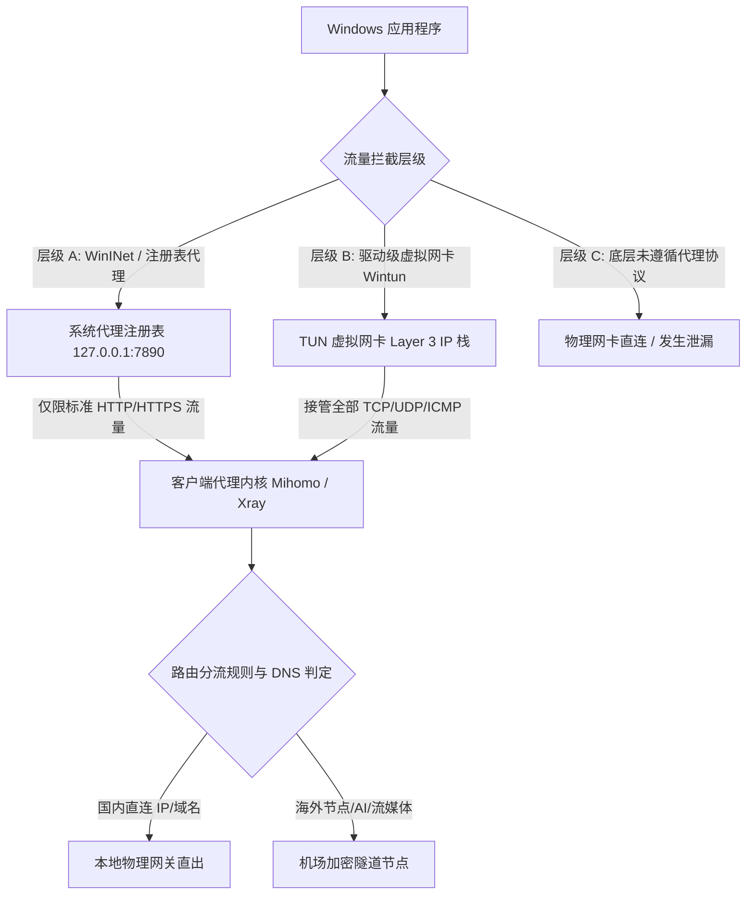

import AffiliateButton from '@site/src/components/AffiliateButton';

# Windows 11/10 平台客户端深度配置指南：Clash Verge Rev、v2rayN 与 TUN 模式系统级调优

在 Windows 10 与 Windows 11 操作系统中，代理工具已经从早期的单协议本地 Socks5 监听，全面进化为支持 **第三层虚拟网卡（TUN 模式）**、**自适应 DNS 智能分流** 与 **多协议异构负载均衡** 的综合网络中枢。然而，Windows 复杂的系统网络栈、WinINet 注册表代理机制、UWP 应用沙箱回环隔离（AppContainer Loopback Restriction）以及多网卡优先级跃点数（Metric），常常导致新手用户面临“开代理国内卡死、关代理电脑断网、终端命令行不走代理”等诸多痛点。

本篇万字级实战百科将从 Windows 内核网络机制出发，横评 2026 年主流客户端，提供保姆级图文配置步骤、系统级 TUN 模式调优、AI/流媒体分流配置代码、排错字典及 10 大核心 FAQ，助您打造无缝、高速、安全的 Windows 梯子环境。

---

## 一、Windows 操作系统代理机制深度解析

要真正掌握 Windows 端代理调优，首先需理解流量从应用程序发出到离开物理网卡所经历的劫持层级。



### 1. 系统代理（System Proxy / WinINet 注册表）
- **机制原理**：客户端通过修改 Windows 注册表键值 `HKCU\Software\Microsoft\Windows\CurrentVersion\Internet Settings` 中的 `ProxyEnable` 和 `ProxyServer`（例如 `127.0.0.1:7890`），通知系统默认代理服务地址。
- **优点**：无需安装底层驱动，普通用户权限即可执行，资源占用极小。
- **致命缺陷**：
  1. 仅对遵循 Windows WinINet API 的软件（如 Edge、Chrome、部分办公套件）生效。
  2. 命令行工具（PowerShell、CMD、WSL2、Git、npm、Docker）默认忽略系统代理。
  3. 大量大型联机游戏（Steam、EA App、Battle.net、FPS 游戏）采用自建 UDP 协议或 Raw Socket，完全绕过系统代理。
  4. UWP 现代化应用（微软商店下载的应用）受沙箱隔离限制，无法直接与本机回环地址（`127.0.0.1`）通信，导致 UWP 应用无法连网。

### 2. TUN 虚拟网卡模式（Wintun / Layer 3 虚拟适配器）
- **机制原理**：通过在 Windows 内核加载高性能虚拟网卡驱动（如 WireGuard 团队研发的开源 **Wintun** 驱动），在系统内虚拟出一个第三层（网络层）网络接口。客户端配置本地路由表，将系统默认路由或者海外目标网段的跃点数调高，使得所有 TCP、UDP 甚至 ICMP（Ping）数据包都被系统路由引擎推入 TUN 虚拟网卡，由代理内核接管后做协议封装。
- **优点**：真正实现“全局接管”。无论是 CMD 命令行、大型 3D 游戏、Node.js 编译构建、WSL2 子系统还是虚拟机流量，统统强制进代理分流引擎。
- **性能开销**：由于存在用户态（User-space）与内核态（Kernel-space）的多次内存拷贝，早期的 TAP 网卡 CPU 占用较高。但自 2023 年起主流客户端全面迁移至 **Wintun**，吞吐量可达数 Gbps，延迟增加不足 1ms。

### 3. Windows UWP 沙箱回环隔离机制
Windows 8 起引入的 Universal Windows Platform (UWP) 架构为保证安全性，默认禁止任何 UWP 容器进程向 `127.0.0.1` 本地回环地址发起网络连接（Loopback Restriction）。这正是“打开代理后，Microsoft Store 或 Xbox 登录报错 0x800704cf”的根本原因。解决该问题必须调用 Windows 底层的 `CheckNetIsolation.exe LoopbackExempt` 命令进行权限豁免。

---

## 二、2026 Windows 主流客户端选型横评大表

面对市面上五花八门的软件，如何精准选型？以下是 2026 年度针对 Windows 11/10 平台的权威实测横评：

| 客户端名称 | 核心驱动与内核 | 协议兼容性 | 内存占用 (平时/满载) | TUN 模式易用度 | 规则分流能力 | 推荐指数与适用人群 |
| :--- | :--- | :--- | :--- | :--- | :--- | :--- |
| **Clash Verge Rev** | **Mihomo (Clash Meta)** + Tauri/Rust | SS, VMess, Trojan, VLESS-Reality, Hysteria2, TUIC v5 | 约 60MB / 120MB | ⭐⭐⭐⭐⭐ (内置驱动一键开关) | ⭐⭐⭐⭐⭐ (脚本、扩展配置、可视化规则) | ⭐⭐⭐⭐⭐ **综合首选**（UI现代、功能全、性能卓越） |
| **v2rayN** | **Xray-core** / **sing-box** | 覆盖全网所有已知代理协议及前沿草案 | 约 90MB / 210MB (含 .NET 运行时) | ⭐⭐⭐⭐ (支持 sing-box/tun2socks 核心) | ⭐⭐⭐⭐ (支持自定义路由与高级 JSON) | ⭐⭐⭐⭐ **极客与协议测试者**（节点管理强大） |
| **FlClash** | **Mihomo** + Flutter 框架 | 主流全协议 | 约 80MB / 140MB | ⭐⭐⭐⭐ (系统级集成) | ⭐⭐⭐⭐ (兼容 Clash 规则) | ⭐⭐⭐⭐ **极简美学爱好者**（跨平台界面统一） |
| **Hiddify** | **sing-box** + Flutter | ShadowTLS, Reality, Hysteria2, WireGuard | 约 70MB / 150MB | ⭐⭐⭐⭐⭐ (全自动托管) | ⭐⭐⭐ (默认集成智能规则) | ⭐⭐⭐⭐ **无脑开箱即用新手** |
| **NekoBox for Windows** | **sing-box** + Qt C++ | 多协议极高自由度 | 约 45MB / 95MB | ⭐⭐⭐ (需手动配置路由接口) | ⭐⭐⭐⭐⭐ (强大的出站与链式代理) | ⭐⭐⭐ **网络工程师 / 运维人员** |

---

## 三、首选客户端保姆级安装与配置实战（以 Clash Verge Rev 为例）

Clash Verge Rev 是当前维护最积极、社区生态最繁荣的开源 Windows 代理软件。

### 步骤 1：确认系统架构与安装包下载
1. **确认架构**：右键点击 Windows「开始」按钮，选择「系统」，查看「系统类型」。
   - **x64**（64 位操作系统，基于 x64 的处理器）：绝大多数 Intel/AMD 台式机与笔记本，下载形如 `Clash.Verge_x.x.x_x64-setup.exe`。
   - **ARM64**：针对高通骁龙 X Elite/Plus 或微软 Surface Pro X 平台，下载形如 `Clash.Verge_x.x.x_arm64-setup.exe`，避免通过 x64 模拟器运行导致性能损耗与 TUN 驱动加载失败。
2. **下载规范**：建议从 GitHub 官方 Release 渠道或受信任镜像下载，安装时勾选「为所有用户安装」以获取正确的系统服务注册权限。

### 步骤 2：安装服务模式（Service Mode）与 Wintun 驱动
为了实现完全无缝的 TUN 虚拟网卡接管，必须安装内核服务：
1. 启动 Clash Verge Rev，进入左侧菜单的「设置 (Settings)」。
2. 找到「服务模式 (Service Mode)」选项，点击右侧的「安装 (Install)」。
3. 系统将弹出 Windows UAC 用户账户控制提权窗口，点击「是」。
4. 安装成功后，服务模式右侧状态图标将变为绿色激活状态，这代表系统已具备底层 Wintun 驱动加载权限。

### 步骤 3：导入机场订阅与自动化配置
好的工具需要高质量的节点支撑。这里以我们长期评测优选的标杆服务商 **[光速云](/docs/brands/guangsu)** 为例：

<AffiliateButton brandId="guangsu" brandName="光速云" coupon="AMM" size="large" />

1. 登录机场后台，在「我的订阅」页面找到「一键导入 Clash 订阅」或复制订阅 URL。
2. 打开 Clash Verge Rev，点击左侧「订阅 (Profiles)」选项卡。
3. 将订阅 URL 粘贴至上方输入框，在备注中填写（如：`光速云-全专线`），点击「导入 (Import)」。
4. 右键点击刚刚导入的配置卡片，选择「编辑信息」，将「更新间隔 (Update Interval)」设置为 `1440` 分钟（24小时）或 `720` 分钟，确保节点与分流规则每日自动更新。
5. 单击选中该配置，左侧状态栏显示对勾，代表配置已正式生效。

### 步骤 4：分流模式与节点优选
1. 点击左侧「代理 (Proxies)」菜单。
2. 顶部模式选择：
   - **规则 (Rule)**：**日常推荐**。国内网站直连，海外受限网站与流媒体自动走代理。
   - **全局 (Global)**：所有连接强行走选定节点（排错或特定国外游戏时使用）。
   - **直连 (Direct)**：所有流量直出，不经任何代理。
3. 在策略组中展开节点列表，点击右上角「闪电图标」进行批量延迟检测，优先选择延迟低且稳定的专线（IEPL/IPLC）节点。

---

## 四、进阶核心系统级调优指南

### 1. TUN 模式深度调优与配置解析
在 Clash Verge Rev 设置中，开启「TUN 模式」即可将系统全局流量导入虚拟网卡。但在高吞吐下载或联机对战时，建议在「订阅配置」或「扩展配置 (Merge / Script)」中进行如下精细化微调：

```yaml
tun:
  enable: true
  stack: mixed # 可选: system, gvisor, mixed (兼顾高吞吐与多连接稳定性)
  dns-hijack:
    - "tcp://any:53"
    - "udp://any:53"
  auto-route: true # 自动配置 Windows 路由表
  auto-redirect: false
  auto-detect-interface: true # 自动识别物理主网卡，防止多网卡网络环路
  mtu: 1500 # 保证以太网/Wi-Fi 分片最优
  strict-route: true # 严格路由，彻底防止 IPv6 或子接口网络旁路泄漏
```

> **参数避坑指南**：
> - `stack: gvisor`：纯用户态实现，兼容性最高但 CPU 占用略大；
> - `stack: system`：利用 Windows 自身网络栈，单核吞吐极高但极少数老旧软件可能异常；
> - `stack: mixed`：TCP 走高效系统栈，UDP 走 gVisor，是目前最均衡的推荐选择。

### 2. DNS 防泄漏与防污染终极架构（Fake-IP）
传统 DNS 解析中，本地先向国内 DNS 查询域名 IP，由于污染机制，会拿到虚假的 IP。Mihomo 内核的 **Fake-IP** 机制通过给国外域名分配内网保留地址段（`198.18.0.0/16`），不仅 100% 免疫本地 DNS 污染，还能将解析过程推迟至海外出口节点完成，减少一次本地 DNS 查询握手延时（通常可降低 80-200ms 首包延迟）。

推荐的 Windows 平台高性能 DNS 模块配置范例：

```yaml
dns:
  enable: true
  listen: 127.0.0.1:1053
  ipv6: false # 国内大部分宽带 IPv6 路由较差，建议强制代理流量走 IPv4
  enhanced-mode: fake-ip
  fake-ip-range: 198.18.0.0/16
  fake-ip-filter:
    - "*.lan"
    - "*.local"
    - "localhost.ptlogin2.qq.com"
    - "+.msftconnecttest.com" # 微软网络连通性检测白名单
    - "+.msftncsi.com"
    - "workgroup"
  default-nameserver:
    - 223.5.5.5
    - 119.29.29.29
  nameserver:
    - https://dns.alidns.com/dns-query
    - https://doh.pub/dns-query
  fallback:
    - https://1.1.1.1/dns-query
    - https://8.8.8.8/dns-query
  fallback-filter:
    geoip: true
    geoip-code: CN
    geosite:
      - gfw
```

### 3. 一键解除 Windows UWP 回环隔离限制
Clash Verge Rev 内置了 Windows UWP 工具。
1. 点击左侧「工具 (Tools)」或「设置」中的「UWP 回环工具 (UWP Loopback)」。
2. 在弹出窗口中点击「Exempt All（全部豁免）」并点击「Save Changes（保存更改）」。
3. 也可以直接以管理员身份在 PowerShell 中执行原生批量豁免命令：
   ```powershell
   Get-AppxPackage | ForEach-Object { CheckNetIsolation.exe LoopbackExempt -a -p="$($_.PackageFamilyName)" }
   ```
执行完毕后，微软应用商店、Xbox 游戏服务、OneNote、Microsoft To Do 将彻底恢复正常代理分流。

---

## 五、针对高负载与 AI/流媒体分流配置代码

为了让 Windows 电脑在运行多任务（一边听国内音乐、一边与 ChatGPT 深度对话、后台挂着 Steam 下载、浏览器看 4K Netflix）时互不干扰，可以在 Clash Verge Rev 的扩展配置中加入以下分流规则：

```yaml
# 扩展配置示例：Clash Merge 规则增强片段
proxy-groups:
  - name: 🤖 人工智能
    type: select
    proxies:
      - 节点选择
      - 🇭🇰 香港专线
      - 🇯🇵 日本专线
      - 🇸🇬 新加坡专线
      - 🇺🇸 美国专线

  - name: 🎬 国际流媒体
    type: select
    proxies:
      - 节点选择
      - 🇸🇬 新加坡专线
      - 🇺🇸 美国专线
      - 🇯🇵 日本专线

  - name: 🎮 游戏平台
    type: select
    proxies:
      - DIRECT
      - 节点选择
      - 🇭🇰 香港专线

rule-providers:
  openai:
    type: http
    behavior: classical
    url: "https://raw.githubusercontent.com/Loyalsoldier/clash-rules/release/openai.txt"
    path: ./ruleset/openai.yaml
    interval: 86400

  claude:
    type: http
    behavior: classical
    url: "https://raw.githubusercontent.com/blackmatrix7/ios_rule_script/master/rule/Clash/Claude/Claude.yaml"
    path: ./ruleset/claude.yaml
    interval: 86400

rules:
  # AI 工具精准走专属低延迟或美国/日本节点
  - RULE-SET,openai,🤖 人工智能
  - RULE-SET,claude,🤖 人工智能
  - DOMAIN-SUFFIX,deepseek.com,DIRECT
  - DOMAIN-SUFFIX,kimi.ai,DIRECT

  # 游戏平台防大流量走代理（建议优先走直连）
  - DOMAIN-SUFFIX,steamcontent.com,DIRECT
  - DOMAIN-SUFFIX,dl.delivery.mp.microsoft.com,DIRECT

  # 国内主流生态直连白名单
  - GEOIP,CN,DIRECT
  - MATCH,节点选择
```

---

## 六、Windows 故障排查字典与常见报错解决指南

在使用 Windows 客户端时，如果遇到异常，请按以下字典对症下药：

### 1. 报错：TUN 模式开启失败，提示 "wintun.dll not found" 或驱动权限不足
- **原因分析**：未以管理员权限安装服务模式，或者杀毒软件（如 360 安全卫士、火绒、Windows Defender）拦截了 Wintun 驱动的注册表写入。
- **排查解决**：
  1. 在杀毒软件提示时选择「允许程序的所有操作」；
  2. 打开 Clash Verge 安装目录，右键以管理员身份运行 `clash-verge.exe`；
  3. 重新进入「设置 -> 服务模式」，卸载后重新点击「安装」；
  4. 检查系统设备管理器中的「网络适配器」，若发现黄色感叹号的 `Wintun Userspace Tunnel`，右键卸载设备并重启电脑。

### 2. 报错：开启代理后，海外网页秒开，但国内微信、百度、淘宝打不开或奇慢
- **原因分析**：DNS 发生严重解析环路或超时，国内 DNS 被错误地配置到了不可达的海外 DoH 服务器；或者开启了“严格路由”导致本地局域网网段被误劫持。
- **排查解决**：
  1. 检查 DNS 配置中的 `nameserver` 是否配置了国内 DNS（如 `https://dns.alidns.com/dns-query`）；
  2. 检查 `tun` 配置下是否有 `bypass` 局域网网段（`192.168.0.0/16`, `10.0.0.0/8`）；
  3. 重置 Windows 本地 DNS 缓存：以管理员身份运行 CMD，输入 `ipconfig /flushdns`。

### 3. 报错：端口监听冲突 `listen tcp 127.0.0.1:7890: bind: address already in use`
- **原因分析**：后台有残留的 Clash 进程、v2rayN 或其他本地服务占用了 7890 端口。
- **排查解决**：
  1. 打开任务管理器，结束所有名为 `clash-verge.exe`、`mihomo.exe`、`xray.exe` 的进程；
  2. 或在 PowerShell 中运行以下命令查找并杀死占用端口的进程：
     ```powershell
     Get-Process -Id (Get-NetTCPConnection -LocalPort 7890).OwningProcess | Stop-Process -Force
     ```
  3. 若端口被系统 Hyper-V 动态端口范围保留，可在 Clash Verge 设置中将混合端口改为 `17890` 或 `20808`。

### 4. 故障：电脑突然完全无法上网（浏览器提示代理服务器拒绝连接 ERR_PROXY_CONNECTION_FAILED）
- **原因分析**：在没有关闭「系统代理」开关的情况下，客户端被强制退出、死机或蓝屏，导致 Windows 注册表中的代理开关依然处于勾选状态，但本地监听核心已死。
- **排查解决**：
  1. 打开 Windows「设置」->「网络和 Internet」->「代理」；
  2. 在「手动设置代理」下方，将「使用代理服务器」开关**手动关闭**；
  3. 重新打开 Clash Verge，正常勾选「系统代理」后再正常退出一次，软件会自动恢复注册表设置。

### 5. 故障：Git / npm / PowerShell 终端不走代理
- **原因分析**：终端命令行进程默认不读取 WinINet 注册表代理。
- **排查解决**：
  - **方案 A（最推荐）**：直接开启客户端的 **TUN 模式**，无需任何命令行设置，全系统所有终端自动透明走代理。
  - **方案 B（临时环境变量）**：在 PowerShell 中执行：
    ```powershell
    $env:HTTP_PROXY="http://127.0.0.1:7890"
    $env:HTTPS_PROXY="http://127.0.0.1:7890"
    ```
  - **方案 C（Git 专项）**：
    ```bash
    git config --global http.proxy http://127.0.0.1:7890
    git config --global https.proxy http://127.0.0.1:7890
    ```

---

## 七、Windows 平台 10 大真实痛点 FAQ

### Q1: Clash Verge Rev 和已经停更的原版 Clash for Windows (CFW) 相比有何区别？
**A**: 原版 CFW 已于 2023 年底完全停止维护，其内置的 Clash 内核无法支持 2024-2026 年主流的 VLESS-Reality、Hysteria2 及 TUIC 等高性能前沿协议，且存在已知的 Electron 安全漏洞。Clash Verge Rev 采用 Rust + Tauri 架构，轻量安全，原生集成 Mihomo 内核，全面支持最新抗封锁协议与规则集，是 CFW 的完美现代化继任者。

### Q2: 为什么开启了代理，玩外服游戏依然提示丢包高、连接超时？
**A**: 大部分竞技网游（如 APEX、战地、COD）采用纯 UDP 协议进行状态同步，普通「系统代理」只管 HTTP/HTTPS，无法转发游戏 UDP 数据包。必须开启客户端的 **TUN 模式**，并在机场服务商处选择支持 **FullCone NAT / UDP 转发** 的低延迟专线节点。

### Q3: 开启 TUN 模式后，电脑 CPU 占用升高或风扇狂转怎么办？
**A**: 这通常是因为 TUN 栈类型设置为了计算密集的纯用户态栈，或者发生了网络环路。建议在配置中将 `tun.stack` 修改为 `mixed` 或 `system`，同时关闭多网卡环境下不必要的虚拟网卡适配器（如 VMware、VirtualBox 的网卡），减少路由重定向开销。

### Q4: v2rayN 和 Clash Verge Rev 到底哪个速度更快？
**A**: 传输速度的核心瓶颈在于**节点线路带宽质量**与**物理延迟**，而非客户端界面本身。在同为 sing-box 或 Xray/Mihomo 现代内核下，二者吞吐能力几乎一致。若追求极致界面与规则自动化推荐 Clash Verge Rev；若需细致调试单节点参数、多路由分流与复杂入站，v2rayN 灵活性更高。

### Q5: Windows 11 的自动代理检测（WPAD）会拖慢上网速度吗？
**A**: 会。Windows 默认开启「自动检测设置 (WPAD)」，在每次建立网络连接时会向局域网广播查询 PAC 脚本，常导致浏览器打开网页时出现 2-3 秒的白屏等待。强烈建议在 Windows「设置」->「网络和 Internet」->「代理」中，将「自动检测设置」彻底**关闭**。

### Q6: 为什么任务管理器里显示有两个 Mihomo / Clash 进程？
**A**: 这是正常架构设计。一个进程是 UI 交互前端（Clash Verge 主程序），另一个是以服务身份在后台以 SYSTEM 权限运行的代理路由内核（Mihomo Core），二者通过本地 IPC/RPC 协议通信，以实现非管理员用户也能驱动 TUN 虚拟网卡。

### Q7: 在公司局域网或校园网使用 TUN 模式，会导致内网打印机和 NAS 无法访问吗？
**A**: 若未正确配置局域网绕行会导致此问题。只要确保配置文件中的 `rules` 前几行包含 `- IP-CIDR,192.168.0.0/16,DIRECT,no-resolve` 及 `- IP-CIDR,10.0.0.0/8,DIRECT,no-resolve`，或在 TUN 模块中配置局域网白名单，局域网共享与内网打印机即可不受任何影响。

### Q8: 电脑休眠唤醒后经常断网，必须重启客户端才能恢复？
**A**: 这是 Windows 快速启动与电源管理对虚拟网卡睡眠挂起处理不当引起的。进入 Windows「设备管理器」->「网络适配器」，找到你的物理网卡（如 Realtek 或 Intel Wi-Fi），右键「属性」->「电源管理」，取消勾选「允许计算机关闭此设备以节约电源」。

### Q9: 浏览器打开网页提示“您的连接不是私密连接 (NET::ERR_CERT_COMMON_NAME_INVALID)”？
**A**: 出现证书报错通常是因为开启了客户端的「MitM / HTTPS 解密」功能而未正确安装根证书，或者是由于机场节点断连返回了 ISP 的重定向拦截页。请检查客户端中是否误开了 HTTPS 过滤功能并将其关闭，或更换健康正常的专线节点。

### Q10: 订阅链接在 Windows 端能够导入，但测速全是“Timeout / 超时”？
**A**: 优先排查：1. 电脑系统时间是否准确（时间偏差超过 90 秒会导致 TLS 握手安全校验直接失败，请在 Windows 设置中点击“立即同步时钟”）；2. Windows Defender 防火墙是否拦截了内核程序；3. 订阅连接是否被本地运营商阻断，可尝试更换热点测试。

---

## 八、蜂巢内链与标杆机场推荐

选择一个底层稳定、延迟极低且全天候具备带宽保障的机场服务商，是 Windows 端发挥其强悍网络吞吐性能的前提条件。

根据我们针对 Windows 平台下 4K/8K 视频流媒体压测、大型 Steam 游戏高速下载以及高并发 AI 接口调用的长期监控：

- **首选标杆推荐：[光速云](/docs/brands/guangsu)**
  - 全节点部署企业级 **IEPL / IPLC 内网专线**，彻底告别晚高峰国际出口拥堵；
  - 完美适配 Windows 各大主流客户端，提供一键专属 Clash 托管订阅与极速更新；
  - 支持多设备并发，低抖动、原生解锁全球 ChatGPT 与 Netflix 4K。
  - **专属限时优惠码**：`AMM`（结账输入享专享折扣）

<AffiliateButton brandId="guangsu" brandName="光速云" coupon="AMM" size="large" />

### 相关进阶技术专题导航
- 想要了解更多协议底层差异？请参考 [2026 主流代理协议全景横评：VLESS vs Trojan vs Hysteria 2 深度解密](/docs/observatory/protocols)
- 查看软路由联动家庭全屋方案？请参考 [OpenWrt 软路由透明网关实战](/docs/clients/router)
- 探索多设备苹果生态无缝漫游？请参考 [macOS 平台客户端权威指南](/docs/clients/macos)
