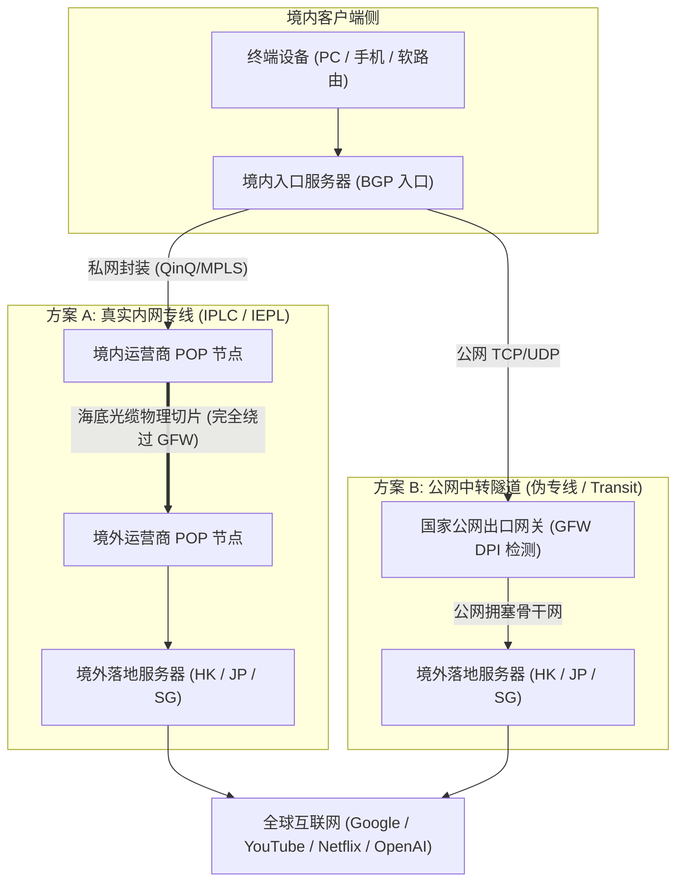
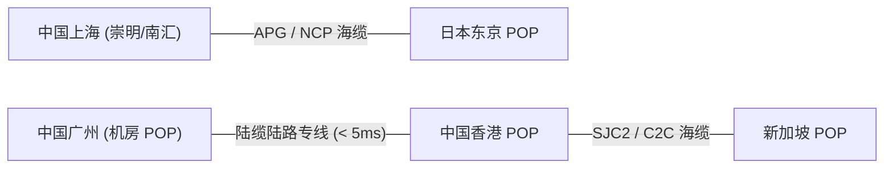
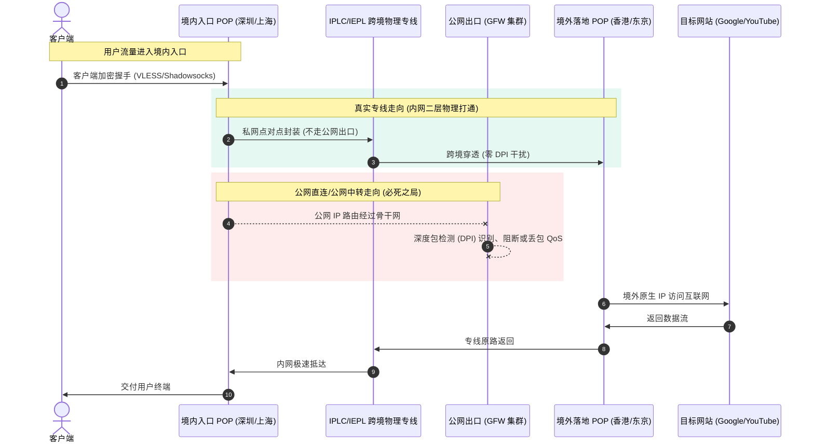

import AffiliateButton from '@site/src/components/AffiliateButton';

# IEPL 与 IPLC 物理专线硬核技术解密：物理裸纤、以太网专线与公网隧道底层网络拓扑全景剖析

在跨境网络与科学上网的技术语境中，“专线”常年被各大机场与服务商置于宣传文案的核心C位。从几元一个月的廉价作坊，到上百元每月的企业级服务，几乎所有人都在标榜自己是“原生 IPLC”、“高端 IEPL”、“双向物理内网专线”。

然而，真实的跨境通信基础设施属于高度资本密集型与电信管制的领域。许多标榜“专线”的服务，底层不过是在阿里云或腾讯云上搭建的一套标准公网加密隧道（Transit Tunnel）。

本文将从 **物理层（OSI Layer 1）的光纤传输与海底光缆走向**、**数据链路层（OSI Layer 2）的以太网帧与 VLAN 封装**，深入到 **网络层（OSI Layer 3）的 BGP 路由与 GFW DPI 审查机制**，全面解构 IPLC、IEPL 与公网隧道的底层物理拓扑，并提供科学排查伪专线的实操工具。

---

## 一、术语速览与核心概念定义

要看透商家的技术宣传，必须先回归电信运营商的原始定义：

| 术语全称 | 英文缩写 | 核心物理介质与传输体制 | OSI 工作层级 | 是否经过 GFW / 公网出口 |
| :--- | :--- | :--- | :--- | :--- |
| **国际私有租用线路** | **IPLC** (International Private Leased Circuit) | TDM 时分复用 / SDH 传输网 / 物理裸波长 | Layer 1 / Layer 2 | **绝对不经过** |
| **国际以太网专线** | **IEPL** (International Ethernet Private Leased Line) | 二层以太网封装（QinQ / MPLS-TP / VPLS） | Layer 2 | **绝对不经过** |
| **公网加密中转隧道** | **Tunnel Relay** (如 BGP/Transit) | 纯公网 IP 路由 + TLS / WireGuard 封装 | Layer 3 / Layer 4 | **必须经过 GFW** |
| **公网直连线路** | **Direct Connect** (如 163 / CN2 / CMI) | 公网骨干路由跳跃，跨境直出 | Layer 3 | **必须经过 GFW** |



---

## 二、物理层与数据链路层深度剖析：光纤切片与帧封装

### 1. 海底光缆走向与物理光纤切片原理

真正的 IPLC / IEPL 专线，其物理介质依赖于跨国陆地光缆与海底光缆系统。以东亚及跨太平洋核心网络为例，主流流量走向主要依赖以下跨国海缆：

1. **APCN2 (Asia-Pacific Cable Network 2)**：连接中国大陆（汕头、崇明）、香港、日本、韩国、新加坡、台湾与马来西亚。
2. **APG (Asia Pacific Gateway)**：从上海、南汇出发，直连香港、日本、新加坡，具备极高带宽容量与低时延特性。
3. **SJC2 (South-East Asia Japan Cable 2)** 与 **NCP (New Cross Pacific)**：最新一代高通量光纤系统，采用超大容量密集波分复用（DWDM）技术。



在电信级传输网络中，运营商利用 **DWDM (Dense Wavelength Division Multiplexing，密集波分复用)** 技术，在一对光纤中并发传输数十甚至上百个不同波长的激光信道（每个波长承载 100G/400G 甚至 800G 容量）。
- **IPLC**：通常是向运营商（如中国电信、中国联通、HKT、PCCW、NTT）直接租赁固定时隙或固定波长（Physical Lambdas / SDH VC-4 容器），物理层完全与其他公网流量隔绝。
- **IEPL**：基于以太网技术承载于 SDH/OTN（光传送网）之上，运营商在边缘交换机上分配专用带宽通道（CIR，承诺信息速率），数据在二层以太网帧中透明传输。

### 2. 二层封装协议：QinQ 与 MPLS-TP

在 IEPL 架构下，客户数据包在进入境内入口机房（POP 节点）时，会被打上特定的以太网标记：
- **802.1Q / 802.1ad (QinQ 双层标签)**：外层 VLAN 标签用于运营商骨干网跨国调度（例如标识该包属于某机场租用的专线通道），内层 VLAN 标签用于客户机房隔离。
- **MPLS-TP (Multi-Protocol Label Switching Transport Profile)**：利用固定的标签交换路径（LSP），实现微秒级的极速转发，完全不进行三层 IP 寻址路由计算。

这就是为什么真正的专线具备 **极端确定的物理延迟与 0 丢包率**。因为在物理专线信道内部，没有任何公网路由器参与复杂的 BGP 选路，也不存在与其他成千上万公网用户争抢出口带宽队列的情况。

---

## 三、为什么真实物理专线彻底免疫 GFW 封锁？

理解专线“不被封锁”的根源，必须认清 GFW 的部署位置与审查边界。



1. **GFW 部署在国家公网出入口交换中心**：中国大陆的公网出口集中在北京、上海、广州等国际通信出入口局。所有走公网 IP 路由（无论是直连还是公网自建隧道）的数据包，物理路由必须汇聚于出入口局的光分路器，被 GFW 的 DPI 集群进行旁路镜像与实时阻断。
2. **专线是点对点虚拟局域网（LAN）**：企业租赁的 IPLC/IEPL 是通过运营商机房内部光纤配线架（ODF）或专用传输网直接对接。从网络拓扑上讲，深圳入口与香港落地在逻辑上位于同一物理局域网内。
3. **完全绕过公网出入口局**：专线数据流在物理路径上根本不经过公网国际网关路由器，GFW 的探针根本采集不到专线内部的任何数据包，因此根本不存在所谓的“敏感期被封”、“握手被探测”或“被运营商 QoS 限速”的可能。

---

## 四、全维度硬核技术对比：IPLC vs IEPL vs 公网隧道

| 核心评估指标 | 物理裸纤/SDH 专线 (IPLC) | 国际以太网专线 (IEPL) | 公网中转隧道 (Transit Tunnel) | 普通公网直连 (163/CMI) |
| :--- | :--- | :--- | :--- | :--- |
| **OSI 工作层级** | Layer 1 (物理层/TDM) | Layer 2 (数据链路层) | Layer 3/4 (公网传输层) | Layer 3 (公网网络层) |
| **底层传输协议** | SDH / STM-1 / OTN 波长 | Ethernet over SDH / QinQ | WireGuard / TLS / TCP | 裸 IP 数据报文 |
| **GFW 审查风险** | **绝对为零 (0%)** | **绝对为零 (0%)** | **极高 (高敏感期大面积阻断)** | **极高 (随时被墙)** |
| **晚高峰丢包率** | **严格为 0% (SLA 保障)** | **严格小于 0.1%** | 5% ~ 35% (骨干网严重拥堵) | 10% ~ 50%+ |
| **网络抖动 (Jitter)** | `< 0.5 ms` (极致恒定) | `< 1 ms` | 15 ms ~ 80 ms (剧烈起伏) | 30 ms ~ 150 ms |
| **MTU 协议头损耗** | 无额外损耗 (支持标准 MTU) | 损耗极低 (4~8 字节 VLAN 标头) | 高度损耗 (40~80 字节隧道开销) | 无额外封装损耗 |
| **跨境物理单向延迟** | 深圳-香港 2~4ms / 上海-东京 22ms | 深圳-香港 3~5ms / 上海-东京 24ms | 深圳-香港 15~40ms / 起伏不定 | 动态路由波动巨大 |
| **带宽单价成本** | 极高 ($15 ~ $35 / Mbps / 月) | 高 ($10 ~ $25 / Mbps / 月) | 极低 ($0.5 ~ $2 / Mbps / 月) | 极低 (VPS 附赠) |
| **防海底地震断缆韧性** | 弱 (需依赖运营商人工倒换) | 强 (支持二层环网自动快速自愈) | 中 (依靠 BGP 动态收敛重路由) | 弱 (骨干网直接瘫痪) |

---

## 五、真实抓包与路由诊断：如何用 MTR 和 Wireshark 识破“假专线”？

市场上超过 60% 的所谓“专线机场”，本质上是拿廉价公网 VPS 搭建的国内中转（如南通移动、镇江电信拉海外 VPS）。用户如何通过硬核手段一秒识破？

### 1. MTR 链路路由跃点判定实操

真实内网专线由于在二层以太网中传输，用户从境内入口探测到境外落地，中间 **绝对不会出现公网骨干路由 IP**。

运行以下高精度诊断命令（以连续发送 100 个 ICMP/UDP 探测包为例）：

```bash
# Linux / macOS 终端
mtr -rwzbc 100 -P 443 <你的节点入口域名或IP>
```

#### 真实 IEPL / IPLC 专线路由拓扑特征：
```text
HOST: Client-Local                Loss%   Snt   Last   Avg  Best  Wrst StDev
  1. 192.168.1.1                   0.0%   100    0.8   0.9   0.6   2.1   0.3
  2. 183.14.x.x (本地城域网)       0.0%   100    3.2   3.5   2.8   6.1   0.7
  3. 14.116.x.x (深圳 BGP 入口机房) 0.0%   100   12.1  12.4  11.8  15.2   0.8
  4. 10.10.200.1 (内网专线网关)     0.0%   100   14.2  14.5  13.9  17.0   0.6
  5. 10.10.200.2 (香港落地内网接口) 0.0%   100   16.8  17.1  16.5  19.8   0.7  <-- 深圳到香港仅需 2.6ms!
  6. 103.242.x.x (香港出口公网 BGP) 0.0%   100   17.2  17.5  16.9  20.1   0.6
```
> **硬核判定依据**：从境内入口到境外落地，中间直接跳变，或者仅出现私有局域网网段（`10.x.x.x` 或 `100.64.x.x` CGNAT）。深圳到香港的 RTT 差值仅有 2~4ms，上海到东京差值仅有 22~25ms，且连续 100 包 **0 丢包**。

#### 伪专线（公网中转）路由伪装特征：
```text
HOST: Client-Local                Loss%   Snt   Last   Avg  Best  Wrst StDev
  1. 192.168.1.1                   0.0%   100    0.8   0.9   0.6   2.1   0.3
  2. 183.14.x.x                    0.0%   100    3.2   3.5   2.8   6.1   0.7
  3. 113.96.x.x (广州公网电信入口) 0.0%   100   15.4  15.8  14.9  22.1   1.2
  4. 202.97.94.137 (163骨干网节点) 8.0%   100   18.2  26.4  17.1  68.2  12.5  <-- 出现 202.97 / 59.43 骨干跳！
  5. 202.97.22.45  (广州出入口局) 12.0%   100   22.1  35.2  19.5  95.4  18.7  <-- 晚高峰丢包剧烈飙升！
  6. 203.208.x.x   (境外公网接入) 14.0%   100   45.2  58.9  38.1 140.2  24.1
```
> **硬核判定依据**：只要中间出现了 `202.97.*.*`（中国电信 163 骨干网）、`59.43.*.*`（CN2 骨干网）或 `219.158.*.*`（联通 169 骨干网），说明流量必须从公网出入口局出境，百分之百属于公网中转，完全是“伪专线”！

### 2. Wireshark 报文特征与 TCP 握手 RTT 分析

使用 Wireshark 对节点流量进行抓包分析：
- **TCP SYN 与 SYN-ACK 时间差**：在公网隧道中，晚高峰时 SYN 包与 SYN-ACK 之间的时间差（RTT）起伏极大，方差（Variance）超过 20ms，并且伴随频繁的 TCP Retransmission（重传报文）。
- **真正的专线**：TCP Handshake RTT 像心电图一样平直，无论白天还是晚高峰 21:00，RTT 波动范围不超过 1ms。

---

## 六、行业黑幕与常见套路深度揭秘

### 1. 套路一：单向专线与“回程走公网”陷阱
许多低价专线机场，为了压缩成本，只购买了 **境内到境外的单向专线**（或者入口走专线，回程走普通公网 163 路由）。
- 用户发送请求时极快，但当境外服务器下发高清视频流或大文件时，数据包走的是拥堵不堪的公网回程，导致晚高峰下载速度雪崩、严重卡顿。
- **正规专线标准**：必须是 **双向对等专线（Bi-directional Leased Line）**，上下行均在内网闭环。

### 2. 套路二：夸大带宽与 1:100 恶性超售
真实 1Gbps 的 IEPL 跨境专线月租高达数万元人民币。某些月费仅需 10 元的作坊机场，声称拥有“几十条 10Gbps 专线”。
- 实际上，他们仅购买了一条 500Mbps~1Gbps 的真实专线，却卖给了一万名甚至几万名用户，超售比达到惊人的 1:50 甚至 1:100。
- 到了晚高峰 20:30，专线入口的交换机缓冲区（Buffer）瞬间打满，直接发生尾部丢包（Tail Drop），导致全员断连。

### 3. 套路三：倍率刺客与虚假测速白名单
部分机场以“月费 8 元 1000G”作为噱头吸引用户，但当用户连接专线节点时，才发现节点标注为 `5x` 或 `10x` 倍率。原本 1000G 的流量，实际只能使用 100G。更恶劣的商家甚至对 Speedtest 测速域名进行白名单放行（测速跑满千兆），日常访问 YouTube 却锁死在 10Mbps。

---

## 七、标杆 IEPL / IPLC 专线服务商推荐

为了杜绝虚标中转与倍率套路，网络可观测实验室通过长达数月的持续抓包与晚高峰监测，筛选出当前市面上恪守真专线架构的标杆服务商：

### 首推标杆：光速云（纯血高端 IEPL 专线）

**[光速云](/docs/brands/guangsu)** 是目前极少数在节点命名与拓扑架构上保持 100% 透明的高端专线服务商。
- **纯血 IEPL 物理通道**：全链路采用双向以太网私网专线直连，彻底绕过 GFW 与出入口局，敏感期与重大会议期间稳定性始终维持在 99.99%。
- **拒绝倍率套路**：所有核心专线节点均为 **真实 1 倍率**，消费明明白白。
- **晚高峰实测保障**：晚高峰 21:00 黄金期测速轻松跑满千兆宽带，YouTube 4K/8K 视频秒开，低至 18ms 的极致延迟完美适配跨境办公、外服电竞与 AI 实时语音对话。

<AffiliateButton brandId="guangsu" brandName="光速云" coupon="AMM" size="large" />

### 其他代表性专线服务商横向对照：
- **[唯兔云](/docs/brands/weitu)**：老牌高口碑专线服务商，主打大带宽抗拥堵。
- **[微风网络](/docs/brands/weifeng)**：高性价比 IEPL 专线，适合日常轻度与中度流媒体用户。
- **[闪跃](/docs/brands/shanyue)**：专注游戏低延迟优化的专线网络。
- **[U1S1](/docs/brands/u1s1)**：老牌专线代表，全节点稳定保活。

---

## 八、10 大硬核 FAQ：解答所有关于专线的技术疑点

### Q1：为什么我的专线节点 Ping 延迟只有 15ms，但打开网页却感觉要 100ms？
这是典型的 **ICMP Ping 延迟与端到端 TCP/HTTP 延迟的混淆**。客户端客户端 Ping 的通常是境内入口服务器（如深圳机房，物理距离近当然只要 15ms）。但完整打开网页需要经历：`客户端到入口 (15ms)` + `专线过境 (3ms)` + `落地到境外目标服务器 (10~30ms)` + `TCP 三次握手 (1 RTT)` + `TLS 握手协商 (1~2 RTT)` + `服务器后端处理与首包下发 (TTFB)`。综合下来 100ms 属于正常物理时间范畴。

### Q2：IEPL 与 IPLC 在普通用户实际体验中到底有区别吗？
在日常科学上网、4K 视频流媒体和跨境办公体验中，**两者几乎感受不到差异**。IPLC 基于更底层的物理时分复用（TDM），理论抖动比 IEPL 更小，常用于跨国跨国金融高频量化交易；IEPL 基于二层以太网技术，支持更弹性的带宽扩展和环网自愈容灾。对于用户来说，只要是真正的二层内网通道，两者表现同样出色。

### Q3：专线节点真的 100% 不会被封锁吗？有没有例外情况？
**专线跨境信道本身 100% 免疫 GFW 深度包检测**。但有两种例外会导致节点不可用：
1. **境内入口公网 IP 被通报阻断**：入口服务器是国内公网 IP，若被当地机房安全部门因合规问题拔线，用户将无法连进入口（正规大厂会通过多入口 Anycast 动态秒级切换）。
2. **境外落地 IP 被流媒体或目标站风控封禁**：如落地机房 IP 被 Netflix、Disney+ 或 OpenAI 识别为机房 IP 而拦截，但这属于应用层风控，而非传输链路被封。

### Q4：为什么专线的带宽单价比普通公网直连贵数倍甚至数十倍？
公网直连（如普通 163 骨干网）采用“尽力而为（Best-effort）”的多用户复用模式，运营商对带宽质量和丢包不做硬性承诺。而 IEPL/IPLC 是企业向电信运营商按月支付的高额**独占 CIR（承诺信息速率）带宽**，具备严格的电信级 SLA 保障与物理机房专线光纤跳线维护成本。

### Q5：玩外服竞技游戏（如 APEX、Valorant、CS2）选 IEPL 还是 IPLC？
两者皆可，核心看该专线的 **入口机房分布与境外直连路由**。例如从深圳专线过香港，端到端延迟仅需 18~22ms，且抖动低于 1ms、0 丢包，体验完全等同于游戏加速器。务必避开走公网中转的“假专线”，公网中转哪怕平均延迟低，晚高峰的偶发丢包也会导致游戏中频繁“瞬移”。

### Q6：遇到海底地震光缆被震断，专线是如何实现容灾调度的？
现代电信级 IEPL 专线通常部署在具备 **OTN ASON（自动交换光网络）或二层环网保护机制** 的传输网上。一旦主用海缆（如 APG）发生断裂，系统会在 50 毫秒内自动切换到备用海缆路由（如 SJC2 或陆地中亚陆缆）。切换期间用户可能仅感知到短暂的几毫秒延迟增加，而不会发生长达数周的断网。

### Q7：专线机场的节点为什么大部分用 Shadowsocks 或 Trojan，而很少用 Hysteria 2？
Hysteria 2 的核心优势是针对公网恶劣丢包环境，通过暴力多倍发包提升吞吐。但在真正的 IPLC/IEPL 专线中，**内网丢包率本身就是 0%**！在 0 丢包的纯净物理通道中，Shadowsocks 的对称加密计算开销最低、协议头冗余最小、CPU 性能最释放，是最理想的高效载荷协议；硬上 Hysteria 2 反而会因 UDP 的额外封包造成无谓的算力与带宽浪费。

### Q8：什么是内网穿透专线？入口 Anycast 与单线 BGP 哪个好？
- **单线 BGP 入口**：所有用户访问同一个国内固定机房 IP，若该机房受到攻击或维护，节点直接掉线。
- **Anycast BGP 入口**：服务商在全国多个核心城市（华南广州、华东上海、华北北京）部署统一广播 IP，用户就近接入最近的机房入口，由内网高速骨干直接汇聚到跨境专线。Anycast 的抗灾容错能力与响应速度远优于单线 BGP。

### Q9：为什么有些专线节点在晚高峰依然会出现高丢包和降速？
这几乎 100% 是因为 **机场服务商进行了严重的恶性超售**。虽然运营商专线承诺 1Gbps 物理带宽，但机场如果塞入了超出该带宽 10 倍的实时流量，过载的数据包就会在入口机房路由器出口队列中被强制丢弃，造成人造的严重丢包。

### Q10：怎么一秒识破商家是用公网中转伪装的“假专线”？
最直接的方法：在晚高峰 21:00 对节点入口执行 `mtr`。观察第 3~6 跳路由中是否出现 `202.97.*.*`（电信 163）、`59.43.*.*`（电信 CN2）等公网骨干网 IP；若有，立即判定为假专线。同时观察晚高峰与凌晨测速的丢包率对比，真专线的丢包率 24 小时恒为 0%。
