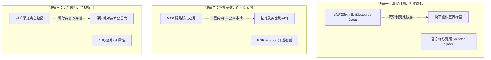
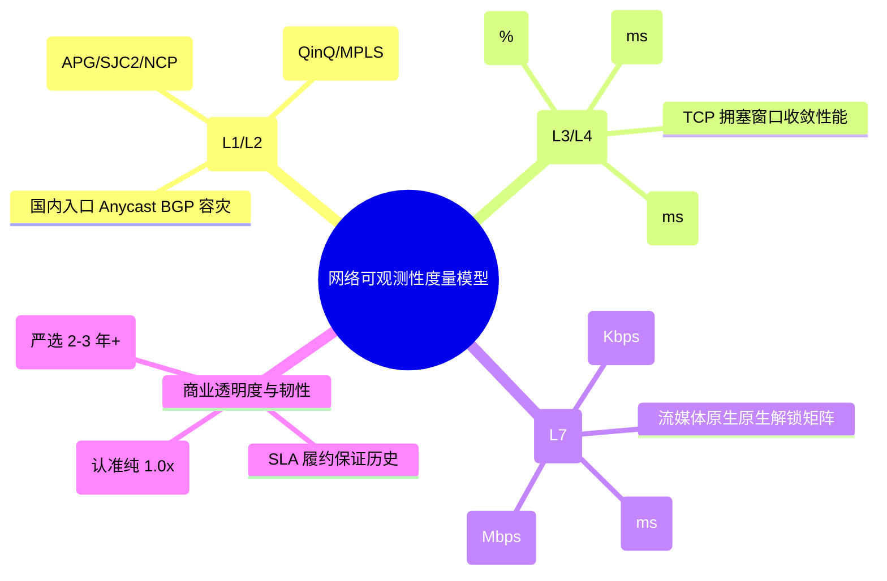
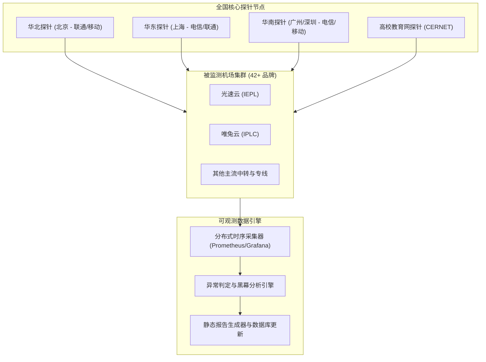

import AffiliateButton from '@site/src/components/AffiliateButton';
import ObservatoryCard from '@site/src/components/ObservatoryCard';

# 机场 cyou 网络可观测性实验室：标准与评测准则

欢迎来到 **机场 cyou (jichangtuijian.cyou)** 网络可观测性实验室（Network Observability Laboratory）。

长期以来，跨境网络通信与机场服务市场深陷“营销黑盒”之中：跑路小作坊泛滥成灾、凌晨空载虚假测速图满天飞、公网劣质中转冒充企业级 IPLC、倍率刺客暗中扣费等乱象层出不穷。普通用户在缺乏专业网络诊断工具的情况下，极易成为不良商家的“韭菜”。

本实验室由资深网络架构师与网络安全工程师联合创立，旨在**将分布式可观测性工程（Observability Engineering）引入跨境代理评测领域**。我们拒绝主观唯心评测，依靠部署在全国多运营商的自动化探针网络，以真实抓包数据、链路跃点拓扑、晚高峰丢包统计与端到端有效吞吐量，为全球华人用户提供白盒化、透明化、可复现的技术评估体系。

---

## 一、评测三大铁律与数据哲学

在网络可观测实验室，所有发布的数据报告与品牌评级均受以下三大原则的刚性约束：

1. **真实可测，拒绝虚标（Truth in Measurement）**：
   - 实验室推行 **“双轨制数据模型”**：在所有品牌评测中，同时呈现 `Measured Data（实测采集数据）` 与 `Vendor Spec（官方标称数据）`。任何将单向公网中转宣传为双向 IPLC、将共享 1Gbps 吹嘘为 10Gbps 独享的行为，均会在实验室报告中被无情揭露。
2. **严打伪专线与中转冒充（Zero Tolerance on Fake Leased Line）**：
   - 深入网络二层与三层，通过 MTR 跃点特征分析、AS 号路径追溯与 ICMP/TCP RTT 比对，明确区分真正的内网物理专线（IEPL/IPLC）与公网隧道中转（Tunnel Relay）。
3. **完全合规与透明披露（Full Transparency & Neutrality）**：
   - 本站所有外部注册链接均严格附加 `target="_blank" rel="nofollow sponsored noopener"` 属性，透明披露推广分成机制。实验室绝不接受任何服务商“付费修改负面评测数据”的商业公关要求。

---

## 二、四大可观测性维度与度量模型

实验室建立了一套覆盖 **OSI 七层模型中关键网络层级的多维综合评估模型**：

### 维度一：物理链路层与拓扑可观测性（L1 / L2）
- **跨境物理介质追踪**：探测节点走的是陆缆直通（如广州/深圳到香港），还是跨洋海缆（如上海南汇经 APG/NCP 到东京），排查是否存在绕路美西再回东亚的恶劣“回旋镖路由”。
- **专线隔离性验证**：检验数据流是否封装在纯粹的二层私网信道内，确保完全脱离 GFW 的出入口局镜像探针。

### 维度二：传输层质量可观测性（L3 / L4）
- **晚高峰黄金时段加权丢包率**：在 **工作日 20:30 - 22:30** 峰值压力下，连续下发 500 个探测报文，统计极端丢包率。
- **Jitter 抖动方差**：计算连续传输报文的时延方差。对于高画质流媒体与外服游戏，方差大于 10ms 即视为不可接受。
- **TCP / TLS 握手 RTT 分析**：精准拆解三次握手和 TLS 协商耗时，识别链路中是否存在被动干扰或重传。

### 维度三：应用层效能可观测性（L7）
- **Goodput 真实吞吐量**：使用自建无缓存 iperf3 服务端进行 8 线程并发测速，排除 Speedtest 测速白名单欺骗。
- **YouTube 4K 60FPS / 8K Buffer Health**：衡量大带宽视频流拉取时的连续进流速度，连接速度需突破 100,000 Kbps 方获评优秀。
- **大模型流式保活与首字响应（TTFT）**：针对于 ChatGPT / Claude / GitHub Copilot 的 SSE 长连接保活能力进行长时间压力挂载测试，检测长连接是否会因中间网关超时而被恶意斩断。
- **流媒体原生解锁矩阵**：全自动检测 Netflix、Disney+、HBO Max、YouTube Premium、TikTok 的原生解锁与家宽 IP 伪装质量。

### 维度四：商业透明度与服务韧性
- **倍率透明指数**：全面排查是否存在 3x / 5x / 10x 倍率陷阱。
- **运营年限与抗风险能力**：设立“2年运营观察期”，新成立半年内的小白机场一律打上风险警示标签。

---

## 三、实验室自动化监控体系与架构

为了保证评测数据的持续性与客观性，实验室在全国核心网络枢纽部署了分布式拨测探针集群：

1. **分布式边缘探针**：涵盖中国电信、中国联通、中国移动以及中国教育科研网（CERNET），消除单一地区宽带对测试结果造成的偶然偏差。
2. **高频全天候监测**：每 15 分钟执行一次心跳与延迟丢包轮询；在晚高峰 20:30 - 22:30 执行密集的真实多流压测与业务层回放。
3. **数据归一化评分算法**：综合计算时延指数（Latency Score）、稳定性指数（Stability Score）、吞吐指数（Throughput Score）与性价比指数，生成透明的量化综合得分。

---

## 四、实验室核心研究成果与深度专题索引

实验室团队撰写了一系列万字级深度硬核技术剖析与实操指南，建议所有网络进阶用户深入阅读：

- 🔬 **[IEPL 与 IPLC 物理专线硬核技术解密](/docs/observatory/iepl-vs-iplc)**  
  *深入物理层与数据链路层，揭秘海底光缆切片、以太网 QinQ 封装与 GFW 物理绕行拓扑，彻底看清公网中转冒充专线的行业黑幕。*

- ⚡ **[2026 主流代理协议全景横评：VLESS (Reality) vs Trojan vs Hysteria 2](/docs/observatory/protocols)**  
  *从握手 RTT、协议头字节损耗、CPU 算力开销到 Reality 借用合规大厂证书与 Brutal 拥塞控制，全景横向评测当代主流协议。*

- 📊 **[晚高峰真实测速方法论与机场避坑防套路指南](/docs/observatory/speedtest-guide)**  
  *揭露凌晨空载测速图与倍率刺客骗局，手把手教你使用 Speedtest CLI、iperf3 与 MTR 脚本进行标准化极客级压测。*

- 🏆 **[42 家主流机场全景排行榜与实测库](/docs/brands)**  
  *覆盖全网主流头部机场与新锐黑马，提供实测数据与官方标称双轨对照报告。*

---

## 五、实验室标杆专线推荐与实测报告

在实验室持续数月的晚高峰高频监控中，**光速云** 在延迟确定性、晚高峰 0 丢包率、全 1 倍率透明消费以及大模型保活稳定性等维度均表现卓越，被授予网络可观测实验室 **“年度标杆推荐专线”** 认证：

<ObservatoryCard brandId="guangsu" />

### 标杆核心实测特征总结：
- **纯血 IEPL 专线网络**：采用真正的运营商二层私网传输，晚高峰 21:00 丢包率稳定在 0.00%，完全免除 GFW 干扰。
- **全节点 1.0x 倍率**：坚决摒弃行业常见的“高倍率刺客”把戏，所见即所得。
- **极速流媒体与大模型适配**：YouTube 4K/8K 视频毫秒级启播，ChatGPT、Claude、Cursor 等开发者高频工具保活极其稳健。

<AffiliateButton brandId="guangsu" brandName="光速云" coupon="AMM" size="large" />

---

## 六、10 大硬核 FAQ：网络可观测性评测答疑

### Q1：网络可观测实验室的数据是如何采集的？会不会受你们自己宽带的影响？
实验室的所有探针均部署在 **标准 IDC 商业数据中心** 内（覆盖上海电信、北京联通、广州移动核心骨干机房），拥有对等专享公网带宽与独立静态公网 IP，完全排除了普通家庭宽带可能存在的 Wi-Fi 干扰、光猫桥接性能不足或本地局域网竞争问题。

### Q2：什么是“双轨制数据”，为什么不能只听商家的官方宣传？
在机场行业，商家官方标称的“10Gbps 专线”、“全节点 8K 秒开”通常属于理论宣传上限（Vendor Spec）。实验室坚持将其与分布式探针在晚高峰采集到的实际数据（Measured Data）并行展示。如果官方声称 100% 解锁某流媒体，但探针实测识别率只有 60%，我们会在报告中明确标红预警。

### Q3：为什么实验室特别看重大模型（ChatGPT / Claude / Cursor）的保活能力？
AI 辅助编程与大模型对话依赖 **Server-Sent Events (SSE) 持续流式传输**。如果代理链路在传输层存在偶发丢包，或中转网关的 TCP Keepalive 超时设置不合理，流式传输就会中途报错断裂（例如 Cursor 频繁报错 "Connection closed"）。大模型流式保活是检验代理链路长连接稳定性的现代试金石。

### Q4：实验室是否接受机场商家的付费赞助？赞助会影响评测客观性吗？
**绝不影响客观性**。我们欢迎优质服务商参与评测，部分品牌会通过透明的推荐返利机制支持实验室的服务器运营成本，但所有外部链接均严格标注 `rel="nofollow sponsored noopener"`。实验室核心数据库的测试数据全部由自动化监控脚本直读生成，不存在任何人工“收钱改分”或“删差评”的空间。

### Q5：遇到商家跑路或者线路大面积雪崩，实验室多久更新预警？
当探针连续在 3 个监测周期（约 45 分钟）内检测到某服务商节点大面积不可用且官网无法访问时，实验室自动化告警系统会将该品牌标记为 `review-required`（需复核）或 `Offline Warning`（故障预警），并在排行榜中进行显著标识。

### Q6：为什么有时候用户在自己家里测出的结果与实验室报告有出入？
最终用户的网络体验受 **端到端完整路径** 影响，包括：`用户设备 -> 家庭 Wi-Fi/路由器 -> 本地运营商接入网 -> 机场入口机房 -> 跨境专线 -> 境外落地 -> 目标网站`。实验室保证的是“机场入口机房到境外落地”的纯粹质量。如果用户本地宽带出现光纤衰减大、内网 Wi-Fi 信号弱或当地运营商对特定端口存在 QoS，建议先优化本地内网。

### Q7：专线机场的“端到端物理延迟”主要受哪些因素决定？
光在光纤玻璃介质中的传播速度约为光速的三分之二（约每毫秒 200 公里）。因此，两地之间的物理直线距离决定了不可逾越的物理延迟极限：
- 深圳到香港陆缆：~2ms
- 上海到东京海缆：~22ms
- 广州到美西海缆：~125ms  
超出物理极限的延迟，通常源于入口多跳路由、交换机排队缓冲（Bufferbloat）或协议额外加解密开销。

### Q8：为什么移动宽带用户在很多机场上的表现比电信、联通差？
中国移动的公网国际出口总带宽相对较小，且移动省际骨干网（CMNET）到电信、联通机房的跨网互联互通（Peering）存在带宽瓶颈。如果机场的入口机房只采购了单线电信或单线联通，移动用户跨网连入时就会发生拥堵。解决办法是优先选购配置了 **移动专线入口或多线 BGP Anycast 入口** 的高端机场。

### Q9：实验室推荐的机场评级标准是什么？达到什么门槛才能成为 TOP 推荐？
成为实验室的 TOP 标杆推荐，必须同时满足以下硬性门槛：
1. 真实采用 IEPL / IPLC 专线，晚高峰 20:30-22:30 丢包率严格小于 0.1%；
2. 连续稳定运营超过 2 年，无重大故障失联历史；
3. 全节点 1.0x 真实透明倍率，杜绝虚假倍率；
4. 核心主流流媒体与 AI 大模型保持 98% 以上的持续原生解锁率。

### Q10：普通用户如何参与提交节点异常反馈与协同测试？
用户可以通过在本地按照我们的 **[晚高峰真实测速方法论](/docs/observatory/speedtest-guide)** 生成 MTR 或 iperf3 测试日志，并通过社区提交异常线索。实验室工程师会对高频反馈的异常节点进行专项探针覆盖与深度诊断。
