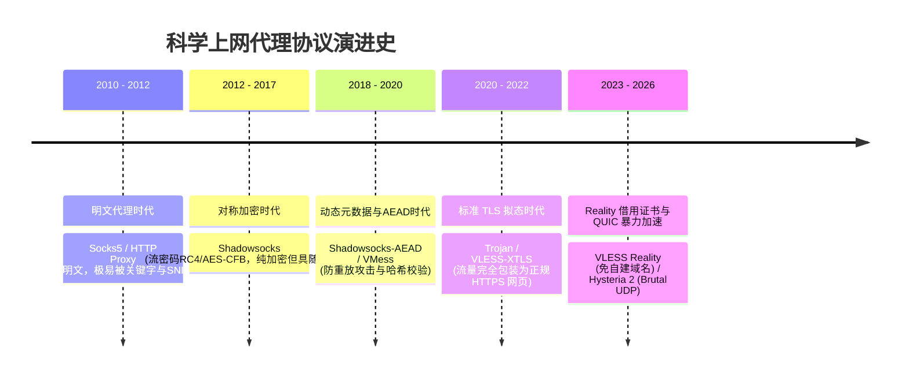
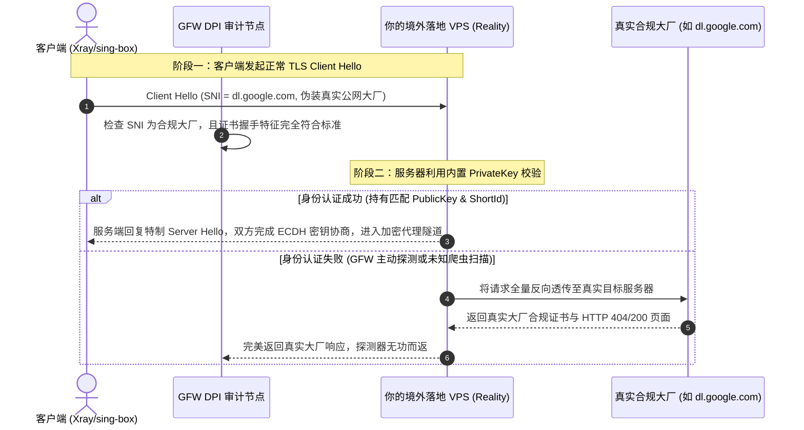
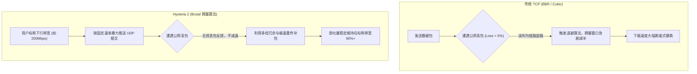

import AffiliateButton from '@site/src/components/AffiliateButton';

# 2026 主流代理协议全景横评：VLESS (Reality) vs Trojan vs Hysteria 2 深度解密

随着国家级防火墙（GFW）与运营商深度包检测（DPI）技术的全方位升级，早期的 Socks5、Shadowsocks 原版协议以及带有固定特征的 VMess 协议已无法单独在公网裸奔抗封锁。网络对抗已从最初的“加密隐写”，演进到“拟态伪装（Mimicry）”与“暴力穿透（Brute-force Penetration）”的全新对抗纪元。

在 2026 年的科学上网与跨境通信实践中，**VLESS with Reality**、**Trojan**、**Hysteria 2 (Hy2)** 以及在物理专线中历久弥新的 **Shadowsocks (2022-AEAD)**，构成了四大核心支柱。

本文将从传输层报文结构、加密握手开销、TCP/UDP 拥塞控制、防主动探测机制等硬核技术维度，提供一份彻底穿透技术黑盒的深度横向评测与选型指南。

---

## 一、代理协议演进简史与当代对抗模型

代理协议的二十年演进，是一部典型的“猫鼠博弈”工程史：



1. **第一代（随机化加密流量）**：Shadowsocks 最初试图通过全包 AES 加密将流量伪装成无序的随机字节。但 GFW 引入基于熵值分析（Entropy Analysis）的机器学习模型，判定“高熵值无序二进制流”即为代理流量，并结合“主动探测（Active Probing）”发送伪造报文识别出服务端。
2. **第二代（HTTPS 拟态伪装）**：Trojan 与 VLESS 放弃了自定义加密特征，转而直接站在巨人的肩膀上——使用正规的 TLS 协议和自签名/真实 CA 证书，让流量在 DPI 眼中与普通网民访问外贸电商、技术博客的 HTTPS 流量毫无二致。
3. **第三代（现实借用与暴力弱网对抗）**：
   - **VLESS Reality**：进一步解决了“自建域名容易被关联、自购证书容易被吊销”的痛点，直接通过 SNI 借用境外合规大厂的公网证书。
   - **Hysteria 2**：针对公网恶劣丢包与高延迟，采用修改版 QUIC (UDP) 协议，打破传统 TCP 的慢启动与退避机制，实现恶劣弱网下的极限吞吐。

---

## 二、四大主力协议底层技术原理解密

### 1. VLESS with Reality：免域名证书借用与防主动探测黑科技

VLESS 是一个无状态的轻量级传输协议。传统的 VLESS + TLS 需要用户自备域名并申请 Let's Encrypt 证书。而 **Reality 技术** 彻底革新了这一链路：



#### Reality 核心机制解密：
- **SNI 伪装**：客户端在 TLS Client Hello 中填入境外高权重合规网站（如 `dl.google.com`、`gateway.icloud.com`）。
- **非对称密钥认证（ECDH）**：服务端在配置文件中预设一对公私钥（`PrivateKey` 与 `PublicKey`）。客户端利用服务端的 `PublicKey`，在 TLS Client Hello 握手的特定扩展字段（如 Key Share）中植入加密认证载荷。
- **完美的 Fallback（防主动探测回落）**：如果 GFW 的探测探针发起 TCP 连接尝试探测该端口，由于探针没有预共享的正确密钥，Reality 服务端会 **直接把该 TCP 连接原封不动地透明代理给真实的大厂网站**！探测器最终收到的是 Google/Apple 真实的合法证书与真实网页。审查系统根本无法将该端口与代理服务端画上等号。

### 2. Trojan：经典工业级 HTTPS 伪装

Trojan 的核心哲学是：“不做多余的自定义加密，让流量成为 100% 的真实 HTTPS”。

```text
+-----------------------+---------+----------------+---------+----------+
| SHA224(Password) + CRLF| Command | Address Type   | Address | Port     | ... 载荷数据 ...
| 56 字节十六进制字符    | 1 字节  | 1 字节 (IPv4/6)| 动态    | 2 字节   | (通过 TLS 1.3 加密)
+-----------------------+---------+----------------+---------+----------+
```

- **验证流程**：Trojan 客户端与服务端首先完成标准 TLS 1.3 握手建立加密隧道。握手完成后，客户端发送首包数据，首部固定为用户密码的 SHA224 哈希值（56 字节 hex）。
- **Web 服务无缝回落**：服务端校验密码哈希。若正确，进入代理管道；若密码错误或收到非 Trojan 格式的 HTTP GET 请求，Trojan 服务端会自动回落到后端的本地 Nginx / Caddy 静态网站，向探测者展示一个真实的个人博客或英文静态站。
- **JA3 / JA4 指纹模拟**：现代客户端（如 Clash Meta/Mihomo、sing-box）集成了 **uTLS 库**，可将 TLS 握手的 Client Hello 报文指纹（Cipher Suites、Extensions 顺序）精确伪装成 Chrome、Firefox 或 iOS Safari，防范 GFW 的指纹聚合分类算法。

### 3. Hysteria 2 (Hy2)：基于 QUIC/UDP 的暴力弱网收割机

在公网骨干网拥塞时，传统基于 TCP 的协议（Trojan、VLESS）会遭遇严重的拥塞恶化：
> **传统 TCP 的致命弱点**：采用 AIMD（加法增大乘法减小）拥塞控制。一旦网络链路因拥塞出现 5% 的偶发丢包，TCP 发送端会误以为带宽耗尽，将拥塞窗口（CWND）瞬间砍半并进入慢启动，导致下载速度直线跌落。



#### Hysteria 2 核心革命性特性：
1. **Brutal 拥塞控制引擎**：完全舍弃传统的丢包拥塞判断。服务端以客户端配置的带宽上限为基准，以恒定速率全力发包。即使链路丢包率高达 20%~30%，依然能强行把带宽灌满。
2. **端口跳跃（Port Hopping）**：运营商常对长连接且流量巨大的单 UDP 端口进行阻断或限速（UDP QoS）。Hysteria 2 支持配置连续端口段（如 `20000:50000`），在连接建立后或固定周期内动态切换传输端口，有效绕开单端口限速策略。
3. **0-RTT 极速连接**：依托 QUIC 的 Session Ticket 缓存，重连可在 0 个 RTT 内发送数据，打开网页首屏体验极大提升。

### 4. Shadowsocks (2022-AEAD)：专线生态的轻量王者

很多人以为 Shadowsocks 已经被淘汰，但在 **物理专线（IEPL/IPLC）** 领域，它依然是无可替代的性能王者。
- **2022 规范改进**：引入基于 BLAKE3 的单向密钥派生函数，防范重放攻击与主动探测，报文首部引入时间戳校验（误差允许范围通常为 ±30 秒）。
- **极简算力与协议损耗**：由于在专线内网无需耗费巨大的计算资源去模拟 TLS 证书与握手协商，Shadowsocks 2022 采用极轻量的对称加密（AES-128-GCM / ChaCha20-Poly1305），协议开销仅数字节，在软路由或手机端运行时发热极低、CPU 占用率低于 5%，是高速专线吞吐的首选。

---

## 三、全方位多维度对比大表

| 评测维度 | VLESS (Reality) | Trojan-GFW / Trojan-Go | Hysteria 2 (Hy2) | Shadowsocks (2022) |
| :--- | :--- | :--- | :--- | :--- |
| **底层传输协议** | TCP / gRPC / WebSocket | TCP | UDP (基于修改版 QUIC) | TCP / UDP |
| **握手建立延迟 (RTT)** | 1-RTT (TLS 1.3) | 1-RTT (TLS 1.3) | **0-RTT (会话复用) / 1-RTT** | **0-RTT (即发即通)** |
| **协议头额外开销** | 较小 (~40 字节 TCP+TLS) | 较小 (~56 字节校验+TLS) | 较大 (~80 字节 UDP+QUIC头) | **极低 (~16 字节)** |
| **CPU 算力与耗电负担** | 中等 (涉及 X25519/ChaCha) | 中等 (标配 TLS 加解密) | 较高 (高发包率+用户态协议栈) | **极低 (硬件 AES 指令集秒解)** |
| **抗 GFW 主动探测** | **极高 (借用大厂证书+回落)** | 高 (需配合有效域名与证书) | 极高 (支持自定义混淆掩码) | 弱 (仅限公网，专线内无需考虑) |
| **抗运营商 UDP QoS** | 免疫 (使用标准 TCP 443) | 免疫 (使用标准 TCP 443) | 依赖端口跳跃 (Port Hopping) | TCP 免疫 / UDP 受限 |
| **弱网 (丢包20%) 吞吐** | 下降 60% ~ 80% (TCP 拥塞) | 下降 60% ~ 80% (TCP 拥塞) | **仅下降 10% ~ 20% (极强)** | 下降 70% (公网) / 专线无丢包 |
| **是否需要自建域名** | **完全不需要 (偷别人域名)** | **必须自建并申请证书** | 可用自签证书 (内置验证) | 完全不需要 |
| **多路复用 (Mux) 支持**| 支持 (如 smux / h2mux) | 支持 | 内置原生 QUIC Streams | 支持 |
| **核心推荐应用场景** | 公网自建 VPS 稳健首选 | 老牌机场通用、全平台兼容 | 移动 5G/校园网/公网劣质直连 | **高端 IEPL/IPLC 物理专线标配** |

---

## 四、真实抓包分析：Wireshark 下的协议报文特征剖析

### 1. VLESS Reality 报文抓包剖析

在 Wireshark 中过滤 `ssl.handshake.type == 1`（Client Hello）：
```text
Frame 42: 517 bytes on wire (4136 bits)
Internet Protocol Version 4, Src: 192.168.1.100, Dst: 104.16.x.x
Transmission Control Protocol, Src Port: 54321, Dst Port: 443
Transport Layer Security
    TLSv1.2 Record Layer: Handshake Protocol: Client Hello
        Handshake Protocol: Client Hello
            Version: TLS 1.2 (0x0303)
            Random: 7b8f9e... (32 bytes)
            Session ID: 3a2c1b... (32 bytes)
            Cipher Suites (16 suites):
                TLS_AES_128_GCM_SHA256 (0x1301)
                TLS_CHACHA20_POLY1305_SHA256 (0x1303)
                ...
            Extension: server_name (len=18)
                Server Name: dl.google.com  <-- [关键伪装] 真实大厂域名
            Extension: supported_versions (len=9)
                Supported Version: TLS 1.3 (0x0304)
            Extension: key_share (len=107)  <-- [关键认证] 隐写了 Reality 认证密文
```
> **技术关键点**：GFW 审查探针抓包看到的完全是发往 `dl.google.com` 的合法 TLS 1.3 协商握手包，包括完整的加密套件、SNI 扩展与 ALPN（`h2`, `http/1.1`）。即使用机器学习模型比对 Chrome 浏览器的指纹（JA3/JA4），由于 uTLS 的完美拟态，完全无法将其与正常访问区隔开。

### 2. Hysteria 2 UDP 混淆抓包

由于 Hysteria 2 采用 UDP 传输，常规抓包会显示为带有特定长度分布的 UDP 报文：
- 若启用了 `obfs`（混淆）机制，Hysteria 2 会在 QUIC 首部前附加一个伪随机填充头，使得 DPI 即使解析 QUIC 报文头也会因为魔数（Magic Number）不匹配而识别为“未知自定义 UDP 流量”。
- 配合端口跳跃（Port Hopping），在 Wireshark 中会看到数据流在短短几分钟内，从端口 31254 连续平滑切换到 42189，令按端口进行流控的路由器彻底失效。

---

## 五、行业常见选型误区与技术陷阱

1. **误区一：“Hysteria 2 速度最快，所以它是全能神协议”**
   - Hysteria 2 本质是牺牲了公网的“拥塞友好性（TCP-friendliness）”来实现个人速度最大化。
   - 在很多省份的中国电信或中国联通家宽中，当地运营商部署了激进的“UDP QoS 策略”。一旦检测到某个 IP 或端口的 UDP 流量突增超过 100Mbps，运营商交换机会直接把该端口的 UDP 丢包率拉高到 80%，甚至临时封禁该 UDP 端口数小时，造成频繁断流。
2. **误区二：“专线机场必须用 Reality 才安全”**
   - 很多用户质问机场为什么不用 Reality。这属于对网络拓扑的认知错位。专线本身走的是运营商内网（IPLC/IEPL），根本不经过公网 GFW。在私网通道中运行 Reality，只会增加 TLS 双重加解密的 CPU 损耗，让客户端手机发热严重，反而降低了吞吐性能。
3. **误区三：“多路复用（Mux）一定要无脑开启”**
   - Mux 将多个 TCP 流复用到单个 TCP 连接中，旨在减少握手 RTT。但在公网高延迟或稍有丢包的环境下，单条 TCP 连接一旦丢包发生重传，复用在其中的所有 HTTP 请求都会一同遭遇“队头阻塞（Head-of-Line Blocking）”，导致网页加载大面积转圈。

---

## 六、实操配置验证与主动探测测试

### 验证 Reality 主动探测回落是否生效

如果你在自建 VPS 或测试节点上部署了 Reality，可以使用以下 `curl` 命令伪装成 GFW 探针向节点发起裸 HTTPS 请求：

```bash
# 直接向节点公网 IP 发送 HTTP 请求，不携带客户端密钥
curl -vk https://<你的服务器IP>:443
```
- **健康回落表现**：控制台输出握手成功，展示的是你配置的伪装目标站（如 `dl.google.com`）的真实证书，且 HTTP 状态码为 200、301 或 404。
- **配置失败表现**：直接拒绝连接（Connection Refused）或返回 Reset（TCP RST），这会直接暴露该端口为非法代理节点。

---

## 七、标杆专线协议架构推荐

对于追求极致稳定、不愿折腾公网 VPS 被封风险的用户，选择在协议与网络架构上精细优化的专业服务商是最优解：

### 首推标杆：光速云（VLESS + IEPL 顶级专线架构）

**[光速云](/docs/brands/guangsu)** 深度融合了协议的轻量化与物理专线的极致吞吐：
- **专线端到端优化**：在内网物理链路上消除冗余握手开销，提供极度平滑的流式传输体验。
- **全平台客户端原生集成**：完美支持 Clash Verge Rev、v2rayN、Sing-box、Surge、Shadowrocket 与 Loon，一键订阅自动匹配最优协议载荷。
- **全节点 1 倍率**：彻底告别倍率套路，晚高峰畅享千兆无拥塞带宽。

<AffiliateButton brandId="guangsu" brandName="光速云" coupon="AMM" size="large" />

---

## 八、10 大硬核 FAQ：代理协议疑问全扫盲

### Q1：VLESS Reality 借用别人网站的域名，被借用的网站管理员会发现吗？
**完全不会**。客户端发送的握手请求直接发往你的代理服务器。只有当未授权的第三方（或审查探针）访问你的端口时，你的服务器才将流量透传给该网站。对于被借用网站而言，这只是一次普通的公网用户访问，没有任何异常日志。

### Q2：为什么 Hysteria 2 测速能跑满 500Mbps，但网页打开却偶尔卡顿“转圈”？
这是因为 Brutal 算法在拼命发包，虽然吞吐量极高，但由于运营商对 UDP 的轻微 QoS 抖动，可能导致部分包含首部元数据的 QUIC 控制帧发生短暂重传。对于需要低延迟微小交互的网页渲染，体验可能不如纯净的 TCP 专线平滑。

### Q3：手机移动蜂窝网络（5G / 4G）最推荐使用什么协议？
- **若使用公网直连节点**：首选 **Hysteria 2**。移动基站切换和信号波动引起的频繁丢包，Hy2 的 Brutal 算法能有效维持吞吐。
- **若使用专线机场**：首选 **Shadowsocks (2022)** 或 **Trojan**。手机端 CPU 负担极轻，省电且不发热。

### Q4：什么是 JA3 / JA4 TLS 指纹？审查机构是如何利用它封锁节点的？
客户端在发起 TLS Client Hello 时，其支持的 Cipher Suites、扩展列表、椭圆曲线算法组合具有相对固定的顺序。将这些参数提取并生成 MD5 哈希，即为 JA3 指纹。早期非标准客户端（如某些老旧 Python 脚本）的指纹与正常 Chrome/Safari 存在明显差异，审查设备可直接针对异常指纹进行全网阻断。

### Q5：为什么高端专线机场极少提供 VLESS Reality？
专线机场的数据传输发生在运营商内网二层（IEPL/IPLC），完全不经过 GFW 公网出口，因此 **根本不需要抵御 GFW 的主动探测与域名伪装**。在内网中运行 Reality 不仅多此一举，还会增加客户端与服务端的计算开销。

### Q6：TUIC v5 与 Hysteria 2 都是基于 QUIC 开发，两者区别在哪里？
- **TUIC v5**：严格遵循标准 IETF QUIC 规范，采用标准的 BBR 拥塞控制，对网络生态更友好，讲究规范与低延迟。
- **Hysteria 2**：采用激进的定制协议栈与私有 Brutal 拥塞控制，属于“暴力发包派”，在恶劣高丢包环境下的吞吐表现远胜 TUIC v5。

### Q7：Reality 配置中的 ShortId 是什么作用？可以留空吗？
`ShortId` 是用来区分不同客户端或增加重放难度的辅助十六进制标识（通常 8 到 16 字节）。建议配置并在客户端与服务端保持一致，留空虽然协议允许，但配置 ShortId 可以更有效地抵御未知探针的盲猜探测。

### Q8：GFW 是如何通过“重放攻击（Replay Attack）”破解早期 Shadowsocks 的？
早期 Shadowsocks 没有严格的时间戳和请求校验。审查探针记录下用户发送过的一个加密数据包，随后原封不动地向同一服务器重复发送多次。若服务端依然返回特定模式的加密响应，探测器即可 100% 确认该端口运行了代理服务并将其加入黑名单。现代 AEAD 和 2022 规范已通过引入 Session Subkey 和单调递增计数器彻底修复了此漏洞。

### Q9：协议的多路复用（Mux）到底该开还是关？
**强烈建议在常规高速网络下保持关闭**。现代宽带带宽充足，开启 Mux 容易因单流丢包引发所有流的队头阻塞。只有在超高延迟、TCP 握手极其缓慢且丢包率几乎为 0 的特定专线网络下，Mux 才有微弱的优化作用。

### Q10：2026 年自建节点和购买专业专线机场，协议选型有何核心建议？
- **自建海外 VPS 节点**：首选 **VLESS Reality**（日常主力抗封锁）+ **Hysteria 2**（恶劣网络备用备用兜底）。
- **购买专业商业机场**：优选支持 **全套 IEPL/IPLC 双向专线** 的服务商（首推光速云），客户端协议采用成熟的 Shadowsocks 或 Trojan，享受免受 GFW 封锁干扰的电信级内网极速体验。
