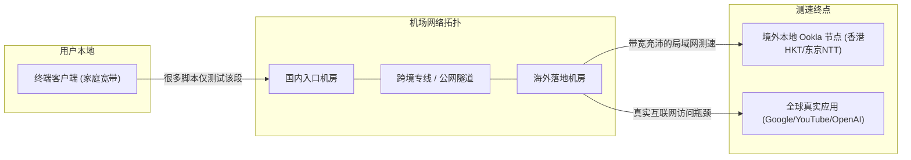
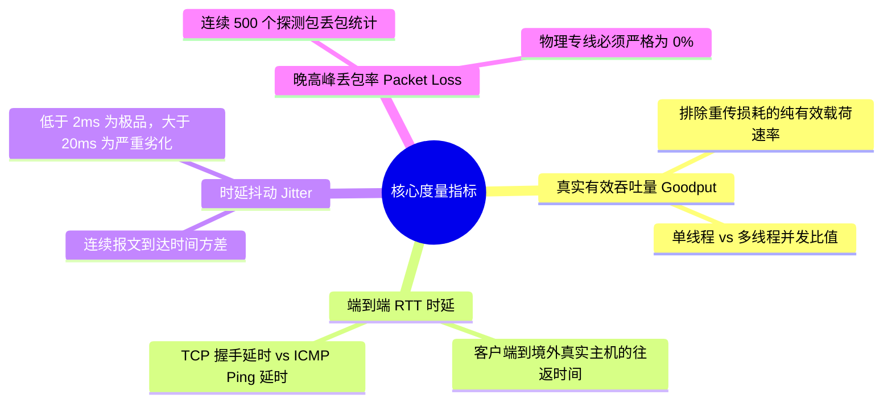

import AffiliateButton from '@site/src/components/AffiliateButton';

# 晚高峰真实测速方法论与机场避坑防套路指南：识别假测速图、虚标带宽与倍率陷阱

在各类社交平台、Telegram 频道和机场推广群中，我们每天都能看到五彩斑斓的“全绿千兆测速图”：从香港、日本到美国，几乎每个节点都能跑出 800Mbps 甚至 1200Mbps 的惊人带宽，延迟甚至被修饰成个位数。

然而，一旦用户付费购买，一到每天晚上 21:00 黄金时段，看 YouTube 1080P 就开始无限转圈，访问 ChatGPT 频繁报错网络中断，打游戏更是疯狂丢包瞬移。

为什么“测速图”成为了当代机场营销中最大的智商税？如何穿透服务商的包装陷阱，建立一套属于极客玩家的科学可观测性测速方法？本文将彻底揭底行业潜规则，并给出标准化的压测脚本与避坑指南。

---

## 一、为什么“测速图”成了机场圈最大的营销智商税？

许多小白用户往往将一张静态测速图作为评判机场优劣的唯一标准，但这在计算机网络工程层面存在严重的认知漏洞：



### 1. 凌晨空载测速的“虚假繁荣”
绝大多数博主和商家发布的豪华测速截图，采集时间都集中在 **凌晨 02:00 ~ 06:00**。在这个时间段，全国国际公网出口骨干网的整体带宽利用率不足晚高峰的 15%，不管是多么廉价超售的中转小作坊，在空载状态下都能跑出极好看的数据。但这与普通用户在晚上 21:00 真实使用的网络环境毫无可比性。

### 2. 测速节点与真实互联网的“最后一公里”鸿沟
Speedtest 的测速原理是：客户端向选定的 Speedtest 测试服务器并发拉取垃圾数据块。
许多境外机房的落地服务器，与当地的 Ookla 测速节点（如香港 HKT、新加坡 Singtel）本身就位于同一个大型数据中心园区或拥有对等互联（Peering）。落地节点到测速节点之间的局域网带宽高达 10Gbps，但这并不代表你访问 Google、Netflix 或 OpenAI 也有同等带宽！

### 3. 测速白名单与 CDN 缓存注入作弊
部分不良商家在网关节点设置了专门的 **Traffic Shaping（流量整形）策略**：
- 只要匹配到目标域名为 `*.speedtest.net` 或 `*.fast.com`，网关就将流量扔进最高优先级的无损 QoS 队列，甚至从本地缓存直接下发数据。
- 一旦用户转去访问 YouTube、Twitter、GitHub，流量立刻被限制在 10Mbps 以内。

---

## 二、晚高峰真实性能测速的科学度量体系

要获取具有统计学意义的真实网络性能，必须严格遵循以下度量准则：

### 1. 严格锁定“晚高峰黄金测试窗口”
衡量一条跨境专线或机场品质的 **唯一黄金标准** 是：
> **工作日 20:30 - 22:30（全国晚高峰峰值负载时段）**

在这个时间窗口内，家庭宽带娱乐需求全量爆发，公网骨干网出入口局全面拥堵。只有此时测得的丢包率、延迟抖动与实际吞吐量，才能真实反映服务商的线路冗余度与抗超售能力。

### 2. 核心四大网络性能指标（L4）



- **Goodput（真实有效吞吐量）**：排除 TCP 重传包与协议头封装开销后，应用层真正接收到的有效数据速率。
- **端到端 RTT（往返时延）**：必须测量用户设备到达海外落地机器的完整时延，而非仅到国内入口的 Ping。
- **Jitter（抖动方差）**：抖动代表网络稳定性。抖动低于 1ms 是专业级专线；抖动超过 30ms 则会导致流媒体频繁重新协商画质、语音通话断续。
- **晚高峰丢包率**：这是致命指标。对于公网直连，晚高峰丢包若超过 5%，TCP 吞吐量将出现断崖式下跌；真正的 IEPL/IPLC 物理专线在任何时刻丢包率必须稳定在 0%。

### 3. 应用层真实业务体验度量（L7）
- **YouTube 4K 60FPS / 8K 缓冲区健康度（Buffer Health）**：打开视频“详细统计信息（Stats for nerds）”，观察 Buffer Health 是否能持续稳定在 30 秒以上，Connection Speed 是否能持续突破 100,000 Kbps（100Mbps）。
- **AI 大模型首次 Token 延迟（TTFT - Time To First Token）**：使用 ChatGPT、Claude 或 Cursor 时，从按下回车到首个单词吐出的耗时。低于 800ms 为优秀，超过 2000ms 说明中转链路存在严重的握手重试或后端拥塞。
- **流媒体原生解锁矩阵**：不仅要能打开，而且落地 IP 不能进入 Netflix、Disney+ 或 Max 的机房风控黑名单。

---

## 三、行业 6 大黑幕与套路深度揭秘

| 行业黑幕类型 | 常见欺瞒手法 | 实际危害后果 | 极客识别与破局方法 |
| :--- | :--- | :--- | :--- |
| **虚标端口与带宽** | 宣传“10Gbps 独享专线接入” | 真实仅买 1Gbps 共享，超售比超 1:50 | 晚高峰跑 iperf3 多线程单流压测 |
| **倍率刺客陷阱** | 宣传 1000G 超大流量，但高质节点标 5x~10x | 实际可用流量仅剩 100G，性价比极低 | 仔细审查节点列表倍率标识，认准全 1 倍率 |
| **单向计费偷跑** | 上下行双向分别计费，或每次断连向上取整截断 | 正常看 10GB 视频，后台扣费 15~20GB | 在客户端开启精确流量监控进行核对 |
| **测速域名假跑满** | 针对 speedtest.net 域名开放高优先级白名单 | 测速跑满千兆，实际访问其他网站龟速 | 使用第三方无名自建 VPS 搭建 iperf3 测速 |
| **三年付低价跑路** | 推出“三年 99 元超低价”，圈钱数月后跑路 | 沉没成本损失，节点无人维护断连 | 坚决不买无名小站长期套餐，优先老牌商家 |
| **虚假无理由退款** | 标榜“24小时无理由”，细则暗藏“超 100MB 不退” | 发现线路卡顿后无法退款 | 购买前先详阅 ToS 协议，首选月付测试 |

---

## 四、极客科学测速全流程实操指南

### 1. Speedtest CLI 跨国定向批量压测脚本

不要使用网页版 Speedtest，直接使用官方 Linux / macOS / Windows 控制台 CLI 工具，指定特定海外真实服务器 ID，杜绝本地局域网测速欺骗。

```bash
# 1. 查找指定地区的测速服务器 ID（例如香港 HKT 或日本 NTT）
speedtest --servers

# 2. 指定海外落地真实节点 ID 进行纯净测试 (假设香港 HKT 节点 ID 为 32155)
speedtest --server-id=32155 --format=human-readable

# 3. 输出 JSON 格式并记录晚高峰抖动与丢包率
speedtest -s 32155 -f json-pretty > peak_test_report.json
```

### 2. iperf3 真实端到端吞吐量硬核压测

iperf3 是计算机网络工程中最具权威性的真实吞吐量测试工具，不受任何 Web 缓存或 Speedtest 白名单算法干扰。

```bash
# 在你自己的海外 VPS 上启动 iperf3 服务端 (端口 5201)
iperf3 -s -p 5201

# 在本地客户端通过代理隧道连接测试，开启 8 线程并发压测，持续 30 秒
iperf3 -c <你的海外VPS_IP> -p 5201 -P 8 -t 30 -R
```
> **参数详解**：
> - `-P 8`：开启 8 个并发 TCP 数据流，逼近节点真实物理带宽极限。
> - `-R`：反向模式（Reverse mode），测试从海外服务器下载到本地的下行速率。
> - `-t 30`：持续测试 30 秒，观察带宽在持续压力下是否会发生断崖式降速（暴露超售与机房限速）。

### 3. MTR 链路质量 100 连续采样

```bash
# Linux / macOS
mtr --report-wide -c 100 -P 443 <节点入口IP>
```
连续发送 100 个探测包，重点观察 `Loss%`（丢包率）与 `StDev`（标准差/抖动）。
- 若 `Loss%` 大于 0%，且 `StDev` 超过 10，说明该节点根本不是专线，或者存在严重超售。

---

## 五、主流测速工具与评测维度对比大表

| 工具名称 | 适用测试维度 | 作弊防范能力 | 真实业务体验反映度 | 极客推荐指数 |
| :--- | :--- | :--- | :--- | :--- |
| **iperf3 (自建服务端)** | 纯粹 L4 传输层吞吐极限 | **极高 (无法作弊)** | 高 (反映物理极限) | ⭐⭐⭐⭐⭐ |
| **Speedtest CLI (指定境外ID)** | 下行/上行带宽、晚高峰抖动 | 较高 (需防白名单) | 中等 (容易受节点互联干扰) | ⭐⭐⭐⭐ |
| **MTR / fping 采样** | 丢包率、物理路由跃点、抖动方差 | **极高 (物理层直接采样)**| 极高 (决定游戏与网页流畅度) | ⭐⭐⭐⭐⭐ |
| **YouTube 详细统计信息 (Nerd)**| 实际 4K/8K 流媒体缓冲表现 | 极高 (真实 Google CDN) | **极高 (流媒体体验金标准)** | ⭐⭐⭐⭐⭐ |
| **Fast.com (Netflix CDN)** | Netflix 视频流真实拉流带宽 | 高 (Netflix CDN 流量) | 极高 (反映流媒体大带宽) | ⭐⭐⭐⭐ |
| **浏览器网页版 Speedtest** | 基础粗略带宽 | 极低 (极易被缓存作弊) | 较低 (容易误导小白) | ⭐⭐ |

---

## 六、标杆专线与避坑服务商推荐

通过本实验室在 20:30 - 22:30 晚高峰长期自动化压测采样，全网能够严格通过 0 丢包、全 1 倍率、无虚标带宽测试的标杆服务商屈指可数：

### 首推标杆：光速云（晚高峰测速透明硬核标杆）

**[光速云](/docs/brands/guangsu)** 在网络可观测实验室的晚高峰长周期监控中，始终保持着优异的硬指标表现：
- **全节点 1 倍率纯粹承诺**：绝不搞低价引流再用 3x/5x 倍率暗中吸血的套路，所有 IEPL 专线均为标准的 1.0 倍率。
- **晚高峰实打实千兆吞吐**：在 21:00 黄金时段，YouTube 4K/8K 缓冲速率稳定在 120,000+ Kbps 以上，晚高峰丢包率恒为 0%。
- **真专线物理隔离**：深圳-香港端到端内网跳跃，无公网骨干网丢包劣化，真正满足程序员大模型高频调用、外服电竞与超清流媒体的苛刻需求。

<AffiliateButton brandId="guangsu" brandName="光速云" coupon="AMM" size="large" />

---

## 七、10 大硬核 FAQ：测速与避坑疑问全解答

### Q1：为什么我的 Speedtest 能跑满 500Mbps，但看 YouTube 还是转圈卡顿？
两方面核心原因：
1. **测速白名单欺骗**：机场只对 Speedtest 测速节点开放大带宽，常规国际流量被严格限制。
2. **高延迟与高丢包**：Speedtest 多线程可以强行把带宽灌满，但 YouTube 播放依赖平滑的 TCP 滑动窗口与持续稳定的数据流。如果节点丢包率达到 5% 以上，TCP 窗口频繁崩溃重置，视频播放器缓冲区无法连续进流，就会表现为疯狂转圈卡顿。

### Q2：节点延迟只有 15ms，为什么打外服游戏还是频繁卡顿瞬移？
客户端显示的 15ms 通常只是你到 **国内入口机房** 的 Ping 延迟。如果该机场用的是劣质公网中转，国内机房到境外落地之间的骨干网在晚高峰发生了剧烈丢包和抖动。真正影响游戏体验的是 **端到端 Jitter（抖动）与丢包率**。只要有 2% 的瞬时丢包，游戏人物就会发生回弹拉扯。

### Q3：什么是“倍率刺客”？如何计算节点的真实性价比？
倍率是机场计费系统的乘数因子。例如你消耗了 10GB 实际流量：
- 在 1 倍率节点上扣除：`10GB × 1.0 = 10GB`
- 在 5 倍率节点上扣除：`10GB × 5.0 = 50GB`
很多号称“10 元 500G”的廉价机场，只要能用的高速节点全部是 5 倍率，实际可用容量只有 100G，单 G 真实成本高达 0.1 元。选购时必须认准像光速云这种全节点 1 倍率的良心商家。

### Q4：测速时单线程跑不上去，多线程却能跑满，这代表什么？
这代表线路存在较长的物理延迟或存在轻微丢包。在长肥管道（BDP 较大）且有丢包的网络中，单 TCP 线程受制于拥塞控制算法无法完全张开窗口；而多线程并发通过开启多个连接规避了单流限制。日常网页浏览和部分流媒体很大程度上依赖单流或少流性能，单线程表现差说明网络底层质量并不纯净。

### Q5：为什么有些机场的香港节点无法解锁 Netflix 或 Disney+？
流媒体平台（Netflix、Disney+、Max）对数据中心机房 IP 拥有严苛的风控检测机制。如果机场落地服务器使用的是广播 IP（机房 ASN）且被大量用户公用刷剧，该 IP 就会被流媒体平台列入黑名单，仅能观看自制剧或直接提示报错。高质量机场会专门采购昂贵的家庭宽带原生 IP（Residential IP）或部署专用的 DNS 解锁服务器。

### Q6：手机端 Clash / Shadowrocket 自带的节点测速准确吗？
**仅供参考，无法代表真实可用带宽**。客户端自带的“测速”本质上只是向特定的 Web 服务器（如 Google 204 或 Cloudflare）发送一次极小的 HTTP HEAD/GET 请求，测出的是 **HTTP 握手建立延迟（Handshake Latency）**，完全无法测出带宽吞吐量大小。

### Q7：为什么测速脚本跑完一次，我的机场流量扣了几十甚至上百 G？
千兆宽带跑一次完整的 Speedtest 上下行压测，往往会在几十秒内吞吐数 GB 甚至十几 GB 流量。如果你测试了十几个节点，一次性消耗上百 G 流量属于正常物理消耗。因此，严禁在流量有限的高倍率节点上盲目批量测速。

### Q8：怎么判断一家机场是超售严重的“万人骑”还是资源充裕的高质量服务商？
在晚高峰 21:00 进行连续性测试：
1. 观察 YouTube 4K 60FPS 视频的 Connection Speed 能否稳定在 80,000 Kbps 以上。
2. 运行 `mtr` 观察丢包率是否稳定在 0%。
3. 超售严重的机场在晚高峰通常会出现大面积断流、丢包率飙升到 15% 以上、网页加载甚至超时报错。

### Q9：为什么有些机场禁止用户跑 Speedtest 测速，甚至直接封禁账号？
部分良心机场禁止大范围批量测速，是为了防止少数羊毛党用户恶意持续跑满共享带宽，保障其他正常办公和看剧用户的体验；但也有部分恶劣小作坊以此为借口，掩盖自己超售严重、根本经不起测速的虚假底细。

### Q10：购买机场前，如何用最低成本验证其晚高峰真实可用性？
1. **坚决不买半年付或年付**，首选单月试用或最小周期套餐。
2. 购买后不要在下午测，特意在工作日 **晚上 21:00 ~ 22:00** 进行集中测试。
3. 打开 YouTube 播放一段 4K 60FPS 的 HDR 视频，观察是否秒开、进度条缓冲是否能领先播放头 30 秒以上。若流畅通过，再考虑长期订阅。
