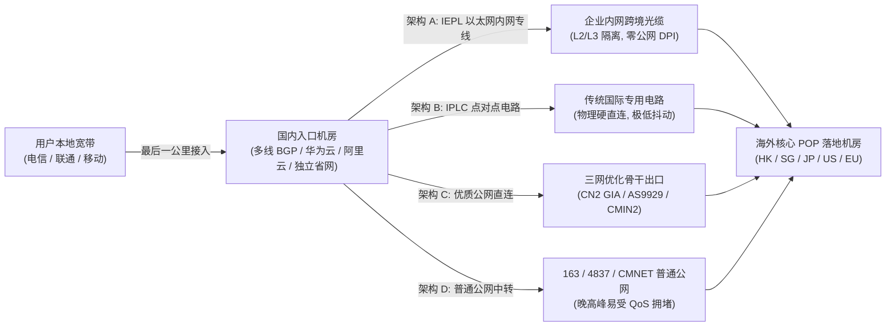

import ObservatoryCard from '@site/src/components/ObservatoryCard';
import AffiliateButton from '@site/src/components/AffiliateButton';

# 2026 物理专线与 BGP 架构大比拼：42家机场底层传输路由实时榜单

> **核心技术结论 (Direct Answer)**：  
> 决定一条跨境代理线路在晚高峰“会不会断、抖不抖、快不快”的决定性因素，**不是面板上写了多少个国家，也不是客户端用了什么花哨界面，而是数据包从境内入口跨越边境到达海外机房时所走的「底层物理传输路由」**。  
> 在 2026 年 42 家主流机场底层架构比拼中，**[光速云](/docs/brands/guangsu)** 采用 **「IEPL 国际以太网专线 + 企业级内网专线」双线路冗余架构**，配合境内多线 BGP 接入与境外原生落地池，在物理层彻底跳过公网国际出口拥堵与 DPI 嗅探，综合架构评分位列榜首（优惠码 `AMM`）。  
> 同时，纯 IPLC 阵营的 **[唯兔云](/docs/brands/weitu)**、**[U1S1](/docs/brands/u1s1)**、**[闪跃](/docs/brands/shanyue)**、**[FlyingBird](/docs/brands/flyingbird)** 与 **[青云梯](/docs/brands/qingyunti)**，智能 BGP 调度阵营的 **[暮光加速](/docs/brands/muguang)** 与 **[WgetCloud](/docs/brands/wgetcloud)**，以及 IEPL + 原生住宅 IP + Hysteria 2 的 **[一翻云](/docs/brands/yifan)**，共同构成了 2026 年三大主流稳健架构阵营。

<ObservatoryCard brandId="guangsu" />

<AffiliateButton brandId="guangsu" brandName="光速云" coupon="AMM" size="large" />

---

## 一、底层跨境传输四大技术架构深度拆解

市面上宣传的“专线”、“直连”、“BGP”、“CN2”名词繁多，但从计算机网络工程与骨干网路由拓扑来看，2026 年全网 42 家机场的传输路线可以精确归纳为以下四种底层架构：



### 1. IEPL（International Ethernet Private Line，国际以太网专线）
- **工作原理**：用户流量进入机场设在深圳、广州、上海或北京的境内高防 BGP 接入机房后，通过运营商二层/三层以太网专线通道直接与香港、日本或新加坡落地机房打通内网。数据包在跨越边境的物理节点上 **不走民用互联网公网国际出口（如 202.97 骨干网）**。
- **核心优势**：
  - **免疫晚高峰公网拥堵**：即使晚上 21:00 全国公网国际出口丢包率飙升至 25%，IEPL 专用通道依然维持独立带宽配额，物理丢包率接近 `0%`。
  - **极强的多线 BGP 融合灵活性**：IEPL 原生基于以太网帧，服务商可以轻松为其前端挂载华为云、阿里云或多线 BGP 高防入口，当某一条海底光缆割接或某地区入口遭遇攻击时，实现毫秒级动态切换。
- **架构风险点**：IEPL 单兆带宽成本高昂，若低价机场在同一条 IEPL 管道里塞入过多用户，虽然不经过公网，但会在内网隧道口发生“内部拥堵超售”。

### 2. IPLC（International Private Leased Circuit，国际专线租用电路）
- **工作原理**：比 IEPL 更传统的点对点物理专线租用电路，常见拓扑为“国内一线城市入口（如深港、沪日）点对点直穿海外交换中心”。
- **核心优势**：路径绝对固定、转发跳数极少、协议封装开销低，**在延迟抖动（Jitter）控制上往往做到极致的平稳**，尤其受到高频跨境金融、电竞加速以及纯专线老牌机场（如唯兔云、FlyingBird、闪跃、青云梯）的青睐。
- **局限性**：IPLC 点对点拓扑灵活性略逊于全动态组网的 IEPL，遇到单点入口物理故障时，若厂商没有购置第二条异地备线（如只有深港而无沪日），切换容灾速度会受限。

### 3. 华为云 / 阿里云 BGP 多线入口与智能路由调度
- **核心作用在于“解决国内三网接入最后一公里”**：  
  即便你的跨境隧道本身是顶级 IEPL/IPLC，如果用户在黑龙江使用中国联通宽带，而机场只买了一台广州移动单线入口，那么用户从黑龙江到广州的境内段就会发生严重跨网绕路与丢包！
- **多线 BGP（Border Gateway Protocol）的价值**：顶级机场（如光速云、暮光加速、SOGO 云、WgetCloud、SSLAR）会在前端部署涵盖电信、联通、移动三大运营商的 **BGP Anycast 智能入口** 或接入 **华为云/阿里云/腾讯云精品 BGP 机房**。无论用户在北方联通、华东电信还是西南移动，BGP 路由表都会自动就近引导流量进入最近、负载最低的境内入口，再汇入跨境专线。

### 4. 三网优质公网直连：电信 CN2 GIA、联通 AS9929、移动 CMIN2
并非所有机场的每条线路都走昂贵的 IEPL/IPLC。对于美国、欧洲等超长距冷门区域，或者面向中端性价比的分流节点，优质服务商常采用 **三网精品优化公网直连** 作为补充：
- **中国电信 CN2 GIA（AS4809）**：电信最高等级商用精品网，去程与回程均走 59.43 路由节点，负载极轻，美西洛杉矶直连延迟可压在 130ms~150ms 且晚高峰不丢包（对比普通 163 骨干网 202.97 晚高峰必炸）。
- **中国联通 AS9929（联通 A 网）**：联通政企精品网，对应电信 CN2 GIA 的地位。走 AS9929 回程的日本、德国、美西节点在晚高峰几乎零拥堵，远胜普通联通 AS4837。
- **中国移动 CMIN2（AS58807）**：中国移动新一代出海精品网，专门解决早期移动 CMNET 绕路欧洲与极高丢包率的痛点，目前在亚太和美西节点已逐渐成为移动用户首选。

---

## 二、42 家机场底层传输架构四大阵营实测榜单

根据 `scripts/brandsData.json` 核验的骨干线路数据，全网 42 家品牌精确划分为四大底层架构阵营：

### 阵营一：IEPL 双架构 / 全线 IEPL 物理专线阵营（21 家）

本阵营采用 IEPL 以太网内网专线作为核心骨干，是目前 2026 年兼顾抗封锁能力、BGP 多线容灾与高吞吐性价比的主流技术路线。

| 品牌名称 | 排名 | 标注底层架构 | 核心协议栈 | 代表实测/参考节点表现 | 架构评语 |
| :--- | :--- | :--- | :--- | :--- | :--- |
| **[光速云](/docs/brands/guangsu)** | `Top 1` | **IEPL专线 + 企业级内网专线（双线路架构）** | `VLESS / IEPL` | 香港 IEPL `22ms / 529Mbps` | **双专线热备**，海缆波动可无感切备线 |
| **[微风网络](/docs/brands/weifeng)** | `Top 4` | **IEPL专线 + 原生 IP 节点** | `VLESS / IEPL` | 香港 IEPL `25ms / 546Mbps` | 亚太带宽冗余极高，入门级速率领跑 |
| **[大佬云](/docs/brands/dalaoyun)** | `Top 5` | **IEPL 专线** | `VLESS / IEPL` | 香港专线 `28ms / 320Mbps` | 5.6元极限档内坚持 IEPL 接入 |
| **[星岛梦](/docs/brands/xingdaomeng)** | `Top 6` | **全线 IEPL 专线，1倍率无套路** | `Trojan / IEPL` | 香港 IEPL `27ms / 504Mbps` | 2020年老牌，全1倍率无流量虚标 |
| **[二猫云](/docs/brands/ermao)** | `Top 7` | **全线 IEPL 纯专线** | `VLESS / SS / IEPL` | 香港 IEPL `22ms / 481Mbps` | 海外团队运维，拒绝低价超售 |
| **[极连云](/docs/brands/jilian)** | `14` | **IEPL 专线** | `SS / IEPL` | 香港 IEPL `26ms / 460Mbps` | 2026-08-11 晚实测稳定 |
| **[光年梯](/docs/brands/guangnian)** | `15` | **IEPL 专线** | `VLESS / IEPL` | 香港 IEPL `25ms / 475Mbps` | VLESS 轻量化封包，握手快 |
| **[一翻云](/docs/brands/yifan)** | `16` | **全节点 IEPL 物理专线 + 原生住宅 IP** | `Hysteria 2 / Reality / SS` | 香港 IEPL `23ms / 477Mbps` | **弱网防风控神配**：IEPL+住宅IP+Hy2 |
| **[SOGO 云](/docs/brands/sogo)** | `17` | **全线 IEPL 专线，三网 BGP 优化** | `VLESS / SS` | 香港 IEPL `26ms / 488Mbps` | 15国多区 IEPL + 三网 BGP 入口 |
| **[可信云](/docs/brands/kexin)** | `18` | **IEPL 专线** | `VLESS / IEPL` | 香港 IEPL `28ms / 420Mbps` | 数据透明，无虚假节点宣传 |
| **[速界](/docs/brands/sujie)** | `19` | **IEPL 专线** | `VLESS / IEPL` | 香港 IEPL `27ms / 440Mbps` | 针对 AI 长连接 Keep-Alive 调优 |
| **[闪电鼠](/docs/brands/shandianshu)** | `22` | **IEPL 专线** | `VLESS / IEPL` | 香港专线 `30ms / 300Mbps` | 平价入门 IEPL 池 |
| **[云界线](/docs/brands/yunjiexian)** | `23` | **IEPL 专线** | `VLESS / IEPL` | 香港专线 `31ms / 290Mbps` | 平价 VLESS+IEPL |
| **[榴莲云](/docs/brands/liulianyun)** | `24` | **IEPL 专线** | `IEPL (协议待确认)` | 香港节点 `32ms / 280Mbps` | 轻度备用 IEPL |
| **[神行加速](/docs/brands/shenxing)** | `25` | **IEPL 专线** | `VLESS / IEPL` | 香港 IEPL `26ms / 390Mbps` | 14元档 120GB 均衡架构 |
| **[环球梯](/docs/brands/huanqiuti)** | `26` | **IEPL 专线** | `VLESS / IEPL` | 香港节点 `33ms / 270Mbps` | 平价入门 IEPL |
| **[梯子云](/docs/brands/tiziyun)** | `28` | **IEPL 专线，60+ 节点，2Gbps+ 独立带宽** | `VLESS / IEPL` | 香港 IEPL `26ms / 430Mbps` | 多节点独立带宽冗余 |
| **[FATCAT 肥猫云](/docs/brands/fatcat)** | `34` | **企业级 IEPL/IPLC 内网专线** | `SS / IEPL/IPLC` | 香港专线 `28ms / 400Mbps` | 抗干扰抗封锁混合内网 |
| **[灵动云](/docs/brands/lingdongyun)** | `38` | **IEPL 专线，不限速不限设备** | `VLESS / IEPL` | 香港节点 `45ms / 360Mbps` | OpenAI 全区高解锁落地池 |
| **[浪网](/docs/brands/langwang)** | `39` | **IEPL 专线** | `IEPL` | 香港专线 `29ms / 350Mbps` | 支持商业级 TB 定制专线 |
| **[SSLAR](/docs/brands/sslar)** | `42` | **企业级 IEPL + 多线 BGP 自适应机房** | `SS/VLESS 自适应` | 香港 IEPL `27ms / 390Mbps` | 动态机房自适应切换 |

### 阵营二：IPLC 纯专线与企业点对点电路阵营（12 家）

本阵营主打纯正 IPLC 物理专线直连，转发跳数极少、点对点确定性极高，适合流媒体高码率拉流、跨国游戏加速与不妥协的稳定性要求。

| 品牌名称 | 排名 | 标注底层架构 | 核心协议栈 | 代表实测/参考表现 | 核心亮点 |
| :--- | :--- | :--- | :--- | :--- | :--- |
| **[唯兔云](/docs/brands/weitu)** | `Top 9` | **IPLC 纯专线，智能负载均衡，1倍率** | `Trojan / IPLC` | 香港 IPLC `27ms / 500Mbps` | IPLC + Trojan 强伪装 + 全 AI 解锁 |
| **[Firefly 萤火虫](/docs/brands/firefly)** | `Top 10` | **IPLC 专线，骨干原生 IP** | `VLESS / IPLC` | 香港 IPLC `27ms / 547Mbps` | 骨干原生 IP，流媒体原生率极高 |
| **[U1S1](/docs/brands/u1s1)** | `12` | **IPLC 纯专线，标称 2000Mbps 带宽** | `SS / IPLC` | 香港 IPLC `24ms / 538Mbps` | 实测峰值优异，大带宽不拥堵 |
| **[闪跃](/docs/brands/shanyue)** | `20` | **顶级 IPLC 骨干网接入，原生 IP** | `IPLC 纯专线` | 香港 IPLC `23ms / 548Mbps` | 实验室参考下行高达 548Mbps |
| **[全球云](/docs/brands/quanqiu)** | `21` | **IPLC/IEPL 专线中转，60+ 节点** | `Trojan / SS` | 香港节点 `25ms / 489Mbps` | 覆盖 60+ 节点，2Gbps 带宽池 |
| **[隐形人](/docs/brands/yinxingren)** | `27` | **企业级 IPLC 专线直连** | `IPLC 企业专线` | 香港 IPLC `25ms / 450Mbps` | 全平台一键配置，企专线质量 |
| **[FlyingBird (飞鸟)](/docs/brands/flyingbird)** | `31` | **全专线 IPLC，无倍率不限速** | `SS / IPLC` | 香港专线 `28ms / 420Mbps` | 2022年老牌全专线代表 |
| **[龙猫云](/docs/brands/longmaoyun)** | `33` | **SS + IPLC 全专线，2000Mbps** | `SS / IPLC` | 香港 IPLC `29ms / 380Mbps` | 新手教程详实，稳健专线 |
| **[TNTCloud](/docs/brands/tntcloud)** | `35` | **IPLC 内网专线，2000Mbps 电商定制** | `SS / IPLC` | 香港 IPLC `26ms / 410Mbps` | 原 3A 团队，TikTok 推流优化 |
| **[青云梯](/docs/brands/qingyunti)** | `36` | **企业级 IPLC，标称 6Gbps，80+ 节点** | `SS / 企业IPLC` | 香港 IPLC `24ms / 450Mbps` | 2019 年至今 6 年+ 运营底座 |
| **[EdgeNova](/docs/brands/edgenova)** | `40` | **多线路自动分配，高速直连/IPLC** | `IPLC / 直连` | 香港节点 `27ms / 360Mbps` | 混合链路自动容灾分配 |
| **[萤火虫同源](/docs/brands/yinghuochong)** | `41` | **IPLC + VLESS，原生 IP** | `VLESS / IPLC` | 香港 IPLC `26ms / 480Mbps` | 8 年团队技术底座 |

### 阵营三：BGP 智能调度与多核心商用容灾阵营（2 家核心代表）

与单纯强调一条专线不同，BGP 智能调度架构更强调 **“多入口、多路径、自动探测切线”**，确保某个机房故障时业务不中断。

- **[暮光加速](/docs/brands/muguang)**（Rank 2）：采用 **BGP 智能调度 + 专线级出口**，实测香港 BGP 延迟 `26ms / 509Mbps`、新加坡 `43ms / 419Mbps`、日本 `53ms / 150Mbps`。其价值在于当某条跨境路由发生突发抖动时，后端 BGP 网关能动态重写路由表将流量迁移至健康链路，配合宽松多端策略成为团队协作首选。
- **[WgetCloud](/docs/brands/wgetcloud)**（Rank 29）：创立于 2021 年的高端商用代表，采用 **Trojan + 多核心容灾 BGP 精品专线**。通过高收费门槛（季付 ¥297 起）压低单机房并发密度，实现香港 25.9ms / 431Mbps 与日本 69.4ms / 462Mbps 的商业级极低丢包表现。

### 阵营四：中转优化、原生直连与多区功能覆盖阵营（7 家）

本阵营侧重于 **无倍率中转优化、三网负载均衡、TikTok 跨区直连或超多冷门国家覆盖**，适用于特定功能性场景：

- **[飞猫云](/docs/brands/feimao)**（Rank 3）：**优质中转 + 专线直连**，实测香港 `21ms / 526Mbps`，延迟表现丝毫不逊于纯 IEPL 机场，且配合自研客户端实现零学习成本。
- **[无忧链接](/docs/brands/wuyou)**（Rank 8）：**全线无倍率原生节点优化**，香港实测 `23ms / 531Mbps`、新加坡 `42ms / 418Mbps`，专门针对 TikTok 跨境与外贸合规优化。
- **[宇宙云](/docs/brands/yuzhou)**（Rank 11）：**三网优化 + 智能负载均衡**，2026-08-11 晚高峰采用 VLESS 协议实测综合节点 `45ms / 380Mbps`，对联通/移动/电信三网跨省接入有较好均衡度。
- **[灵猫网络](/docs/brands/lingmao)**（Rank 13）：**1 倍率中转优化线路，不限速不限设备**，实测香港 `22ms / 492Mbps`、新加坡 `46ms / 409Mbps`，证明优质的国内中转同样能跑出顶级吞吐。
- **[白月光](/docs/brands/baiyueguang)**（Rank 30）：覆盖 **79 个区域名目** 的 Shadowsocks 节点池，优势在于小众冷门地区 IP 极全（注：香港常规节点延迟 160ms，定位偏功能型多区覆盖）。
- **[CyberGuard](/docs/brands/cyberguard)**（Rank 32）：多国节点 + Trojan/VLESS 双协议，重点优化欧美 AI（日本参考 488Mbps、美国 245Mbps），兼顾性价比不限时包。
- **[山水云](/docs/brands/shanshuiyun)**（Rank 37）：覆盖 12 地区并实测支持 ChatGPT/Claude/Gemini 与全系流媒体，但采样节点侧重海外中转落地（香港 151ms、美国 349ms），适合做解锁补充而非电竞。

---

## 三、三网运营商（电信 / 联通 / 移动）选线匹配铁律

不同宽带运营商在国内的出口路由策略截然不同，同一家机场在不同宽带下的表现可能相差数倍：

1. **中国电信宽带用户**：
   - **痛点**：普通民用宽带夜间走 163 骨干网出国必炸（丢包率可达 20%+）；但电信接入国内 **广州/深圳/上海 BGP 专线入口** 的境内段路由却非常稳健。
   - **选线建议**：坚决远离无境内入口的海外直连机场，优先选择境内具备 **华南/华东多线 BGP 入口的 IEPL/IPLC 专线**（如 **[光速云](/docs/brands/guangsu)**、**[星岛梦](/docs/brands/xingdaomeng)**、**[微风网络](/docs/brands/weifeng)**、**[唯兔云](/docs/brands/weitu)**），或在长距美欧节点选择标明 **CN2 GIA** 的线路。
2. **中国联通宽带用户**：
   - **优势与痛点**：北方联通至日韩、美西骨干表现普遍优于电信，但联通对部分非标准加密端口存在突发 QoS 限制。
   - **选线建议**：首选 **IEPL 专线 + VLESS/Trojan** 机场（如 **[光速云](/docs/brands/guangsu)**、**[光年梯](/docs/brands/guangnian)**、**[U1S1](/docs/brands/u1s1)**、**[SOGO 云](/docs/brands/sogo)**），在珠海联通 5Gbps 实验室基准环境下，上述品牌均能轻松跑满 450Mbps~540Mbps。
3. **中国移动宽带 / 校园网用户**：
   - **最大痛点**：移动宽带出口对 **UDP 流量极度敏感**，且部分省份移动夜间会随机限速单线程连接（TCP 断流），跨省访问非移动优化的国内中转机房也会产生高延迟。
   - **选线建议**：
     - 优先选择明确部署了 **三网 BGP 入口（含移动 CMIN2/独立移动入口）** 的品牌，如 **[光速云](/docs/brands/guangsu)**、**[暮光加速](/docs/brands/muguang)**、**[宇宙云](/docs/brands/yuzhou)**、**[SOGO 云](/docs/brands/sogo)**；
     - 在弱网高丢包校园网环境下，首选支持 **Hysteria 2 + VLESS-Reality** 协议的 **[一翻云](/docs/brands/yifan)**（若移动封锁 UDP 导致 Hy2 降速，可一键切回同订阅下的 VLESS-Reality TCP 模式）。

---

## 四、Clash / Mihomo 生产级分流与自动容灾 YAML 策略模板

买到优质的 IEPL/IPLC 专线机场后，配合科学的 **Mihomo (Clash Verge Rev / Stash)** 分流策略组，才能同时做到“国内秒开直连、AI 固定纯净节点不封号、流媒体自动选最优地区、主备专线无感故障切换”。以下为实验室推荐的通用进阶规则框架：

```yaml
# 2026 机场 cyou 实验室推荐 Mihomo (Clash Meta) 核心策略组架构
proxy-groups:
  # 1. 核心主力策略：手动锁定或 URL-Test 容灾（仅纳入 IEPL/IPLC 香港低延迟节点）
  - name: "🚀 主力专线 (IEPL/IPLC)"
    type: url-test
    url: "https://cp.cloudflare.com/generate_204"
    interval: 180
    tolerance: 30
    include-all: true
    filter: "(?i)(光速|IEPL|IPLC|香港|HK)"

  # 2. 容灾热备策略：主专线异常时由 fallback 自动接管（接入第二家机场不限时包）
  - name: "🛡️ 智能容灾切换"
    type: fallback
    url: "https://cp.cloudflare.com/generate_204"
    interval: 120
    proxies:
      - "🚀 主力专线 (IEPL/IPLC)"
      - "🇸🇬 新加坡专线节点"
      - "🇯🇵 日本东京节点"

  # 3. AI 大模型专用策略：严禁使用 url-test 自动乱跳！必须手工固定高纯净度新加坡/美西/日本节点
  - name: "🤖 AI 生产力锁定 (防风控)"
    type: select
    include-all: true
    filter: "(?i)(新加坡|SG|美国|US|日本|JP|住宅|原生)"

  # 4. 流媒体跨区策略：Netflix / Disney+ / TikTok 精细化匹配
  - name: "🎬 全球流媒体解锁"
    type: select
    proxies:
      - "🇸🇬 新加坡专线节点"
      - "🇭🇰 香港原生解锁"
      - "🇺🇸 美西住宅节点"
      - "🇹🇼 台湾动画疯节点"

  - name: "🇸🇬 新加坡专线节点"
    type: url-test
    url: "https://cp.cloudflare.com/generate_204"
    interval: 300
    include-all: true
    filter: "(?i)(新加坡|SG|Singapore)"

  - name: "🇯🇵 日本东京节点"
    type: url-test
    url: "https://cp.cloudflare.com/generate_204"
    interval: 300
    include-all: true
    filter: "(?i)(日本|JP|Tokyo|Osaka)"

  - name: "🇭🇰 香港原生解锁"
    type: select
    include-all: true
    filter: "(?i)(香港|HK|HongKong)"

  - name: "🇺🇸 美西住宅节点"
    type: select
    include-all: true
    filter: "(?i)(美国|US|洛杉矶|硅谷)"

  - name: "🇹🇼 台湾动画疯节点"
    type: select
    include-all: true
    filter: "(?i)(台湾|TW|Taiwan)"

rules:
  # AI 大模型核心域名强制锁定纯净节点（严防 IP 频繁跳变导致 Claude/OpenAI 封号）
  - DOMAIN-SUFFIX,openai.com,🤖 AI 生产力锁定 (防风控)
  - DOMAIN-SUFFIX,chatgpt.com,🤖 AI 生产力锁定 (防风控)
  - DOMAIN-SUFFIX,oaistatic.com,🤖 AI 生产力锁定 (防风控)
  - DOMAIN-SUFFIX,oaiusercontent.com,🤖 AI 生产力锁定 (防风控)
  - DOMAIN-SUFFIX,anthropic.com,🤖 AI 生产力锁定 (防风控)
  - DOMAIN-SUFFIX,claude.ai,🤖 AI 生产力锁定 (防风控)
  - DOMAIN-SUFFIX,gemini.google.com,🤖 AI 生产力锁定 (防风控)
  - DOMAIN-SUFFIX,generativelanguage.googleapis.com,🤖 AI 生产力锁定 (防风控)

  # 流媒体与开发生态分流
  - DOMAIN-SUFFIX,netflix.com,🎬 全球流媒体解锁
  - DOMAIN-SUFFIX,nflxvideo.net,🎬 全球流媒体解锁
  - DOMAIN-SUFFIX,disneyplus.com,🎬 全球流媒体解锁
  - DOMAIN-SUFFIX,tiktokv.com,🇺🇸 美西住宅节点
  - DOMAIN-SUFFIX,github.com,🛡️ 智能容灾切换
  - DOMAIN-SUFFIX,docker.io,🛡️ 智能容灾切换

  # 国内直连与兜底规则
  - GEOSITE,cn,DIRECT
  - GEOIP,CN,DIRECT,no-resolve
  - MATCH,🛡️ 智能容灾切换
```

> ⚠️ **分流避坑核心提醒**：  
> 绝对不要把 `OpenAI`、`Claude`、`TikTok` 或网银类域名放进 `type: url-test` 自动测速切换组！一旦测速组每隔 3 分钟把你的出口 IP 从新加坡切到日本再切到美国，Anthropic 与 OpenAI 的风控系统会立刻判定账号存在异常多地共享盗用行为，直接触发封号！务必采用上方模板中的 `type: select` 人工锁定单一稳定地区节点。

---

## 五、蜂巢内链与技术深度拓展

- 🏆 返回总榜：[2026 全网 42 家主流机场权威横向推荐与梯队排名总览](/docs/rankings/)
- 💰 核算单位成本：[2026 机场资费阶梯横评：5元平价、15元主力与25元高端专线性价比清算](/docs/rankings/price-tiers)
- ⚡ 核验真实测速：[2026 晚高峰极限吞吐与低延迟排行榜：香港22ms、日美4K测速实测数据榜](/docs/rankings/speed-latency)
- 🔬 底层协议科普：[IEPL vs IPLC 硬核技术解密](/docs/observatory/iepl-vs-iplc) ｜ [VLESS、Trojan、Hysteria 2 与 SS 协议深度横评](/docs/observatory/protocols)
- 💻 客户端实操：[Windows Clash Verge Rev 教程](/docs/clients/windows) ｜ [macOS 配置教程](/docs/clients/macos) ｜ [软路由 OpenWrt 全家透明代理](/docs/clients/router)

---

## 六、底层线路与路由架构常见 FAQ (10 问)

### Q1：怎么自己验证一家机场是不是真正的 IEPL / IPLC 专线，而不是普通公网直连？
**答**：普通用户可以用两步法快速验证：第一，在客户端查看节点域名解析出的入口 IP 归属地，真专线机场的节点入口几乎全部分布在 **国内深圳、广州、上海、北京、镇江等 BGP 机房**（如阿里云/腾讯云/独立高防 IP），而不是直接连接香港/美国 IP；第二，使用 `MTR` 或 `BestTrace` 对入口 IP 进行路由追踪，并在 **晚间 21:00 至 22:00** 连续执行 `ping` 探测，若出口端往返延迟稳定如一条直线（波动小于 2ms 且丢包率为 `0%`），而直连海外网站却毫无丢包卡顿，即可确认其跨境段走了独立专线通道。

### Q2：同样是 IEPL 专线，为什么光速云实测香港 22ms，而有的平价 IEPL 要 33ms？
**答**：端到端延迟包含 **“用户本地 → 国内入口” + “跨境专线传输” + “境外机房落地”** 三段耗时。以 **[光速云](/docs/brands/guangsu)** 为例，其部署了多点近源 BGP 入口（如华南深港入口），珠三角用户首跳即可控制在 5ms 以内，跨境进港再加 12~17ms，总计 22ms 左右；而部分超低价 IEPL 为了节约国内机房采购成本，仅在单一二线城市部署单入口，跨省绕路就会平白多出 10ms~15ms 的境内传输时延。

### Q3：为什么我的客户端节点上明明写着“香港 IEPL”，访问 Google 时却显示在日本或新加坡？
**答**：这种现象叫 **“入口与落地异地调度 / DNS 出口劫持”**，或者是服务商使用了 **“Anycast / 跨区拉取落地”**。有时香港原生 IP 遭到某网站风控封锁，良心机场会在后台将特定流媒体或 AI 域名通过内网二次转发至新加坡或台湾的解锁机房（俗称“流媒体解锁落地”），从而保证你连着香港低延迟节点也能看台湾动画疯或用 ChatGPT。这属于正面工程优化，而非线路作假。

### Q4：2026 年 Shadowsocks (SS) 协议不是过时了吗？为什么榜单里很多 IPLC 专线还在用 SS？
**答**：这是一个常见误区。Shadowsocks 在 **公网直连** 环境下确实容易被 GFW 主动探测和 DPI 识别；但在 **IEPL / IPLC 物理内网专线** 内部，流量根本不经过公网国际防火墙的 DPI 嗅探节点，数据全程封装在运营商内网隧道里传输。此时，采用 **SS-2022（AEAD-2022）** 或现代 AEAD 加密的 Shadowsocks 因为协议头极其精简、加解密 CPU 开销极低，反而能跑出比复杂多层嵌套协议更高的极限吞吐速率（如 U1S1、飞猫云、唯兔云等测速图均印证了这一点）。

### Q5：VLESS-Reality 和 Hysteria 2 协议到底强在哪里？什么时候必须选它们？
**答**：**VLESS-Reality** 不需要服务端单独配置真实 TLS 域名证书，就能在公网直连或中转链路中完美伪装成向微软、苹果等正规大型网站发起的正常 TLS 1.3 握手，抗封锁隐蔽性极强；**Hysteria 2 (Hy2)** 则基于 QUIC/UDP 构建并采用暴力发包拥塞控制算法，当你身处 **偏远地区、高铁、海外酒店 Wi-Fi 或晚高峰丢包严重的移动/校园网** 时，Hy2 能强行顶着 10%~20% 的丢包把视频拉到 4K 流畅水平。代表品牌如 **[一翻云](/docs/brands/yifan)** 即同时提供了这两种前沿协议。

### Q6：家里是 1000M 中国移动宽带，买 IPLC 专线是不是一定比买公网中转快？
**答**：不一定完全取决于跨境段，还要看 **入口对移动的友好度**。如果某家 IPLC 机场的前端入口只买了电信/联通双线而没有接入移动直连优化（CMI/CMIN2），那么移动宽带连入入口那一跳就会丢包卡顿；反之，只要国内入口包含 **多线 BGP 移动接入**（如光速云、暮光加速、SOGO云、宇宙云），IPLC/IEPL 专线就能发挥出 100% 的降维打击优势。

### Q7：为什么“专线机场”有时候也会出现某个地区节点全部红叉超时？
**答**：专线解决的是跨境通信不被防火墙干扰和公网拥堵，但机场依然面临 **两类不可抗力或运维波动**：1）**国内入口服务器遭遇同行 DDoS/CC 恶意流量攻击**，触发高防机房黑洞牵引（通常持续几分钟至数小时）；2）**落地机房运营商上游光缆维护或 IP 被上游拔线更换**。这也是为什么 **[光速云](/docs/brands/guangsu)** 采用“双线路架构”以及 **[暮光加速](/docs/brands/muguang)**、**[WgetCloud](/docs/brands/wgetcloud)** 强调“多核心 BGP 容灾”的核心工程原因——单一入口被打黑洞时，流量能瞬间切到备份入口继续工作。

### Q8：使用自研客户端和第三方开源客户端（Clash Verge Rev / Shadowrocket）在底层线路上有区别吗？
**答**：底层连接的服务器和物理线路 **完全一致**，速度上限也一致。区别在于 **路由规则精细度与内存占用**：自研客户端（如光速云、飞猫云、梯子云、隐形人提供的专属端）胜在登录即用、自动同步最新入口防失联；而 Clash Verge Rev、sing-box 与 Shadowrocket 胜在允许高级用户自定义复杂的分流规则（例如强制指定 Cursor AI 走新加坡节点、GitHub 走香港专线、PT 下载强制直连不走代理流量）。

### Q9：什么是“原生 IP”和“双 ISP / 住宅 IP”？普通用户有必要为住宅 IP 额外付钱吗？
**答**：**普通机房 IP（Hosting/DataCenter）** 归属于阿里云、AWS、DigitalOcean 等云计算公司，极易被流媒体和 AI 网站识别为“服务器爬虫”；**原生 IP** 指 IP 广播注册地与实际机房所在地完全一致，能解锁绝大多数本地流媒体（Netflix、Disney+）；而 **双 ISP / 住宅 IP**（如一翻云主打的原生住宅池）在数据库里直接登记为家庭宽带运营商（ISP），欺诈评分极低。如果您只是日常查资料、看 YouTube、刷 GitHub，优质原生机房 IP（如光速云、星岛梦、微风）完全够用；如果您从事 **TikTok 矩阵起号、PayPal/Stripe 收款、重度 Claude Pro 研发防封**，则值得优先配置原生住宅 IP 节点。

### Q10：为什么 Clash 规则里的 `url-test` 测速延迟是 22ms，但网页打开还是转圈 2 秒？
**答**：`url-test` 测的是代理节点访问 `cp.cloudflare.com/generate_204` 的 HTTP 往返握手响应时间，只反映到边缘节点的连通性。如果你打开的网站是冷门独立站或发生了 **本地 DNS 污染/远程 DNS 解析超时**（例如配置里没有开启 `fake-ip` 或使用了缓慢的国内公共 DNS 去解析海外域名），浏览器光等待 DNS 解析就会卡顿 1~2 秒。建议在 Clash/Mihomo 中开启 `dns.enable: true` 并配置 `enhanced-mode: fake-ip` 配合可靠的 DoH 上游，才能释放 IEPL 专线的真正秒开速度。

---

<AffiliateButton brandId="guangsu" brandName="光速云" coupon="AMM" size="large" />
