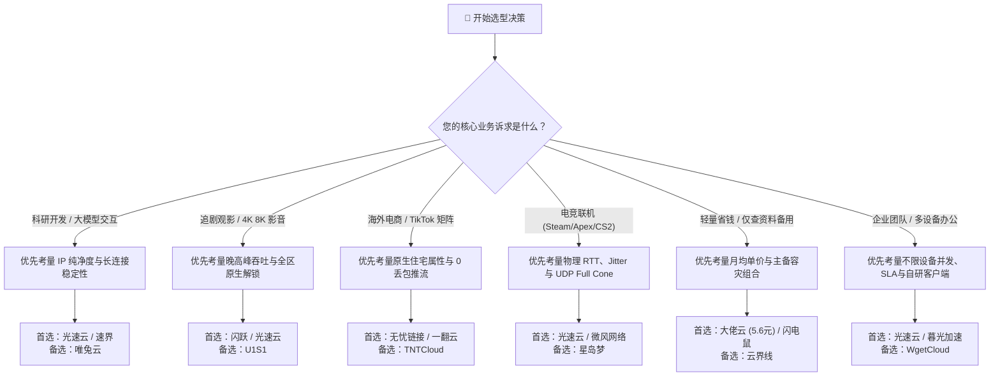

import AffiliateButton from '@site/src/components/AffiliateButton';
import ObservatoryCard from '@site/src/components/ObservatoryCard';
import UnlockMatrix from '@site/src/components/UnlockMatrix';

# 2026年机场场景选型决策指南与全景应用匹配矩阵

> **核心导言与决策方法论 (Executive Summary)**：  
> 在现代跨境网络工程学中，**不存在任何一个能够在「极限低价、全节点独享住宅 IP、晚高峰万兆带宽、企业级不限设备、全球全区流媒体解锁」所有维度同时达到顶峰的单一机场**。  
> 任何服务商的底层架构都受到**物理光缆成本、BGP 入口带宽单价、机房住宅 IP 采购配额与运维负载均衡**的硬性经济学约束。  
> **真正科学的选型策略，是摒弃盲目跟风，以业务的核心应用场景为唯一锚点**进行精准技术匹配。本专题矩阵由「网络可观测实验室」根据 42 家品牌的实测遥测数据构建，覆盖六大高频场景，帮助用户用最小的经济成本获取最高的跨境网络收益。

---

## 一、六大核心应用场景与首选品牌全景速查矩阵

下表总结了 2026 年主流业务场景的核心技术痛点、关键评估指标、实验室第一首选与容灾备选方案：

| 业务场景 | 核心技术痛点 | 关键考量指标 | 综合首选品牌 | 容灾备选品牌 | 深度专题指南 |
| :--- | :--- | :--- | :--- | :--- | :--- |
| **🤖 AI 大模型生产力** | 频繁遭遇 403 阻断、长推理断流、IP 欺诈分过高 | 原生住宅/机房 IP、TLS 握手伪装、纯净度 | **[光速云](/docs/brands/guangsu)** | **[速界](/docs/brands/sujie)** / [唯兔云](/docs/brands/weitu) | [AI 专用选型深度指南](/docs/scenarios/ai-accelerate) |
| **🎬 4K/8K 流媒体影音** | 晚高峰拖动转圈、非自制剧版权锁死、地区版权漂移 | 晚高峰 80,000+ Kbps 吞吐、全区原生解锁 | **[闪跃](/docs/brands/shanyue)** | **[光速云](/docs/brands/guangsu)** / [U1S1](/docs/brands/u1s1) | [流媒体专线选型指南](/docs/scenarios/streaming-unlock) |
| **📦 跨境电商与社媒投放** | 账号关联封店、TikTok 0 播放、直播推流丢帧 | 原生广播 IP 属性、0 物理丢包、防风控策略 | **[无忧链接](/docs/brands/wuyou)** | **[一翻云](/docs/brands/yifan)** / [TNTCloud](/docs/brands/tntcloud) | [电商与社媒选型指南](/docs/scenarios/cross-border-ecommerce) |
| **🎮 电竞跨区与低延迟** | 晚高峰人物瞬移、开枪无判定、UDP 报文被阻断 | 物理 RTT 下限、抖动 (Jitter) < 3ms、Full Cone | **[光速云](/docs/brands/guangsu)** | **[微风网络](/docs/brands/weifeng)** / [星岛梦](/docs/brands/xingdaomeng) | [电竞低延迟选型指南](/docs/scenarios/low-latency-gaming) |
| **💰 极低预算与轻量备用** | 经常断网跑路、月费虚高浪费、查资料刚需 | 5~8 元平价档、长期不限时流量包、主备容灾 | **[大佬云](/docs/brands/dalaoyun)** | **[闪电鼠](/docs/brands/shandianshu)** / [云界线](/docs/brands/yunjiexian) | [平价档横评与防跑路](/docs/scenarios/budget-friendly) |
| **🏢 团队办公与高并发** | 限制设备并发导致断流、频繁验证码、SaaS 假死 | 不限设备并发、多平台官方客户端、企业级 SLA | **[光速云](/docs/brands/guangsu)** | **[暮光加速](/docs/brands/muguang)** / [WgetCloud](/docs/brands/wgetcloud) | [企业与团队协同方案](/docs/scenarios/enterprise-dedicated) |

---

## 二、六大场景深度技术拆解与入口指引

### 1. 🤖 AI 大模型生产力场景（ChatGPT / Claude / Gemini / Midjourney）

随着 OpenAI、Anthropic 和 Google 部署了全球最严格的反作弊和反爬虫风控网关（Cloudflare Turnstile、Arkose Labs、TLS 指纹探测），普通的机房公网代理几乎 100% 触发 `403 Forbidden` 或 `Access Denied`。

```
AI 大模型风控对抗模型：
用户发起请求 ──> TLS 握手 (uTLS 模拟浏览器指纹)
                    │
                    ▼
           IP 风险库检测 (IP2Location / MaxMind / Scamalytics)
           ├── 机房 Hosting IP / 欺诈分 > 30% ──> [403 阻断 / 封号]
           └── 原生/低风险住宅 IP (Residential) ──> [秒速通过 / 允许长推理]
```

- **选型首推**：**[光速云](/docs/brands/guangsu)** —— 采用高纯净度美区/亚太节点，结合最新协议伪装，从容应对数十万 Token 的复杂深度长推理（o1/o3/Claude 3.5 Sonnet）。
- **专题深度研报**：👉 [《2026 ChatGPT、Claude 与 Gemini 专属加速机场深度选型指南》](/docs/scenarios/ai-accelerate)

---

### 2. 🎬 4K/8K 超高清流媒体场景（Netflix / Disney+ / YouTube / Max / Prime Video）

很多用户误以为「能够打开 Netflix」就是「流媒体解锁」。实际上流媒体平台有着严格的版权分级：
1. **仅自制剧解锁**：只能看《怪奇物语》等 Netflix 全球自制剧，看不到当季热门版权电影。
2. **全区原生版权解锁**：能够完整观看日本独播动漫、欧美独家院线大片，支持多国字幕与音轨。
3. **80,000+ Kbps 晚高峰吞吐**：在晚间 20:00~23:00 黄金时段，拖动 4K/8K HDR 杜比视界进度条瞬间起播，杜绝画质降级与缓冲圈。

- **选型首推**：**[闪跃](/docs/brands/shanyue)**、**[光速云](/docs/brands/guangsu)** —— 标配港、日、美、新全区原生解锁，大带宽专线保障极速起播。
- **专题深度研报**：👉 [《2026 年 Netflix、Disney+ 与 YouTube 4K/8K 流媒体全区解锁机场指南》](/docs/scenarios/streaming-unlock)

---

### 3. 📦 跨境电商、外贸出海与 TikTok 矩阵运营

跨境电商是一项强资产业务，账号的安全等同于企业的生命线。
- **亚马逊 / eBay 防关联**：严禁在多个店铺间使用变动无常的公共节点。
- **TikTok 运营与短视频推流**：TikTok 依赖 SIM 卡运营商识别码、系统语言、DNS 一致性以及 IP 本地属性。一旦检测到机房广播 IP，极易判定为自动化营销号，导致「0 播放封控」或直播推流严重卡顿断线。

- **选型首推**：**[无忧链接](/docs/brands/wuyou)**、**[一翻云](/docs/brands/yifan)** —— 专为外贸与海外社媒优化，具备高纯净度本土化广播节点与 0 丢包保障。
- **专题深度研报**：👉 [《跨境电商、TikTok 直播推流与海外社媒多账号运营专用专线》](/docs/scenarios/cross-border-ecommerce)

---

### 4. 🎮 跨区电竞联机与极限低 RTT（Steam / Valorant / CS2 / Apex）

游戏联机与看视频的物理机制截然相反：
- 视频可以通过提前下载 30 秒的缓冲数据掩盖网络波动；
- **电竞游戏是毫秒级双向实时互动**：每秒必须收发数十个微型 UDP 报文包。普通公网节点的抖动（Jitter）与偶发性丢包会直接造成人物瞬移、子弹穿身无判定；甚至由于服务商未开启 Full Cone NAT 导致游戏搜不到战局。

- **选型首推**：**[光速云](/docs/brands/guangsu)**（香港专线 RTT 22ms、日本 38ms、0 物理丢包）、**[微风网络](/docs/brands/weifeng)**。
- **专题深度研报**：👉 [《跨区电竞联机加速：晚高峰 0 丢包与超低 RTT 网络方案》](/docs/scenarios/low-latency-gaming)

---

### 5. 💰 极致高性价比与平价备用梯队（月均 5~8 元档）

对于预算有限的在校学生、仅偶尔查阅学术资料/GitHub 提交代码的轻度开发者，每月花费 30~50 元购买高端专线并不划算。而在市场上，确实存在经过工业集约化运营的真 5.6 元优质专线。

- **防跑路工业模型**：建立「主力专线 + 平价备用」双活容灾体系。
- **选型首推**：**[大佬云](/docs/brands/dalaoyun)**（5.6元档明星老牌）、**[闪电鼠](/docs/brands/shandianshu)**、**[云界线](/docs/brands/yunjiexian)**。
- **专题深度研报**：👉 [《2026 极致高性价比与平价备用机场横向盘点 (5-8元档)》](/docs/scenarios/budget-friendly)

---

### 6. 🏢 企业跨境协同、团队多设备并发与大流量办公

企业级应用必须彻底解决「设备数超限被封禁」、「员工配置门槛高」以及「缺少紧急技术支持」三大难题。通过在企业网关路由器部署透明代理，或者选型自研一键多端客户端，能大幅降低团队的 IT 维护成本。

- **选型首推**：**[光速云](/docs/brands/guangsu)**（大流量专线与网关级部署）、**[暮光加速](/docs/brands/muguang)**（多设备并发支持、7×24 小时真人客服）。
- **专题深度研报**：👉 [《企业跨境办公、不限设备并发与团队协同机场解决方案》](/docs/scenarios/enterprise-dedicated)

---

## 三、2026 全场景科学决策流程树 (Decision Tree)

在实际采购与订阅决策中，请参考以下逻辑判定流程：



---

## 四、场景选型落地配置与客户端生态推荐

选定合适的机场品牌后，必须搭配适配的操作系统客户端与分流规则，才能发挥专线的最佳效能：
- **Windows 用户**：推荐使用 [Clash Verge Rev (Windows 教程)](/docs/clients/windows)，开启 TUN 模式获得全局系统级加速；
- **macOS 用户**：推荐使用 [Clash Verge Rev Mac / Surge (macOS 教程)](/docs/clients/macos)，原生支持 Apple Silicon M 架构；
- **iOS 移动端**：首推 [Shadowrocket 小火箭 (iOS 教程)](/docs/clients/ios) 进行规则分流；
- **Android 设备**：推荐使用 [v2rayNG / FlClash (Android 教程)](/docs/clients/android) 保障后台稳定保活；
- **企业与全屋路由器**：推荐在软路由中部署 [OpenClash (软路由教程)](/docs/clients/router)，实现全办公室设备无感加速。

同时欢迎前往 **[机场可观测性实验室](/docs/observatory/)**，查看我们基于全球测速节点的实时 MTR 路由追踪、晚高峰极限压测与流媒体解锁遥测数据库。
